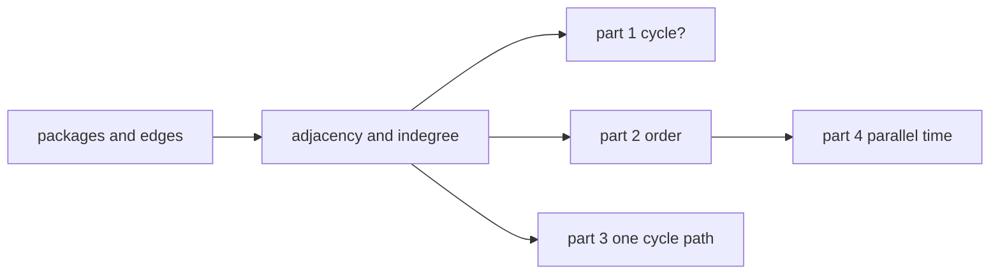

---
failureModes:
- Treating a short topological order as success when the graph had a cycle, so you install
  forever.
- Running DFS and reporting nodes in the order you first saw them, which is not an install
  order.
- Using the same visited set for "in the stack" and "already finished," so you miss a cycle
  or you report one that is not there.
- For the parallel-time part, taking the longest path with plain Dijkstra. Dijkstra wants a
  shortest path and non-negative edges. This graph wants a longest path, which is well defined
  only because it is a DAG.
sayThis:
- This is a directed graph of "must install first." I will build the adjacency list, then
  topo-sort. If the order is shorter than the node count, there is a cycle and I will name
  one.
- Part by part. A correct cycle check before I write the scheduler.
- Time is O(V + E). Space is O(V + E) for the lists, plus O(V) for the indegree array.
gaps:
- The Mercor coding block is described as graphs and original thinking, not as a published
  prompt. This is a four-part drill in that shape, written to practice here. It is not their
  question.
- Course-schedule write-ups usually stop at "return true if no cycle." The follow-ups that
  matter are the cycle path, and the longest path for parallel install time.
- A class hierarchy is the trap. Three hash maps and a queue are the whole program.
references:
- title: Mercor company track
  url: /helpmeprep/companies/mercor
- title: These notes, queues
  url: /helpmeprep/system-design/queues
quiz:
- kind: mc
  question: Kahn's algorithm reports a cycle when?
  choices:
  - The queue is empty before every node has been emitted.
  - The adjacency list contains a self-loop only. Other cycles are invisible.
  - A node's indegree is zero.
  - The graph has more edges than nodes.
  answer: 0
  explain: Every node in a DAG is emitted exactly once. Stopping early means something still
    has a remaining indegree, which is a cycle.
- kind: mc
  question: Why is the longest path in this install graph computable in linear time?
  choices:
  - Longest path is always linear.
  - The graph is a DAG, so a topo order lets you relax each edge once.
  - Dijkstra with negative weights computes it.
  - Because every package has one dependency.
  answer: 1
  explain: Longest path in a general graph is hard. On a DAG, one pass in topo order is enough.
    Do not reach for Dijkstra.
- kind: short
  question: What do you return for an empty package list?
  reveal: An empty install order, no cycle, and a parallel time of 0. Do not special-case it
    into an error. A single package with no edges installs in its own duration.
title: Dependency resolver
description: A four-part graph drill for a 60-minute coding block. Cycle, install order,
  the cycle path, then parallel install time.
track: dsa
section: Worked problems
order: 20
---

## What you are practicing

A multi-part problem you can time at 60 minutes. You are given packages and dependency pairs `before -> after` meaning `before` must be installed first. Each package has a positive duration. There is no framework. `std::unordered_map`, `std::vector`, and `std::queue` are enough.

Read all four parts before writing part 1, so the graph you build can serve the later parts. Say the structure in the first two minutes: "directed graph, topological order, a short order means a cycle."



## Part 1. Can we install?

Return whether every package can be installed, which means the graph is a DAG.

Build `graph[u]` as the list of packages that must wait for `u`, and `indegree[v]` as how many packages must precede `v`. Push every indegree-zero package into a queue. Pop, decrement neighbors, push a neighbor when its indegree hits zero. Count how many you pop.

If the count equals the number of packages, yes. Otherwise there is a cycle. A self-loop (`a` depends on `a`) shows up as an indegree that never hits zero. Disconnected packages with no edges are fine: they start in the queue.


Time O(V + E). Space O(V + E). Say both before they ask.

## Part 2. Install order

Same loop, but append each popped package to `order`. If `order.size()` is short of the package count, return `std::nullopt`. Do not return the partial order as if it were a plan. A partial order still has a cycle in the remainder, and installing it will deadlock.

Any topo order is correct when several packages are ready. Do not sort the ready set unless they ask for a deterministic order. If they do, use a heap instead of a queue and say the cost becomes O((V + E) log V).

## Part 3. Name one cycle

Kahn tells you a cycle exists and not which nodes. For the path, DFS with three colors: white (unseen), gray (on the current stack), black (finished). A gray neighbor is a back edge. Record the stack from that neighbor back to itself.


The returned list starts and ends with the same node so it is obviously a cycle. Do not keep searching for the shortest cycle unless they ask. One cycle is the answer.

## Part 4. Parallel install time

Packages with no pending dependencies run at the same time. The makespan is the longest path of durations through the DAG, where a node's duration is added when you enter it.

If part 2 said there is a cycle, refuse. Otherwise walk the topo order:


`start[v]` is the earliest v can begin, which is the max finish time of its predecessors. The answer is the max finish time. A package with no dependencies contributes only its own duration. Two independent packages of length 5 and 7 take 7, not 12.

This is not Dijkstra. Dijkstra extracts a minimum and does not re-handle a node. Longest path on a DAG is one linear pass. If you mention Dijkstra, say why you are not using it.

## Program

One translation unit. `topo_order` is parts 1 and 2. `find_cycle` is part 3. `parallel_time` is part 4. `main` is the test list below, already executable.

```cpp
#include <algorithm>
#include <cassert>
#include <iostream>
#include <optional>
#include <queue>
#include <string>
#include <unordered_map>
#include <utility>
#include <vector>

using Graph = std::unordered_map<std::string, std::vector<std::string>>;
using Edges = std::vector<std::pair<std::string, std::string>>;

Graph build_graph(const std::vector<std::string>& packages, const Edges& edges) {
  Graph graph;
  for (const auto& package : packages) graph[package];
  for (const auto& [before, after] : edges) graph[before].push_back(after);
  return graph;
}

std::optional<std::vector<std::string>> topo_order(const std::vector<std::string>& packages,
                                                   const Edges& edges) {
  Graph graph = build_graph(packages, edges);
  std::unordered_map<std::string, int> indegree;
  for (const auto& package : packages) indegree[package] = 0;
  for (const auto& [before, after] : edges) {
    (void)before;
    indegree[after] += 1;
  }

  std::queue<std::string> ready;
  for (const auto& package : packages) {
    if (indegree[package] == 0) ready.push(package);
  }

  std::vector<std::string> order;
  while (!ready.empty()) {
    std::string current = ready.front();
    ready.pop();
    order.push_back(current);
    for (const auto& next : graph[current]) {
      if (--indegree[next] == 0) ready.push(next);
    }
  }
  if (order.size() != packages.size()) return std::nullopt;
  return order;
}

bool can_install(const std::vector<std::string>& packages, const Edges& edges) {
  return topo_order(packages, edges).has_value();
}

std::optional<std::vector<std::string>> find_cycle(const std::vector<std::string>& packages,
                                                   const Edges& edges) {
  Graph graph = build_graph(packages, edges);
  std::unordered_map<std::string, int> color;
  for (const auto& package : packages) color[package] = 0;

  std::vector<std::string> stack;
  std::optional<std::vector<std::string>> found;

  auto dfs = [&](auto&& self, const std::string& node) -> void {
    if (found) return;
    color[node] = 1;
    stack.push_back(node);
    for (const auto& next : graph[node]) {
      if (color[next] == 1) {
        auto start = std::find(stack.begin(), stack.end(), next);
        found = std::vector<std::string>(start, stack.end());
        found->push_back(next);
        return;
      }
      if (color[next] == 0) self(self, next);
      if (found) return;
    }
    stack.pop_back();
    color[node] = 2;
  };

  for (const auto& package : packages) {
    if (color[package] == 0) dfs(dfs, package);
    if (found) break;
  }
  return found;
}

std::optional<long long> parallel_time(const std::vector<std::string>& packages, const Edges& edges,
                                       const std::unordered_map<std::string, long long>& duration) {
  auto order = topo_order(packages, edges);
  if (!order) return std::nullopt;
  if (packages.empty()) return 0;

  Graph graph = build_graph(packages, edges);
  std::unordered_map<std::string, long long> start;
  for (const auto& package : packages) start[package] = 0;
  for (const auto& current : *order) {
    long long finish = start[current] + duration.at(current);
    for (const auto& next : graph[current]) {
      start[next] = std::max(start[next], finish);
    }
  }
  long long makespan = 0;
  for (const auto& package : packages) {
    makespan = std::max(makespan, start[package] + duration.at(package));
  }
  return makespan;
}

int main() {
  using namespace std::string_literals;
  Edges none;
  assert(can_install({}, none));
  assert(parallel_time({}, none, {}) == 0);

  assert(can_install({"a"}, none));
  assert(parallel_time({"a"}, none, {{"a", 4}}) == 4);

  Edges chain{{"a", "b"}, {"b", "c"}};
  auto order = topo_order({"a", "b", "c"}, chain);
  assert(order && order->size() == 3 && order->front() == "a" && order->back() == "c");
  assert(parallel_time({"a", "b", "c"}, chain, {{"a", 1}, {"b", 2}, {"c", 3}}) == 6);

  Edges diamond{{"a", "b"}, {"a", "c"}, {"b", "d"}, {"c", "d"}};
  assert(parallel_time({"a", "b", "c", "d"}, diamond, {{"a", 1}, {"b", 5}, {"c", 7}, {"d", 1}}) == 9);

  assert(parallel_time({"a", "b"}, none, {{"a", 5}, {"b", 7}}) == 7);

  Edges cycle{{"a", "b"}, {"b", "a"}};
  assert(!can_install({"a", "b"}, cycle));
  assert(!topo_order({"a", "b"}, cycle));
  auto path = find_cycle({"a", "b"}, cycle);
  assert(path && path->front() == path->back());
  assert(!parallel_time({"a", "b"}, cycle, {{"a", 1}, {"b", 1}}));

  Edges loop{{"a", "a"}};
  assert(!can_install({"a"}, loop));
  auto self = find_cycle({"a"}, loop);
  assert(self && self->size() == 2 && self->front() == "a" && self->back() == "a");

  Edges mixed{{"b", "c"}, {"c", "b"}};
  assert(!can_install({"a", "b", "c"}, mixed));
  auto mixed_cycle = find_cycle({"a", "b", "c"}, mixed);
  assert(mixed_cycle && mixed_cycle->front() != "a");

  std::cout << "dependency resolver ok\n";
  return 0;
}
```

## Tests to write before you get clever

- No packages: order empty, time 0.
- One package, no edges: order is that package, time is its duration.
- A chain a→b→c: order respects the chain, time is the sum.
- A diamond (a before b and c, both before d): b and c overlap, time is not the sum of all four.
- A cycle a→b→a: part 1 false, part 2 refuses, part 3 returns a path that includes both, part 4 refuses.
- A self-loop.
- A node that is in the package list and has no edges, plus a separate cycle. You must still report the cycle. Forgetting the isolated node in the indegree map is the usual bug.

## How to spend the hour

About ten minutes to read and build the graph once. Part 1 and 2 are the same loop. Get them correct and run the tests. Part 3 is the DFS. Part 4 is the pass over the order you already have. If time is gone after part 2, say what part 4 is (longest path on the DAG) and the complexity. A correct partial beats a half-written optimal on every part.

State complexity at the end of each part, out loud, in one sentence.
