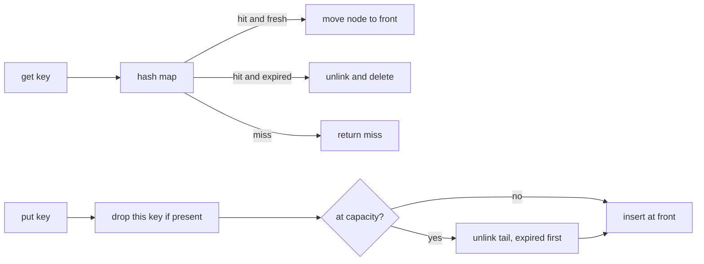

---
failureModes:
- Evicting by insertion order and calling it LRU, so a hot key that is read constantly still
  gets dropped.
- Checking expiry only on get, so a full cache of dead entries refuses new puts.
- Caching a failed lookup (a 404 or an exception) with the same TTL as a real value.
- Two threads updating the map and the order structure separately, so a key exists in one
  and not the other.
sayThis:
- Get, put, and delete are O(1) expected. The map finds the node. The doubly linked list is
  the recency order. A hash map alone cannot do LRU.
- Expiry is lazy on read, and put also drops expired nodes before it admits a new one. A
  background sweeper is optional and must not be the only way a slot frees up.
- I will not cache a failure unless the caller asks, and that negative entry gets a much
  shorter TTL.
gaps:
- Paid LLD courses walk a parking lot or a book-my-show class diagram. This page is the cache
  the DoorDash interactive round actually follows up with, including the failure you must not
  cache.
- Most write-ups stop at a single-threaded LRU. The interview follow-up is the lock, and whether
  the map update and the list move are one critical section.
- TTL plus capacity together is the version that has a real bug. Either feature alone is a
  textbook problem.
references:
- title: DoorDash company track
  url: /helpmeprep/companies/doordash
- title: These notes, caching
  url: /helpmeprep/system-design/caching
quiz:
- kind: mc
  question: A cache is at capacity. The least-recently-used entry is also expired. What do you
    drop?
  choices:
  - The newest entry, because the expired one might still be wanted.
  - The expired entry. It is not a useful resident, and it frees a slot without discarding a
    live key.
  - Nothing. Return an error on put.
  - A random key.
  answer: 1
  explain: Expired entries are garbage. Prefer them over a live LRU victim. If none are expired,
    then evict the true LRU.
- kind: mc
  question: Which pair of structures gives expected O(1) get and put for LRU?
  choices:
  - An array you scan, plus a timestamp column.
  - A hash map from key to linked-list node, plus a doubly linked list ordered by recency.
  - A binary heap of timestamps only.
  - A queue of keys, with no map.
  answer: 1
  explain: The map finds the node. The list moves it to the front or unlinks it. A heap is
    O(log n) and does not know where a key sits.
- kind: short
  question: What has to happen inside one lock?
  reveal: Look up the node, decide expiry, move or unlink it, and update the map. If those
    steps interleave with another thread, you can evict a key that was just refreshed, or
    leave a list node whose map entry is gone.
title: TTL cache with LRU
description: An in-memory cache with a capacity, a per-entry deadline, and O(1) get and put.
  The DoorDash-style follow-up, including what you must not cache.
track: lld
section: Worked problems
order: 20
---

## What you are designing

A library, not a service. Callers do `get`, `put`, and `delete` in one process. Each entry has a value and a deadline. The cache holds at most `capacity` live entries. When it is full, the entry that was used least recently leaves. Time is injected so tests do not sleep.

Out of scope: replication, persistence, and a network API. If they ask, say those are a different design (see the caching notes) and keep the class honest.

## Requirements

- `get(key)` returns the value or misses. A miss includes "never stored" and "stored but past its deadline."
- `put(key, value, ttl)` inserts or replaces. A replace refreshes recency and the deadline.
- `delete(key)` removes the key if it is present.
- At most `capacity` entries that are still live. Expired entries do not count toward the cap once you have noticed them.
- `get` and `put` are O(1) expected.
- Do not store a caller-supplied failure (an empty optional, an error code) unless they pass an explicit negative TTL that is shorter than the success TTL. Default is not to cache it. Say that out loud. The DoorDash follow-up is specifically "your cache hid a 500."

## Types

```text
Cache
  capacity: int
  map: unordered_map<key, Node>
  head, tail: Node          # sentinels; head is most recent
  clock: function<time_point()>
  lock: mutex

Node
  key, value, expires_at
  prev, next
```

The sentinels mean you never null-check the ends of the list. The map's value is the node, not the user's value, because you have to unlink in O(1).



## The operations

**Get.** Lock. If the key is absent, miss. If `expires_at <= now`, unlink, delete from the map, miss. Otherwise move the node to the front and return the value. Moving on read is what makes it LRU rather than a FIFO. Forget the move and you have built the wrong cache.

**Put.** Lock. If the key exists, unlink it first (this is a replace, and it must not count twice). While the live size is at capacity, evict. Prefer a tail node that is already expired. If the tail is live, it is the true LRU victim. Then insert the new node at the front with `expires_at = now + ttl`. Reject a non-positive TTL and a non-positive capacity in the constructor. Those are programming errors, not cache misses.

**Delete.** Lock. Unlink and drop the map entry. Missing key is a no-op.

**Size.** Count only unexpired entries if you expose it, or document that `size` can include garbage until the next put. Pick one. I would not scan the list on every size call. Document that size may include not-yet-noticed expirations, and that put reclaims them.

## Concurrency

One mutex around the map and the list is the design you should finish in the interview. The critical section is short: a handful of pointer writes. Do not lock, call the user, and then unlock. If the value is a heavy object, copy the reference out and use it after the lock.

Striped locks are a follow-up, not the first answer. They are painful because the LRU order is global. Striping the map without a global order gives you "approximate LRU," and you should call it that. A per-key lock does not protect the list.

A background sweeper can unlink expired nodes so a quiet cache does not pin memory. It takes the same lock, walks from the tail, and stops after a budget so it cannot stall gets. It is not required for correctness if put and get already drop expired nodes.

## What not to cache

Add the policy as a parameter on put, default off:

The program below is that rule, plus the map, the list, the lock, and the tests.

```cpp
#include <cassert>
#include <chrono>
#include <functional>
#include <iostream>
#include <list>
#include <mutex>
#include <optional>
#include <stdexcept>
#include <unordered_map>
#include <utility>

// O(1) expected get/put. std::list order: front is most recently used.
// An expired resident is evicted before a live least-recently-used key.
template <class K, class V>
class TtlLruCache {
 public:
  using Clock = std::function<std::chrono::steady_clock::time_point()>;
  using Time = std::chrono::steady_clock::time_point;
  using Duration = std::chrono::milliseconds;

  TtlLruCache(std::size_t capacity, Clock clock) : capacity_(capacity), clock_(std::move(clock)) {
    if (capacity_ == 0) throw std::invalid_argument("capacity must be positive");
  }

  std::optional<V> get(const K& key) {
    std::lock_guard lock(mu_);
    auto it = map_.find(key);
    if (it == map_.end()) return std::nullopt;
    if (it->second.expires_at <= clock_()) {
      erase_unlocked(it);
      return std::nullopt;
    }
    if (it->second.failure) return std::nullopt;
    touch_unlocked(it);
    return it->second.value;
  }

  // A disengaged value is a failure. By default it clears any previous success
  // and is not stored. cache_failure keeps a short negative entry.
  void put(const K& key, std::optional<V> value, Duration ttl, bool cache_failure = false) {
    std::lock_guard lock(mu_);
    if (!value.has_value() && !cache_failure) {
      auto it = map_.find(key);
      if (it != map_.end()) erase_unlocked(it);
      return;
    }
    if (ttl <= Duration::zero()) throw std::invalid_argument("ttl must be positive");

    auto existing = map_.find(key);
    if (existing != map_.end()) erase_unlocked(existing);

    Time now = clock_();
    while (map_.size() >= capacity_) evict_unlocked(now);

    order_.push_front(key);
    Entry entry;
    entry.failure = !value.has_value();
    if (value) entry.value = std::move(*value);
    entry.expires_at = now + ttl;
    entry.place = order_.begin();
    map_.emplace(key, std::move(entry));
  }

  void erase(const K& key) {
    std::lock_guard lock(mu_);
    auto it = map_.find(key);
    if (it != map_.end()) erase_unlocked(it);
  }

  std::size_t size() const {
    std::lock_guard lock(mu_);
    return map_.size();
  }

 private:
  struct Entry {
    V value{};
    bool failure = false;
    Time expires_at{};
    typename std::list<K>::iterator place;
  };

  void touch_unlocked(typename std::unordered_map<K, Entry>::iterator it) {
    order_.splice(order_.begin(), order_, it->second.place);
  }

  void erase_unlocked(typename std::unordered_map<K, Entry>::iterator it) {
    order_.erase(it->second.place);
    map_.erase(it);
  }

  void evict_unlocked(Time now) {
    std::optional<K> victim;
    for (auto it = order_.rbegin(); it != order_.rend(); ++it) {
      if (map_.find(*it)->second.expires_at <= now) {
        victim = *it;
        break;
      }
    }
    if (!victim) victim = order_.back();
    erase_unlocked(map_.find(*victim));
  }

  std::size_t capacity_;
  Clock clock_;
  mutable std::mutex mu_;
  std::list<K> order_;
  std::unordered_map<K, Entry> map_;
};

int main() {
  using namespace std::chrono_literals;
  auto now = std::chrono::steady_clock::time_point{};
  auto clock = [&] { return now; };

  TtlLruCache<std::string, int> cache(2, clock);
  assert(!cache.get("missing"));
  cache.put("a", 1, 10s);
  assert(cache.get("a") == 1);

  cache.put("b", 2, 10s);
  assert(cache.get("a") == 1);  // a is now most recent
  cache.put("c", 3, 10s);       // b is the live LRU
  assert(!cache.get("b"));
  assert(cache.get("a") == 1);
  assert(cache.get("c") == 3);

  TtlLruCache<std::string, int> expiry(1, clock);
  expiry.put("x", 7, 10s);
  now += 11s;
  assert(!expiry.get("x"));
  expiry.put("y", 8, 10s);
  assert(expiry.get("y") == 8);

  now = {};
  TtlLruCache<std::string, int> prefer(2, clock);
  prefer.put("old", 1, 5s);
  prefer.put("fresh", 2, 100s);
  now += 6s;
  prefer.put("new", 3, 100s);  // expired "old" leaves, "fresh" stays
  assert(!prefer.get("old"));
  assert(prefer.get("fresh") == 2);
  assert(prefer.get("new") == 3);

  prefer.put("fresh", std::nullopt, 100s);
  assert(!prefer.get("fresh"));

  now = {};
  TtlLruCache<std::string, int> replace(1, clock);
  replace.put("k", 1, 10s);
  replace.put("k", 2, 10s);
  assert(replace.size() == 1);
  assert(replace.get("k") == 2);

  std::cout << "ttl lru cache ok\n";
  return 0;
}
```


A success followed by a failure must not keep serving the success, and a failure must not occupy a slot for the success TTL. If they insist on negative caching, the TTL is seconds, not the hour you use for a homepage.

## Tests you should name

- Get of an unknown key misses.
- Put then get returns the value and makes that key most recent.
- Capacity 2: putting a third key drops the one that was not touched. Touching the older key before the third put saves it.
- A key put with a 10-second TTL misses when the clock jumps 11 seconds, and the slot can be reused.
- At capacity, an expired tail is dropped before a live LRU entry.
- Replace refreshes TTL and recency and does not grow the size.
- Two threads putting distinct keys do not lose an entry or leave a node off the list. A single lock makes this true. Mention it even if you do not write the thread test in time.

## Levels

- **Mid-level.** Map plus doubly linked list, get moves to front, put evicts the tail, tests for capacity.
- **Senior.** TTL and capacity interact, expired entries are preferred victims, failures are not cached, clock is injectable.
- **Staff.** States the lock scope, refuses to call user code under the lock, and can say what approximate LRU would mean if they striped it.
