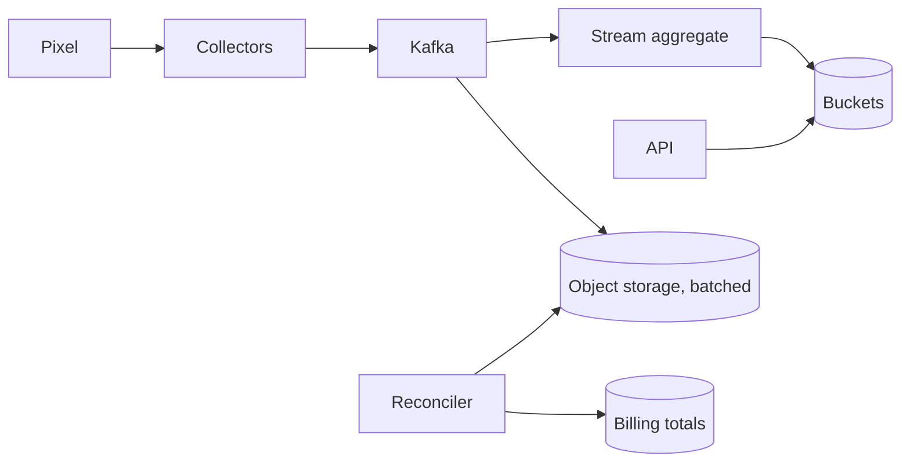

---
failureModes:
- Incrementing a counter in place from a consumer that retries, so a restart doubles revenue.
- A dashboard query that scans raw events for a year.
- No late-event policy, so clicks that arrive an hour late vanish or land in the wrong hour.
- One hot advertiser's key pinning a single partition.
sayThis:
- Events append to a log, keyed so retries dedupe. A stream job rolls them into time buckets
  that the API reads.
- I query aggregates, not raw clicks, for the dashboard. Raw stays for a bounded retention
  so I can rebuild.
- Late events either update the bucket or fall into an 'unknown hour' correction. I will say
  which.
gaps:
- Public click-aggregator breakdowns cover the log and rollups. Idempotent aggregation across
  restarts and late data are the Flink-shaped holes, and the free path rarely has a stream-processing
  page to point at.
- Fraud and double-click from one user are product filters on the pipeline, not a footnote
  after you have already counted.
- This note separates billing-grade counts (slower, reconciled) from the dashboard (fast,
  approximate) so you do not pretend one number serves both.
references:
- title: Hello Interview, public ad click aggregator
  url: https://www.hellointerview.com/learn/system-design/problem-breakdowns/ad-click-aggregator
- title: These notes, stream processing
  url: /helpmeprep/system-design/flink
quiz:
- kind: mc
  question: 'The dashboard should read from:'
  choices:
  - A scan of every raw click in object storage, on each page load.
  - Pre-aggregated buckets (ad, time window) written by a stream job.
  - The browser's memory.
  - A single Redis INCR with no log.
  answer: 1
  explain: Raw events are the source. Aggregates are the query model. You keep raw long enough
    to recompute.
- kind: mc
  question: 'A consumer crashes after counting and before committing its offset. On restart
    it will:'
  choices:
  - Lose the batch forever if the log retained it.
  - Redeliver the batch. The count must be an upsert of a deterministic aggregate or include
    event ids, not a blind increment.
  - Skip to the end automatically.
  - Lock the advertiser out.
  answer: 1
  explain: At-least-once delivery double-counts blind increments. Write bucket totals in a
    way that replay repairs.
- kind: short
  question: How do you key the log?
  reveal: By ad id or advertiser id if you need order per ad, knowing a huge advertiser becomes
    a hot partition. If you only need throughput, key randomly and aggregate in the job. Dedup
    keys are the event id, stored for the retry window, not the partition key.
title: Ad click aggregator
description: Ingest a firehose of click and impression events and answer 'how did this ad
  do in this window?' without losing the plot on retries.
track: system-design
section: Worked problems
order: 600
---

## What you are designing

Browsers and apps emit impression and click events. Advertisers look at counts and spend over the last hour, day, and month. Finance may bill from the same facts and cannot be doubled by a retry. Assume hundreds of thousands of events per second at peak, bursty during a campaign, and queries that are aggregates, not "show me one user's click."

## Requirements

- Ingest events with at-least-once delivery from clients and from your own collectors.
- Dedup exact retries.
- Serve dashboard aggregates in well under a second.
- Support a slower, reconciled number for billing.

Losing a single click is acceptable for the dashboard if you say so. Losing or double-counting a day's billing is not.

## Entities and API

`Event(id, ad_id, type, ts, user_key)`, `Bucket(ad_id, window_start, clicks, impressions)`.

```text
POST /v1/events            { id, ad_id, type, ts }   -- collector
GET  /v1/ads/{id}/stats?from&to
```

The public pixel should be tiny and asynchronous. The user click should not wait on your aggregate.

## High-level design



Collectors validate, drop obvious garbage, and append. Kafka retains days. A stream job windows by event time into minute buckets and upserts them. A batch job rebuilds daily billing totals from raw files so a bug in the stream job is recoverable.

## Data model

```sql
CREATE TABLE ad_buckets (
  ad_id         BIGINT NOT NULL,
  window_start  TIMESTAMPTZ NOT NULL,
  clicks        BIGINT NOT NULL,
  impressions   BIGINT NOT NULL,
  PRIMARY KEY (ad_id, window_start)
);
```

The stream job writes a bucket as a set, not an increment, if the window result is deterministic from the events it assigned. If that is hard, include event ids in a short-lived dedup store and increment only on first sight. Billing reads a separate table produced by the batch reconciler.

## Deep dives

**Late events.** Watermarks close a minute a few minutes after the fact (see the stream-processing page). Events later than that go to a correction topic that adjusts the hour, or they are ignored for the dashboard and still counted in the nightly reconcile. Say the bound. "Realtime" that is five minutes late is a fine product if you name it.

**Hot ads.** Partition the stream by `ad_id` for per-ad order, and split a known-hot ad across sub-keys that the job sums. A single Super Bowl ad should not be one partition's problem alone.

**Fraud.** Dedup exact event ids. Also collapse obvious repeats (same user, same ad, many clicks in a second) before the billing number. The dashboard can show filtered and raw. Do not pretend a filter is perfect.

**Query.** `GET stats` sums buckets in the range. Cache the hot advertiser's last 24 hours. Month-long queries read daily rollups, not minutes. Raw storage is columnar files, not the serving database.

## Levels

- **Mid-level.** A log, a consumer that aggregates, a table the API reads, a reason not to scan raw events.
- **Senior.** Idempotent buckets, event time and lateness, hot key split, raw retained for rebuild.
- **Staff.** Dashboard versus billing, fraud filters, and the cost of being wrong in each direction.
