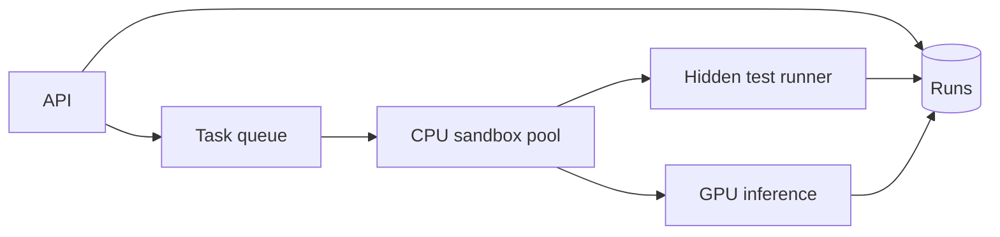

---
failureModes:
- The agent can read hidden tests or the network, so the score measures cheating, not skill.
- A flaky test that fails the gold patch, so you punish a correct agent.
- An image tag that moves, so last week's run is not reproducible.
- A sandbox left on a fast disk that gets wiped, taking the environment and the artifact with
  it.
sayThis:
- I split GPU inference from CPU sandboxes. The scheduler places a task in a pinned image,
  the agent acts inside that sandbox, and the harness runs tests the agent cannot see.
- Every run records image digest, model version, and a trajectory id. I can replay or at least
  explain the score.
- I baseline the gold patch on the same image. If gold fails, I do not trust agent failures
  on that task.
gaps:
- Agent eval harnesses are not in the classic public problem list. A ChatGPT-shaped chapter
  does not cover sandbox isolation, hidden tests, or reproducible images.
- Flake measurement and reward hacking are the failure modes that dominate real benchmarks
  (SWE-Bench style) and are easy to omit if you only draw 'a queue of jobs.'
- 'This note is written so you can use a real split you have operated: training or inference
  on one cluster, task execution in a different environment with pinned images.'
references:
- title: SWE-bench
  url: https://www.swebench.com/
- title: These notes, long-running tasks
  url: /helpmeprep/system-design/long-running
- title: These notes, LLM inference
  url: /helpmeprep/system-design/llm-inference
quiz:
- kind: mc
  question: Why pin container images by digest rather than tag?
  choices:
  - Digests are shorter.
  - A tag can move, so two runs with the same name are not the same environment. A digest
    is the bytes.
  - Kubernetes requires colors.
  - It disables the network.
  answer: 1
  explain: Reproducibility is the product. Tags are mutable names.
- kind: mc
  question: 'The gold patch fails tests on a task. You should:'
  choices:
  - Count every agent failure on that task as a real fail.
  - Quarantine the task. The harness is broken or flaky, and agent scores on it are noise.
  - Raise the temperature.
  - Delete the agent.
  answer: 1
  explain: The gold patch is the control. If the control fails, you are not measuring the
    agent.
- kind: short
  question: What must the sandbox not allow?
  reveal: Reading hidden tests, opening arbitrary egress, or talking to the grader except
    through the harness. Otherwise the optimal policy is to cheat. Enforce with network policy,
    a non-root user, cgroup limits, and tests mounted only into the grader's step.
title: Agent evaluation pipeline
description: Run coding agents against real repo tasks in isolated sandboxes and produce a
  score you can compare across versions.
track: system-design
section: Worked problems
order: 670
---

## What you are designing

A lab wants a number: how often does this coding agent solve tasks like SWE-Bench, on a fixed set, in an environment that matches the repo. You will run thousands of attempts. Each attempt is a model loop plus a sandbox plus a test command. Assume sandboxes are the throughput bottleneck (image pull and setup), GPUs are a separate scarce pool, and a score that cannot be reproduced is not a score.

## Requirements

- Schedule a run for (agent version, task set, config).
- Execute tasks in isolation with a pinned environment.
- Store the trajectory and the test result.
- Compare two agent versions on the same tasks.
- Detect tasks where the harness itself is flaky.

A single task can cost on the order of a dollar of model time plus sandbox time. Say the budget. Latency per task is minutes, so this is a batch system, not an interactive API.

## Entities and API

`Task(repo, commit, image_digest, test_cmd, hidden_tests_ref)`, `Run(id, agent_version, task_id, status)`, `Step(run_id, n, action, obs_ref)`, `Result(run_id, passed, tests_passed, cost)`.

```text
POST /v1/runs            { agent_version, task_set, samples }
GET  /v1/runs/{id}
GET  /v1/leaderboard?task_set=
```

## High-level design



The scheduler leases a sandbox from a warm pool, checks out the repo at a pinned commit, and starts the agent loop. The model tier is called over the network with a timeout per step. When the agent stops or the step budget ends, a separate test process runs the hidden tests. Results and a pointer to the trajectory land in the database. The sandbox is destroyed.

## Data model

```sql
CREATE TABLE tasks (
  id            BIGSERIAL PRIMARY KEY,
  repo          TEXT NOT NULL,
  commit_sha    TEXT NOT NULL,
  image_digest  TEXT NOT NULL,
  test_cmd      TEXT NOT NULL,
  hidden_ref    TEXT NOT NULL
);
CREATE TABLE runs (
  id             BIGSERIAL PRIMARY KEY,
  agent_version  TEXT NOT NULL,
  task_id        BIGINT NOT NULL,
  status         TEXT NOT NULL,
  sandbox_id     TEXT,
  cost_cents     INT,
  UNIQUE (agent_version, task_id, sample_idx)
);
```

`sample_idx` lets you run a task more than once when the agent is stochastic, and the unique key keeps a retry from creating a second sample by accident.

## Deep dives

**Isolation.** No egress by default. Dependencies are in the image, not fetched during the run. Hidden tests are not in the workspace the agent can list. CPU, memory, disk, and wall clock are capped. A sandbox escape is a security incident; assume hostile model output. This is also why the GPU tier is not inside the sandbox: the model sees tool results the harness chooses to return, not a raw internal network.

**Reproducibility.** Image digest, commit, agent version, prompt version, and sampling seed are columns on the run. If you cannot fill them, do not publish the number. Ephemeral local disk is a trap: anything you need after the run (logs, the patch) is copied to object storage before the sandbox dies.

**Flakes and cheating.** On a cadence, run the gold patch. Tasks that fail gold are removed from the headline score. Agent patches that pass by editing tests or reading a leaked file are failed by a policy check before you celebrate. Compare agents on the same task ids (paired), not on two random subsets.

**Throughput.** Cold start dominates. Keep a warm pool of the common images, bounded so idle sandboxes do not bankrupt you. Queue age is the SLO. The model tier has its own admission control from the inference page; the eval system is just another tenant with a batch priority.

## Levels

- **Mid-level.** A queue, a sandbox, a model call, stored pass/fail, a pinned task definition.
- **Senior.** Hidden tests, digest pinning, leases, gold-patch baseline, cost per run.
- **Staff.** Warm pools, paired comparison, cheat detection, and the split between the GPU cluster and the execution environment when they cannot be the same place.
