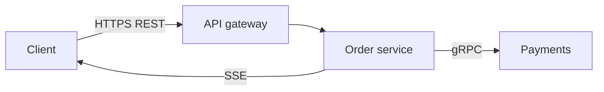

---
failureModes:
- Taking the user id from the request body and authorizing that, so any caller can act as
  anyone.
- 'Offset pagination on a large, changing table: slow, and rows move between pages.'
- Returning 200 with a partial body and no signal that a dependency failed.
- A breaking response change with no version, so old mobile clients crash on Monday.
sayThis:
- Public API is REST. Identity comes from the token. Writes carry an idempotency key.
- Between my services I would use gRPC with deadlines. I would not make the mobile client
  speak protobuf on day one.
- If Payment fails and Address succeeds, I return 200 with an explicit degraded list, not
  a 500 that throws away the data I have. Consumer failing is a 500, because the page cannot
  render without it.
gaps:
- Public API pages cover REST, GraphQL, RPC, pagination, idempotency keys, errors, versioning,
  and auth. WebSockets and SSE are filed under networking, so candidates forget to design
  the push contract next to the request contract.
- Partial failure is usually missing. Aggregator endpoints need a stated rule for which dependency
  is hard and which is soft, and a field the client can branch on.
- Cursor pagination is named. The index that makes the cursor cheap, a stable (sort_key, id)
  pair, is often left implied. This page writes the predicate.
references:
- title: Hello Interview, public API design
  url: https://www.hellointerview.com/learn/system-design/core-concepts/api-design
- title: MDN, HTTP response status codes
  url: https://developer.mozilla.org/en-US/docs/Web/HTTP/Status
- title: Stripe API idempotent requests
  url: https://docs.stripe.com/api/idempotent_requests
quiz:
- kind: mc
  question: Which pagination stays fast on page 10,000?
  choices:
  - OFFSET 100000 LIMIT 20 on an unindexed column.
  - A keyset predicate on an index of (created_at, id).
  - Fetching all rows and slicing in the client.
  - A random offset so the database can cache.
  answer: 1
  explain: Keyset pagination seeks into an index. OFFSET walks and discards rows, and it skips
    or repeats rows when the table changes.
- kind: mc
  question: A client retries a timed-out POST. What must be true?
  choices:
  - The server generates a fresh idempotency key.
  - The client reuses the same key, and the server stores the first response.
  - Retries are always wrong.
  - The load balancer dedupes by source IP.
  answer: 1
  explain: The key is chosen by the client and replayed. The server records the outcome and
    returns it again.
- kind: short
  question: When would you choose SSE over WebSockets?
  reveal: 'When the server pushes and the client rarely sends: live scores, job progress,
    a feed tail. SSE is plain HTTP, works with existing auth and proxies, and reconnects with
    Last-Event-ID. Use WebSockets when both sides send frequently.'
title: APIs
description: 'REST, gRPC, GraphQL, WebSockets, and SSE: which contract to draw, and the patterns
  that keep it evolvable.'
track: system-design
section: Core concepts
order: 40
---

The API is the contract you design the boxes to satisfy. If you cannot name the request, you are not ready to draw Kafka.

## Pick a style on purpose

**REST** is the default for a public product API. Resources are nouns, verbs are HTTP methods, and status codes mean something. `POST /v1/orders` creates. `GET /v1/orders/{id}` reads. `PATCH` updates a subset. A client that only has the URL and the docs can guess the shape.

**gRPC** fits internal service-to-service calls: a schema in the repo, small payloads, deadlines, and streaming when a response is a sequence. The cost is browsers, debuggability, and operational sharp edges (stream limits, load shedding). Put an HTTP edge in front of mobile and web clients.

**GraphQL** fits when one screen on iOS and a different screen on the web want different slices of the same graph, and you are willing to own query cost. The interview trap is N+1: a resolver that issues a query per list item. Say you would batch with a dataloader, cap query depth, and persist the queries you allow if this is public.

**WebSockets** are a long-lived bidirectional pipe. **SSE** is a one-way stream of events over HTTP. Design the resource API first. Then add `GET /v1/orders/{id}/events` as SSE, or a socket that subscribes to order ids. Reconnects need a cursor (`Last-Event-ID` or a sequence number) so the client does not miss or double-apply events.

## Shapes that keep you out of trouble

Identity comes from the credential. Never trust `user_id` in a body to decide whose data this is.

Lists take a cursor, not a page number:

```sql
SELECT id, created_at FROM orders
WHERE user_id = :u
  AND (created_at, id) < (:cursor_time, :cursor_id)
ORDER BY created_at DESC, id DESC
LIMIT 20;
```

That predicate matches an index on `(user_id, created_at, id)`. The next cursor is the last row you returned.

Writes that clients retry send `Idempotency-Key`. You store the key and the response. A replay returns the stored response and does not run the side effect twice.

Errors are a small JSON object with a stable code. Use 400 for a bad payload, 401/403 for auth, 404 when the resource is absent, 409 for a version or uniqueness conflict, 422 when the syntax is fine but the rule fails, 429 with `Retry-After` when they are over limit, 202 when you accepted work you have not finished. 5xx means the client may retry if the operation is idempotent.

When one request fans out to several upstreams, decide which failures are fatal. A bootstrap call that cannot load the account should fail. A missing recommendation rail should come back as `degraded: ["recs"]` on a 200. Silent nulls make the client guess.

Version the contract when you break it (`/v2`, or a new field that old clients ignore). Additive fields are not a break. Removing or retyping a field is.


