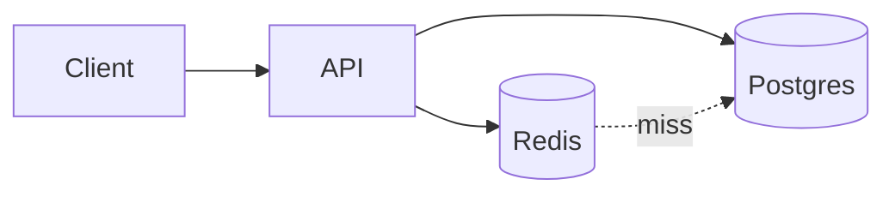

---
failureModes:
- 'A cache stampede: a hot key expires and a thousand requests all miss and all hit the database.'
- Caching an error or an empty upstream response, so a blip becomes a long outage.
- Two writers, a cache, and no invalidation story. Users see the old price after checkout.
- A single hot key that does not shard, so one Redis node melts while the cluster looks idle.
sayThis:
- Cache-aside for the read path. The database is the source of truth. I set a TTL and I coalesce
  refreshes so a miss does not become a stampede.
- I do not cache failures. A 500 from the menu service should not sit in Redis for five minutes.
- If I need the write to be visible immediately, I delete the key in the same flow as the
  commit, and I can tolerate a race with a short TTL as backup.
gaps:
- Public caching pages cover placement (CDN, client, process, external), cache-aside, write-through,
  write-back, eviction, stampede, and hot keys. They are lighter on negative caching, single-flight,
  and stale-while-revalidate, which are the tools you actually use once stampede is named.
- Invalidation is often 'set a TTL.' That is a strategy only if you also say how wrong a stale
  read is allowed to be.
- 'The interaction with an outbox is missing: a cache is another derived view. Delete or update
  it from the same change stream that updates search, or accept a race and bound it.'
references:
- title: Hello Interview, public caching
  url: https://www.hellointerview.com/learn/system-design/core-concepts/caching
- title: Redis, eviction policies
  url: https://redis.io/docs/latest/develop/reference/eviction/
quiz:
- kind: mc
  question: A celebrity profile key expires and the database CPU pegs. What is this called,
    and what helps?
  choices:
  - A hot partition of writes. Shard the key.
  - A cache stampede. Single-flight the reload and serve stale while one request refreshes.
  - Replication lag. Add a replica.
  - An LSM compaction storm. Lower the TTL.
  answer: 1
  explain: Many readers miss at once. Coalesce them. Serving a slightly stale value during
    refresh removes the cliff.
- kind: mc
  question: Which policy can lose writes if the cache process dies?
  choices:
  - Cache-aside, because the database was written first.
  - Write-through, because the cache and database update together.
  - Write-behind, because the database is updated later from the cache.
  - A CDN, because it only stores images.
  answer: 2
  explain: Write-behind acknowledges before the durable store has the data. A crash loses
    the buffer. Do not use it for anything you cannot recreate.
- kind: short
  question: What is negative caching, and when is it dangerous?
  reveal: Storing 'this key does not exist' so you do not hammer the database for missing
    ids. It is dangerous when the row is created a moment later and the negative entry hides
    it, and when you cache a transient 500 as if it were a real empty result. Use a short
    TTL and never store transport failures.
title: Caching
description: Where to cache, the four write policies, and the failures that show up the day
  a hot key expires.
track: system-design
section: Core concepts
order: 80
---

A cache stores a derived copy closer to the reader. It is not a database. The moment you forget that, you start debugging "the user updated their name and half the fleet still shows the old one."

## Where

- **Client and CDN.** Great for bytes and for responses that are the same for many users. Useless for a personalized feed unless the cache key includes the user, at which point the hit rate collapses.
- **In-process.** Nanoseconds, and invisible to the other servers. Use it for tiny, rarely changing config. Remember that every process has its own copy.
- **External (Redis, Memcached).** The shared cache you draw on a whiteboard. Network hop measured in fractions of a millisecond inside a region.

## Policies

**Cache-aside:** the app reads the cache, and on a miss reads the database and fills the cache. The database remains the source of truth. This is the default you should propose.

**Read-through:** the cache itself loads on a miss. Same idea, different owner.

**Write-through:** writes go to the cache and the database before you ack. Reads are warm. Writes are slower, and you still need a plan for cache failure.

**Write-behind:** you ack when the cache has it, and flush to the database later. Fast, and you can lose data. Say that out loud if you propose it. It is acceptable for view counts, not for payments.

## Eviction

LRU is the usual policy. LFU is better when a large scan would otherwise flush the hot set. TTL is how you bound staleness even if invalidation fails. Size the cache from the working set, not from the whole dataset. A cache of everything is just a second database with fewer features.

## The problems worth saying first

**Stampede.** A hot key expires. Every request misses. Fix: a lock or single-flight so one request rebuilds, and serve the previous value while that happens (stale-while-revalidate). Jitter TTLs so a million keys do not expire on the same second.

**Invalidation.** After a successful commit, delete the key. A racing read may refill the old value; a short TTL limits the damage. Do not try to update the cached object field-by-field unless the object is simple and the update is the only writer.

**Hot keys.** Replication of the key (read replicas) helps reads. It does not help if the key is also written constantly. Then you shard the logical key (key#0 … key#N) and merge on read, or you stop caching something that changes every request.

**Poison.** Do not store a 500. Do store a short-lived "absent" for ids that 404, if absent ids are common and creation is rare.

