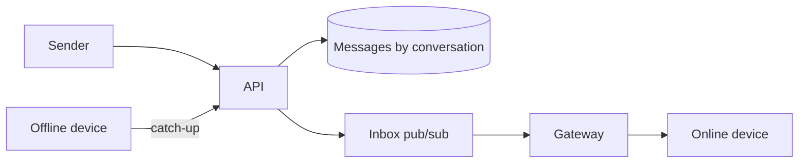

---
failureModes:
- Keeping every socket's mailbox only in the memory of one process, so a deploy deletes undelivered
  messages.
- A group of ten thousand people implemented as a fan-out that runs inside the send request.
- No per-conversation sequence, so retries duplicate bubbles or reorder them.
- Read receipts that take a global lock on the conversation row.
sayThis:
- The message is durable in a store keyed by conversation before I ack the sender. Delivery
  to online devices is a push. Offline devices catch up from a cursor.
- Order is a sequence number inside the conversation, not a global clock.
- 'Large groups are a different path: I store the message once and fan out notifications,
  or I refuse groups past a size and say so.'
gaps:
- Public chat breakdowns cover sockets and a message table. They are thinner on multi-device
  cursors, media uploads, and the group-size cliff.
- End-to-end encryption is often 'we will use HTTPS.' If you claim E2E, you do not get to
  read the body on the server, which changes search and abuse review. Say that constraint
  or do not claim it.
- This note treats receipts as separate small events so they do not rewrite the message row
  on every reader.
references:
- title: Hello Interview, public WhatsApp breakdown
  url: https://www.hellointerview.com/learn/system-design/problem-breakdowns/whatsapp
- title: These notes, real-time updates
  url: /helpmeprep/system-design/realtime
quiz:
- kind: mc
  question: When do you ack the sender?
  choices:
  - When the TCP send buffer accepts the bytes.
  - After the message row is durable.
  - After every recipient has read it.
  - After the push notification vendor responds.
  answer: 1
  explain: The durable write is the commitment. Push is best-effort and the cursor heals the
    rest.
- kind: mc
  question: 'A user has two phones. Cursors should be:'
  choices:
  - One per user, so the second phone steals the first phone's place.
  - One per device, with the server storing messages until each device advances or a retention
    bound.
  - Unnecessary if you use WebSockets.
  - Stored only on the client.
  answer: 1
  explain: Each device has its own delivered position. The message log is shared.
- kind: short
  question: How do you handle a retry of the same send?
  reveal: The client sends a client-generated id. The server unique-keys (conversation_id,
    sender, client_id) and returns the original sequence if the insert conflicts. The UI then
    has one bubble.
title: WhatsApp-style chat
description: Deliver messages between people and small groups, with order, receipts, and a
  phone that was offline all afternoon.
track: system-design
section: Worked problems
order: 560
---

## What you are designing

Two people, or a small group, exchange messages. Recipients who are online see them immediately. Recipients who are not see them when they open the app. Order inside a conversation is stable. Assume a billion users, messages that are small, groups that you cap (for example a few hundred) unless you explicitly design channels, and that media is an attachment pointer.

## Requirements

- Send a message and know the server has it.
- Deliver to all members, online via socket, offline via catch-up.
- Show sent and delivered, and optionally read.
- Do not drop or duplicate a message the client retried.

A one-second delay is fine. A lost message is not. Search across all history is out of scope unless you have time; say you would index asynchronously.

## Entities and API

`Conversation`, `Member`, `Message(conversation_id, seq, sender, body, client_id)`, `DeviceCursor`.

```text
POST /v1/conversations/{id}/messages    { client_id, body }
GET  /v1/conversations/{id}/messages?after_seq=
WS   subscribe conversation or user inbox
```

Send returns 200 with the assigned `seq` only after the row is durable. The same `client_id` returns the original message, not a second row, which is how a flaky mobile radio stays safe. `after_seq` is how a reconnect catches up. An unknown conversation is 404. A conversation the caller is not in is 403. The socket is an optimization. A client that only polls the GET still receives every message, late.

## High-level design



Send inserts the next sequence and returns it. A pub/sub wakes gateways that hold sockets for the members. Each gateway writes the thin event to its local sockets. Devices that miss it pull `after_seq` on reconnect. See the real-time page for the gateway split.

## Data model

```sql
CREATE TABLE messages (
  conversation_id BIGINT NOT NULL,
  seq             BIGINT NOT NULL,
  sender_id       BIGINT NOT NULL,
  client_id       TEXT NOT NULL,
  body            TEXT NOT NULL,
  created_at      TIMESTAMPTZ NOT NULL DEFAULT now(),
  PRIMARY KEY (conversation_id, seq),
  UNIQUE (conversation_id, sender_id, client_id)
);
CREATE TABLE device_cursors (
  device_id       BIGINT NOT NULL,
  conversation_id BIGINT NOT NULL,
  delivered_seq   BIGINT NOT NULL,
  PRIMARY KEY (device_id, conversation_id)
);
```

At scale this table is partitioned by `conversation_id`. A sequence allocator per conversation (a row you increment, or a monotonic id from a single writer for that conversation) gives you order without a global lock.

## Deep dives

**Offline and multi-device.** Messages stay until every member device has passed them or until a retention window you state (a phone that is gone for a year may need a full refetch of recent history, not an infinite queue). The inbox for "which conversations changed?" is a per-user list of `(conversation_id, latest_seq)` so the app does not poll every thread.

**Groups.** Small groups copy the message once and notify N members. That N is the fan-out. Past a threshold, either store once and have clients pull (a channel) or fan out asynchronously with isolation so one giant group cannot block direct messages. Say the cap in the requirements.

**Receipts.** Delivered and read are events `(conversation, member, seq)`, compacted to "this member has read up to seq." They are not updates to the message body. They can be lossy and delayed. Do not put them on the send path.

**Media and abuse.** Attachments use the blob upload pattern. The message stores the object id. Block lists are checked at send and at fan-out. If you promise end-to-end encryption, the server stores ciphertext and you cannot do server-side search or content moderation without a separate client-side design. Do not claim E2E and then draw a server that ranks message text.

## Levels

- **Mid-level.** Durable message, sequence, online push, offline pull, client id dedup.
- **Senior.** Gateway separation, per-device cursors, group cap, receipts off the hot path.
- **Staff.** Partitioning, hot conversations, encryption boundary, and what you do when the push vendor is down (the cursor still works).
