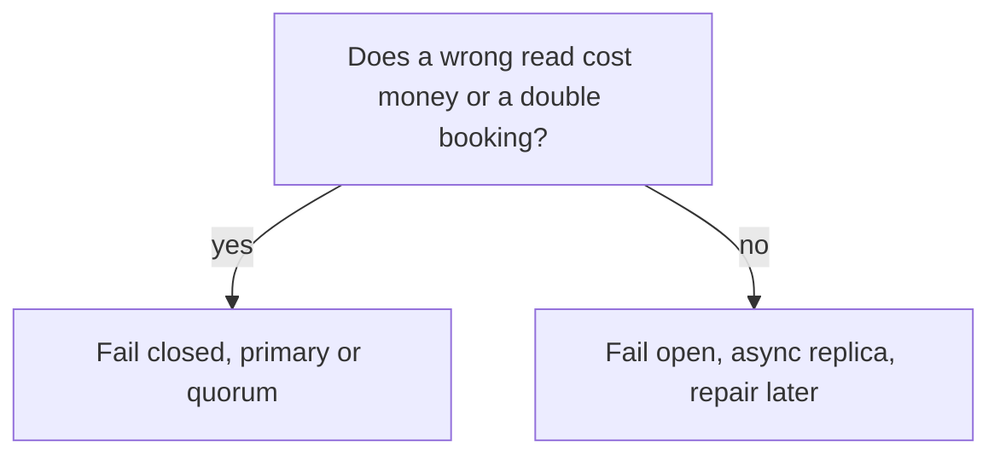

---
failureModes:
- Saying 'CP' or 'AP' as if it were a personality and not a behavior during a partition.
- Promising linearizability from an async replica.
- Using last-write-wins on data that is not a single register, and dropping one of two concurrent
  edits.
- Ignoring the latency side of PACELC and putting a synchronous cross-region quorum on a user
  click.
sayThis:
- During a partition I will serve reads and accept that a replica may be stale. I will not
  accept that for a seat map. Seats fail closed.
- I need read-your-writes for the person who just edited. Everyone else can be a second behind.
- 'PACELC is the everyday version: even with no partition, I am choosing latency or consistency.
  Async replicas choose latency.'
gaps:
- The public CAP page explains the theorem, walks an example, and has an 'advanced' section
  on levels of consistency. PACELC, quorum arithmetic, and session guarantees are easy to
  leave unnamed, so candidates cannot say which level a feature needs.
- Isolation levels (read committed, repeatable read, serializable) are a different axis from
  distributed consistency and are almost absent from the free path. A design that takes inventory
  needs one sentence on isolation.
- 'This page ties the vocabulary to a decision: what does this product do while a replica
  or a region is unreachable?'
references:
- title: Hello Interview, public CAP theorem
  url: https://www.hellointerview.com/learn/system-design/core-concepts/cap-theorem
- title: Postgres, transaction isolation
  url: https://www.postgresql.org/docs/current/transaction-iso.html
quiz:
- kind: mc
  question: CAP forces a choice in which situation?
  choices:
  - On every request, all the time.
  - When a partition stops some nodes from talking, and you must choose whether to answer
    or to wait.
  - Only when you use NoSQL.
  - Only at write throughput above 10k QPS.
  answer: 1
  explain: The theorem is about a partition. The rest of the time you still have a latency-versus-consistency
    choice, which is the PACELC point.
- kind: mc
  question: Read-your-writes means what?
  choices:
  - Every client on earth sees a write immediately.
  - The client that performed the write sees it in their later reads.
  - The database is serializable.
  - Caches are disabled.
  answer: 1
  explain: It is a session guarantee, not global linearizability. Pin that session to the
    primary or pass a token.
- kind: short
  question: What does R + W > N buy you?
  reveal: A read quorum overlaps a write quorum, so the read sees the latest successful write
    if the only failure is nodes you did not contact. It does not remove the need to resolve
    two concurrent writes that both thought they won, and it costs latency equal to the slowest
    replica you waited for.
title: Consistency, CAP, and PACELC
description: A usable map of consistency models, what CAP actually constrains, and why latency
  shows up even when the network is fine.
track: system-design
section: Core concepts
order: 110
---

Consistency is a promise about what a read is allowed to return. Stronger promises cost latency and availability. Name the promise a feature needs. Do not name a theorem and stop.

## Models you can actually use

From strongest to weakest, the ones worth saying:

- **Linearizability.** Once a write completes, every later read sees it. The system behaves like one copy. This is what people want for a lock, a seat, or a balance, and it is what you give up first when you replicate asynchronously.
- **Sequential and causal.** Everyone sees the same order, or at least an order that respects "this read followed that write." Useful, and hard to explain quickly. Mention them if you need them, then move on.
- **Read-your-writes and monotonic reads.** Session guarantees. The user who just paid sees the payment. Their feed does not jump backwards. Cheap, and enough for a lot of product work.
- **Eventual.** If writes stop, copies converge. They have not stopped, so say how you reconcile (last writer wins, a merge function, or a human).

## CAP, briefly and correctly

A partition means some nodes cannot talk. You either refuse requests that need the missing nodes (favor consistency) or you answer with what you have (favor availability). You do not "choose partition tolerance." On a real network you have it whether you like it or not.

Seat inventory fails closed: better to show "unavailable" than to sell one seat twice. A social feed fails open: better to show a slightly old timeline than an error page. That is the whole CAP answer for most interviews.

## PACELC

CAP is silent when the network is fine. PACELC adds: else, you choose latency or consistency. Waiting for a remote replica on every write is the consistency choice. Acknowledging on the local primary is the latency choice. Async replication is that choice, made in advance.

## Isolation is the single-node cousin

Inside one database, **read committed** (Postgres's default) means you do not see uncommitted rows, and you can still see anomalies a serializable schedule would forbid. **Serializable** or an explicit `SELECT … FOR UPDATE` is what you want when two transactions might take the last item. Say which one. "The database is ACID" is not a concurrency-control story.

