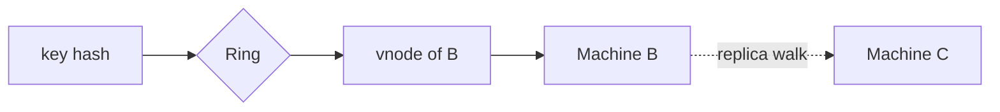

---
failureModes:
- 'Naive modulo hashing: adding one node remaps almost every key and thunders on the database.'
- Too few virtual nodes, so some physical nodes own twice the ring by bad luck.
- A hot key. Consistent hashing balances keys, not QPS. One celebrity still pins one node.
- Forgetting that replication factor means the next N distinct physical nodes, not the next
  N virtual nodes on the same box.
sayThis:
- Modulo is fine when the node count never changes. The moment I autoscale the cache, I want
  consistent hashing so only about 1/N of the keys move.
- I will use virtual nodes so ownership is even, and I will replicate to the next distinct
  machines clockwise.
- If one key is hot, hashing will not save me. I have to split that key or cache it differently.
gaps:
- The public consistent-hashing page covers modulo, the ring, hot spots, and real systems.
  Bounded-load hashing and rendezvous hashing are the usual omissions, and they matter when
  you cannot tolerate the unluckiest node owning twice the traffic.
- The replication-on-the-ring detail (skip virtual nodes that map to a machine you already
  chose) is how people accidentally store all three replicas on one host.
- Membership changes are described as 'data moves.' The in-flight request story (who serves
  a key while it is moving) is the part operators actually page on.
references:
- title: Hello Interview, public consistent hashing
  url: https://www.hellointerview.com/learn/system-design/core-concepts/consistent-hashing
- title: Dynamo paper, Amazon
  url: https://www.allthingsdistributed.com/files/amazon-dynamo-sosp2007.pdf
quiz:
- kind: mc
  question: You have 10 cache nodes and add an 11th, using consistent hashing. About how many
    keys move?
  choices:
  - About 100%, as with modulo.
  - About 1/11 of the keys.
  - None. Hashing is stable.
  - Half, always.
  answer: 1
  explain: Only the keys that fall in the arc the new node took over should move. Modulo reshuffles
    nearly everything.
- kind: mc
  question: Virtual nodes exist to fix what?
  choices:
  - Hot keys.
  - Uneven ownership when each machine is a single point on the ring.
  - The need for replication.
  - TLS.
  answer: 1
  explain: Many points per machine make the owned arcs average out. They do nothing for one
    key that is requested a million times.
- kind: short
  question: What is rendezvous hashing in one sentence?
  reveal: For each key, score every node with a hash of (key, node) and pick the highest score.
    Adding a node only steals the keys for which the new node wins. It avoids a ring and virtual
    nodes, at the cost of touching the node list per lookup, which is fine when the list is
    small.
title: Consistent hashing
description: How to spread keys across a changing set of nodes without moving all the data
  every time you add one.
track: system-design
section: Core concepts
order: 120
---

Caches and storage clusters change size. A hash of `key % N` is simple and brutal: change N, and almost every key maps somewhere else. The cluster then refetches the world from the database. Consistent hashing exists so a membership change moves about one node's share of the keys.

## The ring

Imagine a circle of hash values. Each node is placed at one or more points by hashing its id. A key is hashed onto the circle and walks clockwise to the first node. When a node joins, it takes the arc between itself and its predecessor. When it leaves, the next node inherits that arc. Everyone else stays put.

With one point per node, the arcs vary a lot. **Virtual nodes** place each machine at many points (a hundred or more). Ownership averages out. The lookup is "hash the key, find the next point," which a balanced tree or a sorted ring handles in log time.

`std::map` is the ring. `lower_bound` is the clockwise step. Replica copies skip virtual nodes of a machine you already picked.

```cpp
#include <cassert>
#include <cstdint>
#include <iostream>
#include <map>
#include <string>
#include <unordered_set>
#include <vector>

// Sorted ring of virtual nodes. Lookup is the first point clockwise of the key.
// Replicas walk until they have `n` distinct physical machines.
class ConsistentHash {
 public:
  void add_node(const std::string& node, int virtual_nodes = 64) {
    for (int i = 0; i < virtual_nodes; ++i) {
      ring_[hash(node + "#" + std::to_string(i))] = node;
    }
  }

  std::string owner(const std::string& key) const {
    auto nodes = owners(key, 1);
    return nodes.empty() ? std::string{} : nodes.front();
  }

  std::vector<std::string> owners(const std::string& key, int copies) const {
    std::vector<std::string> picked;
    if (ring_.empty() || copies <= 0) return picked;
    auto it = ring_.lower_bound(hash(key));
    if (it == ring_.end()) it = ring_.begin();
    std::unordered_set<std::string> seen;
    for (std::size_t stepped = 0; stepped < ring_.size() && static_cast<int>(picked.size()) < copies;
         ++stepped) {
      if (seen.insert(it->second).second) picked.push_back(it->second);
      ++it;
      if (it == ring_.end()) it = ring_.begin();
    }
    return picked;
  }

 private:
  static std::uint64_t hash(const std::string& text) {
    return static_cast<std::uint64_t>(std::hash<std::string>{}(text));
  }

  std::map<std::uint64_t, std::string> ring_;
};

int main() {
  ConsistentHash ring;
  ring.add_node("a");
  ring.add_node("b");
  ring.add_node("c");
  std::string first = ring.owner("user-42");
  assert(!first.empty());
  auto copies = ring.owners("user-42", 3);
  assert(copies.size() == 3);
  assert(std::unordered_set<std::string>(copies.begin(), copies.end()).size() == 3);
  std::cout << "consistent hash ok\n";
  return 0;
}
```


## Replicas

If you want three copies, walk clockwise until you have three *different physical machines*. Skipping extra virtual nodes of a machine you already picked is the step everyone forgets, and it is how a rack failure deletes the key.

## What it does not balance

Request rate. A uniform key distribution with a power-law popularity still melts one node. Split the hot key, replicate that one value, or use bounded-load consistent hashing: a node that is too far above average load refuses the key and you try the next node. The refusal has to be visible to everyone, or clients disagree about who owns the key.

**Rendezvous (highest-random-weight) hashing** is the other classic: hash the pair (key, node) for each node and pick the max. No ring. Adding a node only moves keys that prefer it. It is a good thing to mention for a small, stable directory such as a set of cache hosts.

While a key is moving, two nodes may briefly believe they own it. For a cache, that is a miss storm you dampen. For storage, you forward writes to the new owner and finish the copy before you delete the old one.


