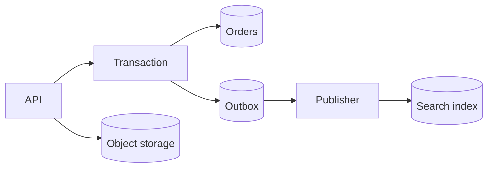

---
failureModes:
- Modeling the domain in the abstract and then discovering the hot query needs a join across
  shards.
- Storing a large blob in the row database and copying it on every replica.
- A mutable 'current state' with no history, so you cannot explain a grade, a payout, or a
  ban.
- Dual-writing the database and the search index from the request path, and living with silent
  drift.
sayThis:
- The access path picks the key. I am not picking a database and then hoping the query fits.
- The file bytes live in object storage. The row stores the key, the checksum, and who is
  allowed to read it.
- Search is a derived view. I will publish changes through an outbox, not with a second write
  I can forget.
gaps:
- Public data-modeling pages survey relational, document, key-value, wide-column, and graph
  models, plus normalization. They mention indexing and sharding as later concerns. The outbox,
  object-storage split, and versioned facts (rubric version, prompt version) are easy to skip
  and are where real designs rot.
- Multi-tenant keys are rarely practiced. If every query is 'for this lab' or 'for this restaurant,'
  that id belongs at the front of the primary key.
- Temporal data (what was true on Tuesday) is hand-waved. Grades, prices, and policies need
  an effective version, not an in-place overwrite.
references:
- title: Hello Interview, public data modeling
  url: https://www.hellointerview.com/learn/system-design/core-concepts/data-modeling
- title: Postgres, constraints
  url: https://www.postgresql.org/docs/current/ddl-constraints.html
quiz:
- kind: mc
  question: Where should a 20 MB resume PDF live?
  choices:
  - In a bytea column so joins stay easy.
  - In object storage, with the row holding the URI, checksum, and owner.
  - In Redis, next to the session.
  - Inline in the search document.
  answer: 1
  explain: The database stores metadata and authorization. The blob store stores bytes. You
    can replicate and back them up on different schedules.
- kind: mc
  question: Why prefer an outbox over writing to Postgres and Elasticsearch in one request?
  choices:
  - The outbox is faster on the happy path.
  - A crash between the two writes leaves them disagreed, and the outbox makes the second
    write recoverable.
  - Elasticsearch cannot index rows.
  - Outboxes avoid the need for a schema.
  answer: 1
  explain: Two writes are not atomic. The outbox is a row in the same transaction as the business
    write. A publisher relays it until the index acks.
- kind: short
  question: What columns do you refuse to design up front?
  reveal: 'The obvious ones the interviewer already assumes: name, email, a password hash.
    Spend the ink on the columns the design hinges on: status, lease expiry, version, idempotency
    key, shard key.'
title: Data modeling
description: How to choose entities, keys, and relationships so the queries you already named
  are cheap.
track: system-design
section: Core concepts
order: 50
---

A data model is a set of decisions about what is true, how you find it, and what you are willing to recompute. Start from the requirements you already wrote, not from a favorite database.

## Entities and keys

List the nouns. For each one, name the primary key and the two or three ways you will look it up. If you cannot name the lookup, you do not yet know the entity.

Prefer opaque ids (`uuid` or a snowflake) that you generate, so you are not stuck with a single-node sequence when you shard. Put the tenant id in the key when every query is scoped to a customer, a lab, or a restaurant. That keeps one tenant's rows together and makes a bad query obvious.

Relationships are foreign keys while you are in one database. They become ids plus a background check once you split services. Do not split services in the first drawing unless the boundary is the point of the problem.

## Normalize, then denormalize a specific read

Third normal form is the right default for data that changes: a user's country lives once. Denormalize when a read is hot and the join is the cost. A feed item can store the author's display name at fan-out time. Say what you do when the name changes: either you accept staleness for a while, or you have a repair job. "I'll just denormalize" without that sentence is incomplete.

## Facts you must be able to replay

Some rows are not "the current value." A grade depends on the rubric version, the model version, and the prompt version. A price depends on when it was quoted. Store those as columns, and unique-key the combination you must not double-insert. Overwriting a score in place destroys the audit.

Status columns want a constrained set (`open`, `claimed`, `submitted`, `canceled`) and a partial index on the state the workers poll. A lease column (`lease_until`) belongs on the row if a human or a worker can crash mid-task.

## What does not belong in the row store

Bytes, video, and large documents go to object storage. The row keeps the pointer, size, checksum, and ACL. Search documents, embeddings, and analytics rollups are derived. Write the source of truth once, in the same transaction as an outbox row, and let a consumer update the derived view. Dual writes from the application will drift the first time a process dies between them.

