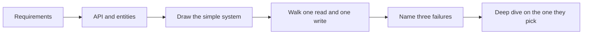

---
failureModes:
- Spending 20 minutes on requirements and never drawing a system.
- Doing arithmetic that does not change any box, then running out of time.
- Listing eight features and designing none of them completely.
- Waiting to be asked about failures, races, or a dependency being down.
sayThis:
- I'm at twelve minutes, so I'm leaving requirements and writing the API.
- I'll start with Postgres and a queue. Here is the query that stops fitting, and here is
  what I would split off.
- Three things break first. I'd like to go deep on this one. Is that the part you care about?
gaps:
- The public delivery write-up uses a pace aimed at a roomy interview (about five minutes
  of requirements, then entities, API, an optional data flow, 10–15 minutes of design, and
  about ten minutes of depth). A 45-minute Mercor-style loop dies on that pace. This page
  gives both clocks and tells you to be done with a working picture by minute 25.
- The public framework treats back-of-the-envelope math as usually skippable. That is fair
  for a social feed. It is wrong for cost-shaped problems (LLM calls, sandbox-seconds, payout
  correctness). Do the math when a number changes the design.
- 'Failure modes are a deep-dive topic in many guides. On this team they are part of the opening:
  name three before you are asked.'
references:
- title: Hello Interview, public delivery framework
  url: https://www.hellointerview.com/learn/system-design/in-a-hurry/delivery
- title: Hello Interview, public introduction (rubric themes)
  url: https://www.hellointerview.com/learn/system-design/in-a-hurry/introduction
quiz:
- kind: mc
  question: On a 45-minute loop, when should a complete high-level picture be on the board?
  choices:
  - By minute 45, as the closing summary.
  - By about minute 20–25, so the rest is depth.
  - Only if the interviewer asks you to draw.
  - After you have finished every deep dive.
  answer: 1
  explain: The second half is where senior signal lives. A design that arrives at minute 40
    cannot be probed.
- kind: mc
  question: When is capacity math worth doing up front?
  choices:
  - Always, for five minutes, even if it will not change a component.
  - Never. Interviewers dislike numbers.
  - When the result changes sharding, batching, or whether one machine is enough.
  - Only after the interviewer asks for a specific QPS.
  answer: 2
  explain: Math is a design tool. If the conclusion is 'it is a lot,' you spent time you needed
    for the drawing.
- kind: short
  question: Give the 45-minute clock in one breath.
  reveal: 0–4 requirements and two questions, then assumptions. 4–7 API. 7–11 tables and the
    two indexes that matter. 11–20 draw and walk one read and one write. 20–25 name three
    failure modes and offer a deep dive. 25–45 go deep, still drawing.
title: Delivery framework
description: 'A repeatable clock for a 45-minute or 60-minute system design interview: requirements,
  entities, API, data flow, high-level design, and deep dives.'
track: system-design
section: Start here
order: 20
---

Put a clock where you can see it. Say the time checks out loud. The point of a framework is not ceremony. It is a rail you can grab when you are nervous, so you still finish a working system.

## Two clocks

| Minutes | 45-minute loop | 60-minute loop |
|---|---|---|
| Opening | 0–4 requirements | 0–6 requirements |
| Contract | 4–7 API | 6–12 API |
| Data | 7–11 entities, keys, two indexes | 12–18 entities and the access path |
| Picture | 11–20 draw and walk a read and a write | 18–35 simple design that meets the API |
| Pivot | 20–25 three failure modes, offer a deep dive | 35–40 name the bottleneck |
| Depth | 25–45 one hard problem, still drawing | 40–60 two deep dives |

If you are slow, cut features, not the drawing. A narrow design you finished beats a wide design you narrated.

## Requirements

Functional requirements are "a user can…" sentences. Write three to five. Ask at most two questions, state assumptions, and move. A long list feels thorough and then traps you into designing the long list.

Non-functional requirements are quantified and local. "Low latency" is not a requirement. "Redirects return in under 50 ms at the edge" is. Pick the ones that will change the design:

- Consistency or availability when a partition or a dependency fails.
- Read-heavy or write-heavy, and whether traffic is bursty.
- The latency budget of the one request a human is waiting on.
- Durability. A lost tweet is rude. A lost payment is an incident.
- Cost, when the expensive step is a model call or a sandbox.
- Security and tenancy, when the data is resumes, recordings, or card data.

Do capacity math only when the number picks a component. "Can the hot set fit in Redis?" and "Is the token budget 25 hours or 25 days?" are useful. "So it is big" is not.

## Entities, then the API

Entities are the nouns you will store and return. A short list is a first draft: User, Tweet, Follow. You will add columns later, next to the database, when you know which request writes them. Good names matter. Interviewers notice when every table is `data`.

Default the external API to HTTP and resources that are plural nouns. Take the caller identity from the session, not from a user id in the body. Mark writes with an idempotency key. Say which calls are synchronous.

```text
POST /v1/tweets          { text }            -> 201 Tweet
GET  /v1/feed?cursor=    -> Tweet page
POST /v1/follows         { followee_id }     -> 204
```

Reach for gRPC between your own services when you own both sides and the payload is chatty. Reach for GraphQL only when you truly have many client shapes and you are willing to talk about the N+1 problem. For server push, design the request API first, then add SSE or WebSockets as a separate path.

## Data flow, when the system is a pipeline

Skip this for a CRUD product. Use it when the interesting part is a sequence: crawl, transcribe, grade, publish. Five or six steps, each with an input and a durable status, is enough. That list becomes the queue stages in the drawing.

## High-level design

Draw boxes a teammate could implement: client, gateway, service, database, cache, queue, worker, object store, model host. Walk one read and one write. When the walk touches storage, write the columns and the index that make that query fast. Note caches and queues with a verbal "I will come back to this" instead of designing them in the first pass.

A simple sentence keeps you honest: "If this dependency is down, the user sees ___."

## Deep dives

Lead with the non-functional requirement your simple design fails. For a feed, that is fan-out. For tickets, that is two buyers and one seat. For grading, that is a model that returns a score you cannot trace to a quote in the transcript.

Junior interviewers will point at the weak spot. Senior candidates should point at it first, then pause long enough for the interviewer to choose. Do not monologue over the person who has a rubric to fill.


