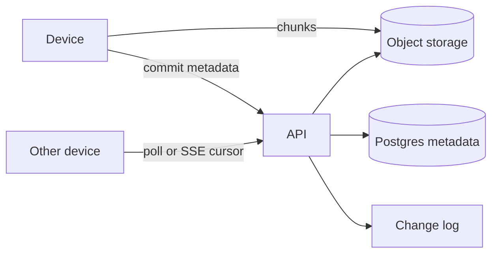

---
failureModes:
- Uploading the whole file on every save, so a one-byte edit costs a gigabyte.
- Two devices writing the same file with last-write-wins and no conflict copy.
- Listing files by scanning object storage instead of a metadata table.
- A sync cursor that is not per device, so a second laptop misses or replays the wrong edits.
sayThis:
- Files are split into chunks addressed by hash. The metadata database says which chunks make
  this version. Unchanged chunks are not uploaded.
- Each device pulls a change feed from a cursor. Uploads are presigned and direct to object
  storage.
- When two devices edit offline, I keep both versions and let the user resolve, rather than
  dropping one.
gaps:
- Public Dropbox breakdowns focus on upload and metadata. Chunk-level dedup across users,
  conflict copies, and the per-device cursor are thinner, and sharing permissions are often
  a hand wave.
- Desktop clients that are offline for a week are the real consistency problem. A design that
  assumes everyone is online is a chat app, not a sync app.
- This note treats sharing as an ACL on the metadata, not as a second storage system.
references:
- title: Hello Interview, public Dropbox breakdown
  url: https://www.hellointerview.com/learn/system-design/problem-breakdowns/dropbox
- title: These notes, large blob uploads
  url: /helpmeprep/system-design/large-blobs
quiz:
- kind: mc
  question: Why address chunks by content hash?
  choices:
  - Hashes compress better.
  - An unchanged chunk is already stored, and two users with the same bytes upload once.
  - It replaces authorization.
  - It makes conflicts impossible.
  answer: 1
  explain: Content addressing gives dedup and cheap 'already have this chunk' checks. It does
    not solve conflicts or ACLs.
- kind: mc
  question: Where does the file name live?
  choices:
  - Only in the object key, so rename is a copy.
  - In a metadata row that points at a content version. Rename does not touch bytes.
  - In the CDN cache key only.
  - Inside every chunk.
  answer: 1
  explain: Names, folders, and sharing change often. Bytes do not. Split them.
- kind: short
  question: What is a sync cursor?
  reveal: A per-device position in that user's change log (a monotonic version). On reconnect
    the client asks for changes after its cursor and uploads anything it did locally that
    the server has not seen. The server is the authority for ordering committed changes.
title: Dropbox
description: 'Sync a folder across devices: content-addressed chunks, metadata in a database,
  and a feed of changes per user.'
track: system-design
section: Worked problems
order: 510
---

## What you are designing

A user drops files in a folder. Other devices, and people they shared with, end up with the same bytes. Files can be large. Clients go offline. Assume tens of millions of users, files up to a few gigabytes, and that most edits touch a small fraction of a file.

## Requirements

- Upload, download, rename, delete, and nest files in folders.
- Sync changes to other devices within a few seconds when they are online, and catch up after being offline.
- Share a file or folder with another user at a permission (view, edit).
- Do not lose a conflicting edit.

Bandwidth matters more than shaving a millisecond off the API.

## Entities and API

`User`, `Node` (file or folder: name, parent, owner), `Version` (a list of chunk hashes), `Chunk` (hash, size, location), `Change` (user, version, cursor), `Acl`.

```text
POST /v1/files/uploads                 -> upload id + part URLs
POST /v1/files/{id}/commit             { chunk_hashes } -> version
GET  /v1/changes?cursor=               -> changes, next cursor
POST /v1/shares                        { node_id, grantee, role }
```

## High-level design



The client splits a file into chunks (say 4 MB), hashes each, and asks which hashes the server already has. It uploads only the missing ones via presigned multipart URLs. Commit writes a new version row pointing at the ordered hashes and appends a change for every device that can see the file.

## Data model

```sql
CREATE TABLE nodes (
  id          BIGSERIAL PRIMARY KEY,
  owner_id    BIGINT NOT NULL,
  parent_id   BIGINT,
  name        TEXT NOT NULL,
  is_dir      BOOLEAN NOT NULL,
  head_ver    BIGINT,
  UNIQUE (owner_id, parent_id, name)
);
CREATE TABLE versions (
  id        BIGSERIAL PRIMARY KEY,
  node_id   BIGINT NOT NULL REFERENCES nodes(id),
  chunks    TEXT[] NOT NULL,
  created_by BIGINT NOT NULL,
  created_at TIMESTAMPTZ NOT NULL DEFAULT now()
);
CREATE TABLE changes (
  user_id  BIGINT NOT NULL,
  seq      BIGINT NOT NULL,
  node_id  BIGINT NOT NULL,
  ver_id   BIGINT,
  PRIMARY KEY (user_id, seq)
);
```

Chunks themselves are objects at key = hash. A reference count or a garbage-collection scan reclaims unreferenced hashes. Do not delete on the user-facing path.

## Deep dives

**Sync.** Each user has a monotonic `seq`. A device stores the last seq it applied. `GET /changes` returns the page after that seq. SSE can poke the device to pull. Operations are small (the version id, not the bytes). Downloads of missing chunks happen after the metadata is applied.

**Conflicts.** If commit includes a base version and the server's head is different, do not overwrite. Create a conflicted copy (`notes (conflicted copy from laptop).txt`) or return 409 and let the client do it. Last-write-wins is acceptable only for a key-value note you have called out as such.

**Sharing.** An ACL row grants a user or a group access to a node. The change fan-out writes a `changes` row per recipient. Folder sharing includes descendants; decide whether permission is inherited at read time (simpler, slower) or materialized (faster, harder to revoke). Revocation deletes the grant and stops new presigned URLs. Already-downloaded bytes cannot be unretrieved; say that.

**Scale.** Metadata is relational and sharded by `owner_id` once one database is not enough. Blobs are content-addressed and live in object storage with a CDN for downloads. The hot problem is the change feed, which is an append-only index per user, not the bytes.

## Levels

- **Mid-level.** Metadata versus bytes, presigned upload, a way for the other device to learn about the change.
- **Senior.** Chunking and dedup, cursors, conflict behavior, ACLs that actually get checked before a URL is signed.
- **Staff.** Garbage collection of chunks, sharing revocation limits, sharding the metadata by tenant, and offline clients that return with a week's edits.
