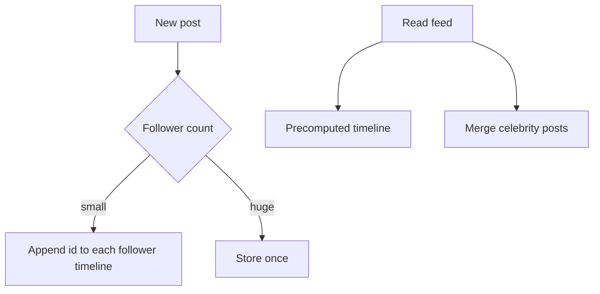

---
failureModes:
- Fan-out on write for a user with millions of followers, so one post becomes a multi-minute
  stamp and a queue backup.
- Fan-out on read that hits the database for every follow on every refresh.
- A hybrid that forgets to merge the celebrity posts, so the feed is missing the one account
  everyone follows.
- No bound on fan-out parallelism, so a single post wakes every worker and starves the rest
  of the product.
sayThis:
- 'For ordinary users I fan out on write: the post id is appended to each follower''s timeline
  cache. Reads are a slice of one list.'
- 'For celebrities I fan out on read: the post lives once, and the feed merges those few accounts
  at read time.'
- The merge is by timestamp, with a cursor, and it is fine if a celebrity post appears within
  a second rather than instantly.
gaps:
- Fan-out is not in the public pattern list. It is buried inside the news-feed breakdown,
  so candidates never reuse it for notifications, chat fan-out, or webhook delivery.
- The hybrid (write-fan-out for normal accounts, read-fan-out for huge ones) is the actual
  answer and is easy to state vaguely. This page draws the threshold and the merge.
- Backpressure when one write must touch a million rows is the failure mode. Free feed sketches
  often stop at 'push to followers.'
references:
- title: Hello Interview, public news-feed breakdown
  url: https://www.hellointerview.com/learn/system-design/problem-breakdowns/fb-news-feed
- title: Hello Interview, public pattern index
  url: https://www.hellointerview.com/learn/system-design/in-a-hurry/patterns
quiz:
- kind: mc
  question: 'Fan-out on write is a poor fit when:'
  choices:
  - A user has 200 followers and reads are far more common than writes.
  - One account has 20 million followers, so a single post would enqueue 20 million timeline
    writes.
  - You want the home timeline read to be one cache fetch.
  - Posts are immutable.
  answer: 1
  explain: The write amplification is the follower count. Past some threshold, store the post
    once and merge on read.
- kind: mc
  question: In a hybrid feed, a read does what?
  choices:
  - Scans every post in the system.
  - Reads the precomputed timeline and merges the recent posts of the celebrity accounts the
    user follows.
  - Always recomputes from scratch so it is simpler.
  - Locks the celebrity row.
  answer: 1
  explain: The common path stays O(page size). The celebrity set is small per user even if
    the celebrity is large.
- kind: short
  question: Name a second product that is the same pattern.
  reveal: Notifications and webhooks. Delivering one event to many subscribers is fan-out.
    The same celebrity problem appears as a tenant with a million webhook endpoints or a user
    with every phone in a country. Batch, shard the work, and isolate that tenant so they
    cannot fill the queue.
title: Fan-out
description: 'Do the work once per reader at write time, or once per read: how to choose,
  and how celebrities break the choice.'
track: system-design
section: Patterns
order: 480
---

Fan-out is the decision of when to multiply work by the number of readers. You either pay at write time, so each reader has a private copy of "what to show," or you pay at read time, assembling the view from shared data. Reads usually outnumber writes, which is why paying at write time is the default, until one writer has so many readers that the write never finishes.

## On write

When someone posts, a worker reads their follower list (in pages, not one giant fetch) and appends the post id to each follower's timeline, usually a Redis list or a row in a wide-column table. The home request is "give me the first page of my timeline," which is one key. Ordering is the append order, or a score you set explicitly.

Bound it. A worker pool with a max concurrency, a per-user budget, and isolation for heavy hitters. If this queue backs up, new posts are late for everyone, so the celebrity must not share an unbounded queue with ordinary users.

## On read

Store the post once. A read loads the accounts the user follows and merges their recent posts by time, with a cursor. This is simple and write-cheap. It gets expensive as the follow count grows, and it is painful if every read hits disk. Cache each account's recent post ids.

## Hybrid

Do write fan-out for accounts under a threshold (thousands of followers, pick a number and stick to it). Do read fan-out for accounts above it. A user's feed read is "my precomputed timeline, merged with recent posts from the celebrities I follow." Celebrity posts show up slightly later and cost a little more at read time. Ordinary posts stay cheap. You will be asked "what if I follow 500 celebrities?" Cap the merge set, or precompute for users who follow many celebrities too. Say the cap.

Deletions and edits must fan out as well, or you store only ids in the timeline and the post body is fetched through a cache that you invalidate. Prefer ids. Copying the whole post into a million timelines makes an edit a disaster.

