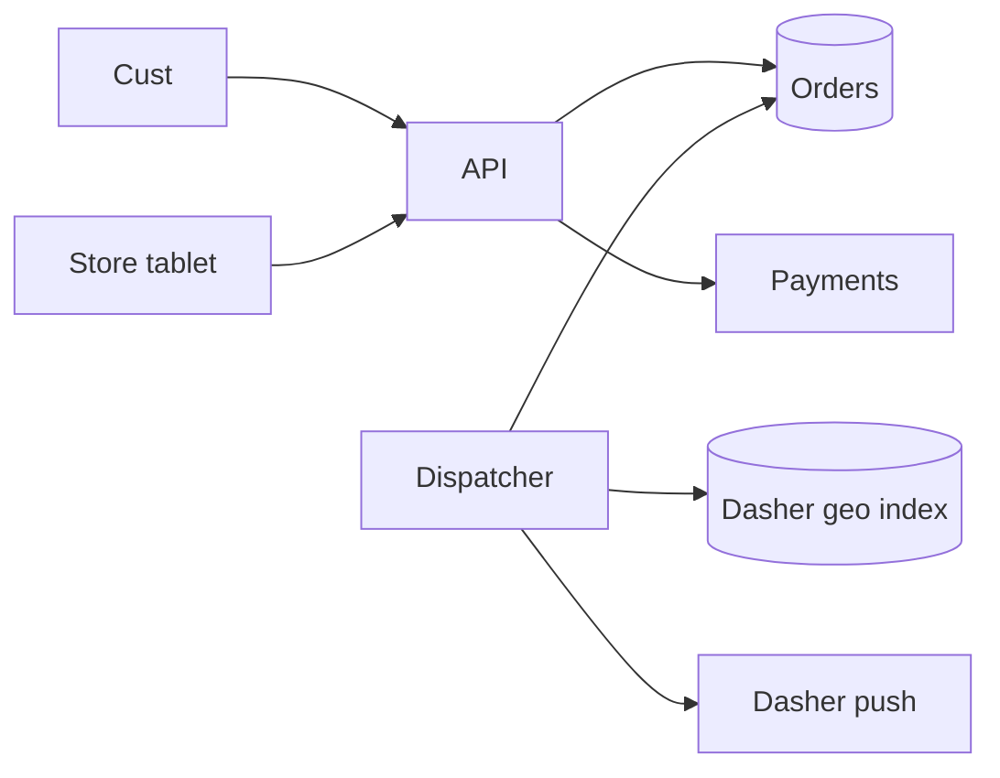

---
failureModes:
- Assigning a Dasher who is already at capacity because the check and the insert are two steps.
- Retrying dispatch creates a second assignment and two people show up for one order.
- Optimizing a global route for the whole city synchronously on the order request.
- No timeout when a Dasher never accepts, so the food sits while the order looks assigned.
sayThis:
- The order is durable first. Dispatch is a worker that claims a free Dasher with a conditional
  update and a lease. A retry of the HTTP create returns the same order.
- I rank a small set of nearby free Dashers by ETA to the store, not the whole fleet.
- If the Dasher does not accept before the lease ends, the order goes back to the pool. The
  customer sees a state, not a spinner with no owner.
gaps:
- Public 'local delivery' breakdowns exist and often center on inventory or batching. A dispatch
  loop with accept/decline, capacity, and idempotent assignment is the DoorDash interview
  problem and is easy to under-specify.
- Store prep time changes who you should assign and when. Matching at order creation is the
  wrong clock if the kitchen needs 20 minutes.
- 'This note adds degraded modes: if location is stale, widen the radius; if the Dasher app
  is unreachable, do not mark the order picked up.'
references:
- title: Hello Interview, public local delivery breakdown
  url: https://www.hellointerview.com/learn/system-design/problem-breakdowns/gopuff
- title: These notes, idempotency
  url: /helpmeprep/system-design/idempotency
quiz:
- kind: mc
  question: 'The customer double-taps ''place order.'' You should:'
  choices:
  - Create two orders and refund one later if you notice.
  - Require an idempotency key and return the original order on replay.
  - Depend on the load balancer to dedupe.
  - Take two payments and one delivery.
  answer: 1
  explain: The client retries. The key makes the second POST a read of the first result.
- kind: mc
  question: When should dispatch run relative to a 25-minute kitchen?
  choices:
  - The instant the order is placed, so the Dasher waits in the parking lot the whole time.
  - When predicted ready-time is close, so the Dasher arrives as the food comes up.
  - The next morning in a batch.
  - Only after the customer calls support.
  answer: 1
  explain: Assigning too early wastes Dasher time and blocks them from other orders. Prep
    time is an input to the scheduler.
- kind: short
  question: How is this different from ride matching?
  reveal: There is a third party, the store, with a prep time and an order that can contain
    items from one kitchen. Capacity is 'how many orders are already in this Dasher's bag,'
    not a binary free flag. The pickup and the dropoff are both locations, and being early
    to the store is a cost, not a win.
title: Food delivery dispatch
description: 'A DoorDash-shaped system: orders from many stores, a pool of Dashers, and assignment
  that stays correct when everyone retries.'
track: system-design
section: Worked problems
order: 540
---

## What you are designing

A customer orders from a store. The kitchen prepares the food. A Dasher picks it up and delivers it. You choose the Dasher. This is the three-sided version of ride matching: store, Dasher, customer. Assume a city has thousands of online Dashers and that dinner is a sharp peak. One order is one store. Batching multiple pickups is a follow-up, not the first drawing.

## Requirements

- Place an order once, even if the client retries.
- Show state: confirmed, being prepared, assigned, picked up, delivered.
- Assign a Dasher who is online, under capacity, and plausibly on time.
- Reassign if the Dasher declines or goes silent.
- Do not mark an order delivered twice, and do not double-pay.

A late assignment is bad. Two Dashers for one order is worse.

## Entities and API

`Order`, `Store`, `Dasher`, `Assignment(order, dasher, state, lease)`, `Location`.

```text
POST /v1/orders                 Idempotency-Key  -> order
POST /v1/assignments/{id}/accept
POST /v1/assignments/{id}/decline
POST /v1/orders/{id}/events     { picked_up | delivered }
```

Create is idempotent on the client's key, so a double tap is one order and one charge authorization. Accept and decline belong to the assignment, not the order: accepting an expired lease is 409, not a second Dasher on the same food. Event posts are idempotent on `(order, event type)` so a retried "delivered" does not pay the Dasher twice. 404 means that id is not this caller's. Do not return another customer's order in the error body.

## High-level design



Create order and payment auth are a saga: if auth fails, the order is not confirmed. The store sees confirmed orders on its tablet (poll or push). The dispatcher wakes up when the predicted ready time is near, not necessarily at create. It queries nearby Dashers, claims one, and pushes an offer.

## Data model

```sql
CREATE TABLE orders (
  id            BIGSERIAL PRIMARY KEY,
  customer_id   BIGINT NOT NULL,
  store_id      BIGINT NOT NULL,
  idem_key      TEXT NOT NULL,
  state         TEXT NOT NULL,
  ready_at      TIMESTAMPTZ,
  UNIQUE (customer_id, idem_key)
);
CREATE TABLE assignments (
  id          BIGSERIAL PRIMARY KEY,
  order_id    BIGINT NOT NULL,
  dasher_id   BIGINT NOT NULL,
  state       TEXT NOT NULL, -- offered | accepted | canceled
  lease_until TIMESTAMPTZ,
  UNIQUE (order_id, dasher_id)
);
CREATE UNIQUE INDEX one_live_assignment ON assignments (order_id)
  WHERE state IN ('offered','accepted');
```

The partial unique index is the double-assignment lock. A second dispatcher loses the insert.

## Deep dives

**Who is eligible.** Geo-query Dashers near the store, drop anyone offline, at bag capacity, or with an offer lease still running. Rank by ETA to the store plus slack against `ready_at`. Call routing only for the top handful. If the best ETA cannot make the promise, say so to the customer instead of assigning a Dasher who will be late by design.

**Offer loop.** Insert the offered assignment, push to the Dasher, and set a lease of a few seconds. Accept updates the assignment where state is still offered and fills `orders.dasher_id` conditionally. Decline or expiry cancels that assignment and lets the dispatcher try the next Dasher. The customer-facing state stays "finding a Dasher" until accept.

**Capacity and batching.** A simple capacity is a max concurrent orders. A better one accounts for route: adding a pickup that is on the way is different from adding a pickup across town. For v1, refuse to batch. For the follow-up, only batch when the extra stop fits the existing promise, and recompute rather than stacking greedily without a check.

**Payout.** A ledger row keyed by `(assignment_id, type)` so a retry of "pay for this dropoff" does not double-pay. Tips can arrive later as a second ledger line.

## Levels

- **Mid-level.** Idempotent create, durable order, one assignment constraint, a geo candidate set.
- **Senior.** Lease and decline, ready-time scheduling, capacity, payment separated from dispatch.
- **Staff.** Batching trade-offs, hot stores, stale locations, and how you degrade ETA when routing is down. Mentions fairness to Dashers.
