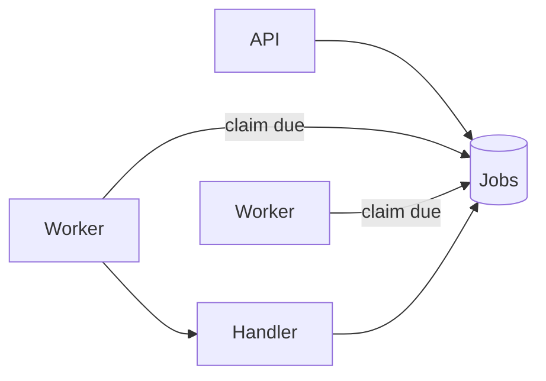

---
failureModes:
- A single poller that becomes the bottleneck and the single point of failure.
- Two workers taking the same due job because the claim is not conditional.
- A clock jump or a long GC pause that fires a one-shot job twice or not at all, with no idempotent
  handler.
- One tenant submitting a million jobs and delaying everyone else's.
sayThis:
- Workers claim due jobs with SKIP LOCKED or a lease. The schedule is data, not a crontab
  on one box.
- The handler is idempotent. A second run after a crash is a no-op or a safe repeat.
- I partition by tenant or by time bucket so a noisy neighbor has their own queue.
gaps:
- The public job-scheduler breakdown is paywalled. Free queue pages do not cover recurrence,
  skew, and the difference between 'run at T' and 'run every hour.'
- A scheduler that only stores the next run in memory is a demo. Durability and failover of
  the scheduler itself are the design.
- 'This note lines up with the long-running task pattern: the scheduler decides when, the
  worker decides how, the lease decides who.'
references:
- title: Hello Interview, public job scheduler outline (article may be paywalled)
  url: https://www.hellointerview.com/learn/system-design/problem-breakdowns/job-scheduler
- title: These notes, long-running tasks
  url: /helpmeprep/system-design/long-running
quiz:
- kind: mc
  question: How does a worker take a job without blocking all other workers?
  choices:
  - LOCK TABLE jobs.
  - UPDATE ... WHERE id IN (SELECT id ... FOR UPDATE SKIP LOCKED) so each worker locks different
    rows.
  - A global mutex in the load balancer.
  - DNS round robin.
  answer: 1
  explain: SKIP LOCKED is the usual SQL answer. A queue service does the same with a visibility
    timeout.
- kind: mc
  question: 'A recurring job should store:'
  choices:
  - Only a cron string on a laptop.
  - The schedule plus the next fire time, and after a run, compute the following fire time
    in the same transaction as success.
  - Nothing. Workers remember.
  - The entire history in a Redis list that evicts.
  answer: 1
  explain: If you crash after running and before scheduling the next one, you must not lose
    the series or double-schedule it. One transaction.
- kind: short
  question: What is scheduler skew?
  reveal: Many jobs set to 'top of the hour' fire together and stampede. Jitter the fire time,
    or schedule in coarse buckets and let workers pull steadily. Also isolate tenants so one
    customer's backlog cannot use the whole worker pool.
title: Job scheduler
description: Run a large number of jobs at the right time, on one of many workers, without
  double execution being fatal.
track: system-design
section: Worked problems
order: 630
---

## What you are designing

Users or services register jobs: send this email at 9:00, recompute this report every hour, retry this webhook in five minutes. A fleet of workers runs them. Assume millions of scheduled jobs, a burst at round clock times, and handlers that can crash mid-way. You are designing the scheduler, not every handler.

## Requirements

- Register a one-shot or a recurring job.
- Run it close to the due time (define the slack, for example within 10 seconds, not within a millisecond).
- Survive worker and scheduler process death.
- Avoid two workers doing the same logical run, or make that harmless.

A job that runs twice must not send two emails. That is the handler's idempotency, and the scheduler must give the handler a stable run id to key on.

## Entities and API

`Job(id, owner, schedule, next_run_at, payload_ref)`, `Run(job_id, run_id, state, lease_until)`.

```text
POST /v1/jobs          { schedule | run_at, payload }
DELETE /v1/jobs/{id}
GET  /v1/jobs/{id}/runs
```

Create returns 201 and a job id. The same idempotency key returns that job instead of a second schedule. Delete returns 204 and stops future fires. A run that is already claimed either finishes or is cancelled, and you say which before you write the code. `GET .../runs` is the audit trail, paged by time, not a scan of every payload. A run id is stable for one scheduled fire, so a worker that crashes and retries does not send the payload twice.

## High-level design



There is no special leader if workers can claim safely. A optional dispatcher can push due job ids onto a queue so the database is not polled by thousands of workers. Either way the claim is conditional. A crashed worker's lease expires and the run becomes claimable again under the same run id.

## Data model

```sql
CREATE TABLE jobs (
  id           BIGSERIAL PRIMARY KEY,
  owner_id     BIGINT NOT NULL,
  next_run_at  TIMESTAMPTZ NOT NULL,
  schedule     TEXT,
  payload_ref  TEXT NOT NULL,
  enabled      BOOLEAN NOT NULL DEFAULT true
);
CREATE INDEX jobs_due ON jobs (next_run_at) WHERE enabled;
CREATE TABLE runs (
  job_id      BIGINT NOT NULL,
  run_at      TIMESTAMPTZ NOT NULL,
  state       TEXT NOT NULL,
  lease_until TIMESTAMPTZ,
  attempts    INT NOT NULL DEFAULT 0,
  PRIMARY KEY (job_id, run_at)
);
```

The primary key of `runs` is the idempotency key the handler uses ("email for job 9 at 09:00").

## Deep dives

**Claim.** Same shape as the task queue on the Postgres page: select due jobs `FOR UPDATE SKIP LOCKED`, insert or update the run to `leased`, commit. The handler executes, then you set the run `succeeded` and advance `next_run_at` in one transaction. If you advance the schedule before the handler finishes, a crash skips or overlaps. If you advance only after success, a poison job blocks the schedule unless you count attempts and park it.

**Time.** Store UTC. Recurrence is "next instant after this one in this timezone," and daylight-saving time will duplicate or skip an hour. Say you use a library and you test the DST boundary. Do not write your own cron parser in the interview; say what it must return.

**Scale and isolation.** Shard jobs by owner so a poll touches an index of what is due, not a scan. Cap concurrent runs per owner. Jitter anything scheduled at `:00`. If the due set is huge, a dispatcher pulls a page and enqueues ids so workers do not all hammer the same index.

**Failure.** Attempts, backoff, and a dead state the owner can see. Alert on age of the oldest due job. That metric is the scheduler's health, more than CPU.

## Levels

- **Mid-level.** Durable jobs, a due index, a conditional claim, a run record.
- **Senior.** Lease expiry, idempotent run id, recurrence advanced in the right transaction, noisy-neighbor cap.
- **Staff.** DST and clock assumptions, shard or partition plan, push versus poll, and the SLO on lateness versus the cost of polling.
