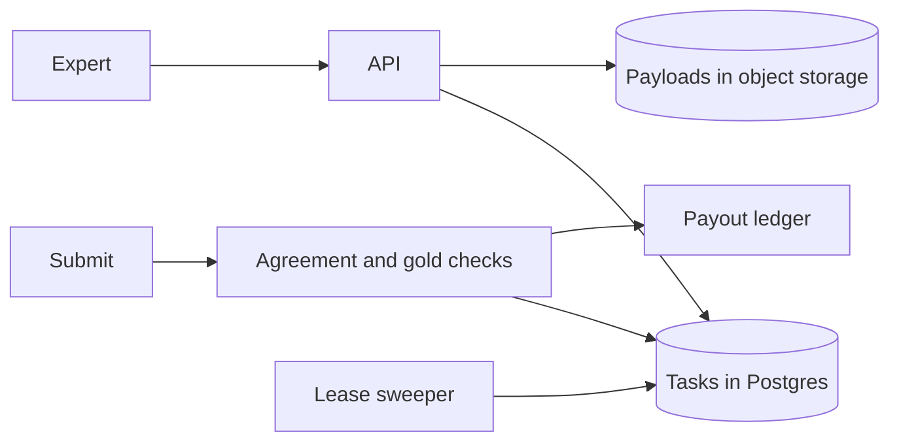

---
failureModes:
- Two experts claim the same task because the claim is a read then a write.
- A lease that never expires, so a crashed client holds the task until someone notices.
- Gold tasks the worker can recognize and game, so the quality score is theater.
- A payout inserted twice when the complete call retries.
sayThis:
- Experts pull the next task. I claim it with FOR UPDATE SKIP LOCKED and a lease. Pushing
  work at people who are offline is how you create a backlog you cannot see.
- I mix in gold tasks and compare redundant labels. Disagreement becomes a new adjudication
  task, not an average of two guesses.
- Payouts are a ledger row unique on the assignment id. Retries do not pay twice.
gaps:
- Human-in-the-loop routing is not a classic public breakdown. Ticketmaster covers contention
  for seats, not quality of a label or a deadline across a pool of specialists.
- The pull model, gold tasks, and adjudication loop are the design. A queue of tasks without
  a quality story will not pass a team that sells labels.
- This note makes the SQL claim the center of the interview, because that is the part people
  hand-wave and then get wrong under pressure.
references:
- title: These notes, Postgres
  url: /helpmeprep/system-design/postgres
- title: These notes, contention
  url: /helpmeprep/system-design/contention
- title: These notes, payments
  url: /helpmeprep/system-design/payments
quiz:
- kind: mc
  question: 'The claim statement should be:'
  choices:
  - SELECT id FROM tasks WHERE status='open' LIMIT 1, then later UPDATE.
  - A single statement that locks with FOR UPDATE SKIP LOCKED and updates status to claimed
    with a lease.
  - A Redis pub/sub message.
  - An email to all experts.
  answer: 1
  explain: The lock and the status change commit together. A separate select is a double-claim
    race.
- kind: mc
  question: Why pull instead of push as the default?
  choices:
  - Push is impossible.
  - Experts are online only sometimes. A pull plus a lease matches real availability. Push
    piles tasks onto people who are not there.
  - Pull avoids the need for skills.
  - Pull is strongly consistent across regions for free.
  answer: 1
  explain: You can still prioritize inside the pull (deadlines first). You do not need to
    guess who is at the keyboard.
- kind: short
  question: What do you do when two experts disagree?
  reveal: Do not silently average. Create an adjudication task for a higher-skilled expert,
    or request a third label if the rubric says so. Record all labels. The published label
    is the adjudicated one, with the others kept for the quality model.
title: Expert task routing
description: Assign labeling and review work to qualified humans, protect quality with gold
  checks, and pay exactly once.
track: system-design
section: Worked problems
order: 690
---

## What you are designing

A customer submits a batch of tasks: grade these answers, judge these pairs, review these documents. Each task needs an expert with a skill, sometimes two or three independent experts. You track quality and you pay for accepted work. Deadlines exist. Assume tens of thousands of open tasks and a few thousand experts, with a long tail of rare skills that are the actual bottleneck.

## Requirements

- An expert asks for the next task they are qualified for and receives at most one claim.
- If they vanish, the task returns to the pool.
- Quality is measured, not assumed: gold tasks and agreement.
- A completed assignment pays once.
- A customer can see whether a batch will hit its deadline.

Correctness of the claim and of the payout matters more than shaving latency below a couple of hundred milliseconds.

## Entities and API

`Project`, `Task(status, skill, priority, lease_until, claimed_by)`, `Assignment`, `GoldLabel`, `Payout`.

```text
POST /v1/tasks/next          -> claimed task or 204
POST /v1/assignments/{id}/heartbeat
POST /v1/assignments/{id}/submit
POST /v1/projects            batch create
```

`/tasks/next` is a claim, not a read. 200 returns the task and a lease deadline. 204 means the queue is empty for this skill, which is not an error and should not be retried in a tight loop. Heartbeat extends the lease. A heartbeat after expiry is 409 and the expert must claim again, because someone else may own the task. Submit is idempotent on the assignment id: a double submit stores one answer and returns the same receipt. Batch create returns 202 when the payload is stored asynchronously. Those tasks are not claimable until the object is durable.

## High-level design



Payloads (the long document, the model output) live in object storage. The task row is small and indexed for the claim query. A sweeper or the claim query itself ignores leases that have expired, setting status back to open.

## Data model

```sql
CREATE TABLE tasks (
  id           BIGSERIAL PRIMARY KEY,
  project_id   BIGINT NOT NULL,
  status       TEXT NOT NULL,
  skill        TEXT NOT NULL,
  priority     INT NOT NULL,
  claimed_by   BIGINT,
  lease_until  TIMESTAMPTZ,
  created_at   TIMESTAMPTZ NOT NULL DEFAULT now()
);
CREATE INDEX tasks_claim ON tasks (skill, priority DESC, created_at)
  WHERE status = 'open';
```

```sql
WITH next AS (
  SELECT id FROM tasks
  WHERE status = 'open' AND skill = :skill
  ORDER BY priority DESC, created_at
  FOR UPDATE SKIP LOCKED
  LIMIT 1
)
UPDATE tasks t
SET status = 'claimed', claimed_by = :expert,
    lease_until = now() + interval '30 minutes'
FROM next
WHERE t.id = next.id
RETURNING t.*;
```

```sql
INSERT INTO payouts (assignment_id, expert_id, amount_cents)
VALUES (:a, :e, :c)
ON CONFLICT (assignment_id) DO NOTHING;
```

## Deep dives

**Who gets the hard task.** The claim query can require a minimum quality score for the skill, stored on `expert_skills` and updated from gold results. Do not compute a fancy rank over every expert on the pull; filter in SQL, order by priority, and let the lease serialize. A project nearing its deadline bumps priority. Watch starvation: a low-priority project still needs a fairness term or it never runs.

**Quality.** Sprinkle gold tasks whose answer you know. Score experts on those, not only on speed. If gold tasks are recognizable, rotate them and do not reuse the same item until it is memorized. For normal tasks, two experts and an agreement threshold. Disagreement creates an adjudication task. An expert whose gold accuracy drops is paused, which is a status update, not a delete of their past labels (you may need to relabel those).

**Deadlines.** Throughput is active experts times tasks per hour, by skill. Compare that to remaining tasks and time left. Alert when the forecast misses, early enough to add experts or cut scope. This forecast is a query, not a new infrastructure.

**Payout and cancel.** The payout unique key is the assignment. A canceled project stops new claims and pays assignments already submitted. Do not try to claw back with an in-place delete; reverse with a ledger line if you must.

## Levels

- **Mid-level.** Pull API, the claim SQL, a lease, payloads in object storage, idempotent submit.
- **Senior.** Partial index, gold and redundancy, payout uniqueness, deadline forecast, what happens on cancel.
- **Staff.** Skill scarcity, exploration of new experts, audit of who saw which customer data, and how a bad expert's labels are retracted from a delivered dataset.
