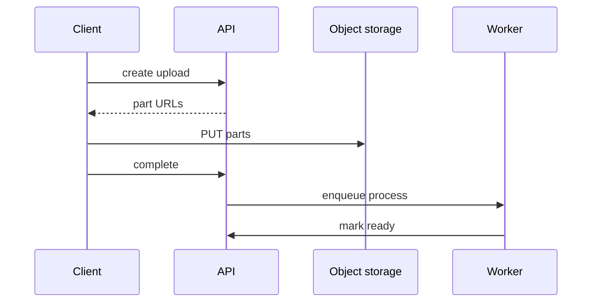

---
failureModes:
- The app server buffering the file and dying at a deploy, leaving a half-written object nobody
  tracks.
- A client that retries the whole multi-gigabyte upload because one part failed and you did
  not support parts.
- Marking the file ready before a malware scan or a checksum check.
- Orphaned parts from abandoned uploads, billed forever.
sayThis:
- The client asks for an upload, receives a multipart upload id and presigned part URLs, uploads
  parts in parallel, then calls complete. My server never sees the bytes.
- Complete records the checksum and enqueues processing. The file is not downloadable until
  processing says it is clean.
- Abandoned uploads expire. I do not need a sweeper that lists the bucket if the storage lifecycle
  rule does it.
gaps:
- The public large-blob pattern is paywalled. The free technology map draws a blob box and
  stops. Resumability, part size, and the 'not ready yet' state are the actual design.
- Dedup of identical bytes by content hash is a storage win and a privacy footgun (one user
  learning that another uploaded the same file). Say whether the hash is per-tenant.
- This page ties the upload to the long-running task pattern, which is how thumbnails and
  transcodes get produced without a second design.
references:
- title: Hello Interview, public large-blob outline (article may be paywalled)
  url: https://www.hellointerview.com/learn/system-design/patterns/large-blobs
- title: AWS multipart upload
  url: https://docs.aws.amazon.com/AmazonS3/latest/userguide/mpuoverview.html
quiz:
- kind: mc
  question: Where do the file bytes go during upload?
  choices:
  - Through the API process, so it can validate them inline.
  - Directly from the client to object storage. The API handles authorization and metadata.
  - Into the primary database.
  - Into the CDN only.
  answer: 1
  explain: Validate type and quota before you sign the URL. Validate checksum and safety after
    the bytes land, asynchronously.
- kind: mc
  question: 'A part fails on a flaky network. The client should:'
  choices:
  - Restart from byte zero always.
  - Retry that part. Parts that already succeeded stay put.
  - Open a second object and hope.
  - POST the part to the health-check endpoint.
  answer: 1
  explain: Multipart exists so failure is local to a part. The complete call happens only
    when every part etag is in.
- kind: short
  question: What does the complete call do?
  reveal: The client sends the part list and etags. The API asks the blob store to assemble
    the object, verifies the checksum if you have one, writes the metadata row as 'uploaded,'
    and enqueues scan or transcode. Until that job passes, downloads are refused or return
    a placeholder.
title: Large blob uploads
description: 'Move bytes around the application server: presigned multipart uploads, completion,
  and processing that happens after.'
track: system-design
section: Patterns
order: 450
---

Large files break the assumption that a request body fits in memory and finishes before a timeout. The pattern is the same for photos, video, dataset export, and resume PDFs. Only the processing after the upload changes.

## Steps

1. The client calls `POST /uploads` with size, type, and checksum. The API checks quota and policy, creates a metadata row in state `pending`, and opens a multipart upload.
2. The API returns presigned URLs for parts, or a way to ask for the next part URL. Part size is a few megabytes and up, so a mobile client can retry a part without restarting a movie.
3. The client uploads parts in parallel, directly to the bucket, and keeps the etag of each.
4. The client calls `POST /uploads/{id}/complete` with the part list. The API finalizes the object, stores the etags and checksum, and sets state to `uploaded`.
5. A worker scans, transcodes, or extracts text, then sets state to `ready` or `rejected`.

Downloads of a file that is not `ready` return 409 or a placeholder, not the raw upload. That gap is where you hide malware scanning and where you avoid serving a half-processed video.

## Failure and garbage

If the client disappears, the pending row and the incomplete multipart upload should expire (a lifecycle rule plus a status sweeper). Do not leave orphans as a billing surprise.

Completing twice must be safe. The second complete sees `uploaded` or `ready` and returns the same metadata. Part retries overwrite the same part number.

If you deduplicate by hash, scope the hash to the tenant unless you are building a public content-addressed store on purpose. A global hash lets one customer probe whether another customer uploaded a given file.

## Small files

Do not force this ceremony on a 4 KB avatar. A single presigned PUT is enough. Say the threshold where you switch to multipart, rather than drawing one path for every byte.

