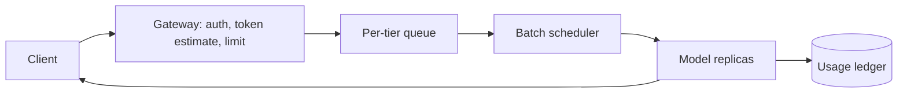

---
failureModes:
- One request per GPU with no batching, so utilization is terrible and the queue lies about
  capacity.
- Unbounded prompts and outputs, so one caller exhausts memory and the token bill.
- 'No backpressure: you accept every request, the queue grows without a bound, and timeouts
  retry into the pile.'
- A sticky KV cache that pins a conversation to one replica which then dies and takes the
  session with it.
sayThis:
- I separate prefill and decode. I batch decode steps across requests. The KV cache is why
  a long chat is a memory problem, not just a FLOP problem.
- Admission control is a token budget, not a request count. When the queue's oldest item passes
  the SLO I start rejecting with 429.
- A cheaper model or a cached answer handles the easy calls. The big model is for the calls
  that fail a router, because GPUs are the scarce resource.
gaps:
- Public 'design ChatGPT' material, where it is not paywalled, stays at 'a bunch of GPUs and
  a cache.' Continuous batching, KV-cache memory, and admission in tokens are the actual serving
  interview, and they are missing from the free classic-system list.
- Prefix caching (shared system prompt) and speculative decoding change throughput and are
  worth one sentence if you have built with vLLM-class engines. Do not turn the interview
  into a kernel lecture.
- This note treats the model server as a dependency with a 429, a timeout, and an idempotency
  story, same as any other expensive backend.
references:
- title: vLLM documentation
  url: https://docs.vllm.ai/en/latest/
- title: These notes, rate limiting
  url: /helpmeprep/system-design/rate-limiting
- title: Orca / continuous batching background, Yu et al.
  url: https://www.usenix.org/conference/osdi22/presentation/yu
quiz:
- kind: mc
  question: Why does a long conversation pressure GPU memory even if the GPU can 'handle the
    FLOPs'?
  choices:
  - JSON is large.
  - The KV cache stores attention state for every token already generated, and it stays resident
    while the request is active.
  - TCP buffers hold the prompt.
  - Embeddings are stored in Postgres.
  answer: 1
  explain: Memory for KV cache, times concurrent sequences, is often the capacity limit. Batch
    size is not free.
- kind: mc
  question: 'The right backpressure signal when GPUs are saturated is:'
  choices:
  - Accept everything and let clients time out and retry.
  - A bounded queue and 429s, with Retry-After, once wait time or token backlog crosses the
    SLO.
  - A bigger API gateway timeout.
  - Dropping requests silently after you have billed them.
  answer: 1
  explain: Retries on top of an unbounded queue are how a brownout becomes an outage. Shed
    load where the client can see it.
- kind: short
  question: What is continuous batching in one sentence?
  reveal: New requests join a running batch at the next decode step instead of waiting for
    a static batch to finish. It keeps the GPU busy when requests have very different lengths.
    The scheduler still has to cap concurrent sequences so the KV cache fits.
title: LLM inference serving
description: 'Serve a large model to many callers with a latency and cost budget: batching,
  KV cache, queues, and what you do when the GPU is full.'
track: system-design
section: Worked problems
order: 650
---

## What you are designing

Many clients call a completion or chat API backed by a large model you host. A request has a prompt and a max output length. You owe a latency SLO for short calls (for example first token in a few hundred milliseconds for interactive, or minutes for batch) and a cost per token you can defend. Assume GPU memory is the scarce resource, traffic is bursty, and some callers will send enormous prompts if you let them.

If you have worked on vLLM, say what that taught you about scheduling, then design the system around it rather than narrating one engine's flags.

## Requirements

- Serve `POST /v1/chat/completions` with streaming tokens.
- Isolate tenants so one key cannot occupy every GPU.
- Bound latency for the interactive class and throughput for the batch class.
- Fail clearly when you are over capacity.

Exact bitwise reproducibility is not the goal. Not dropping or double-billing a streamed response matters more.

## Entities and API

`Request(id, tenant, prompt_tokens, max_output, priority)`, `Replica`, `Usage(tenant, tokens)`.

```text
POST /v1/chat/completions     stream tokens, or 429
GET  /v1/usage
```

Streaming is SSE or chunked HTTP. The client must tolerate a disconnect by retrying with an idempotency key; you either resume (hard) or start over (say which). Starting over is the honest v1, and you bill once by key if the first stream actually finished.

## High-level design



The gateway rejects prompts over a token cap and tenants over their budget before a GPU sees them. A scheduler groups waiting requests onto replicas, preferring to fill a batch without exceeding KV memory. Replicas are stateless aside from the cache for active requests. A router can send easy calls to a small model.

## Data model

You do not put prompts in Postgres on the hot path. You do put a usage ledger:

```sql
CREATE TABLE usage (
  tenant_id   BIGINT NOT NULL,
  request_id  TEXT NOT NULL,
  model       TEXT NOT NULL,
  prompt_tokens INT NOT NULL,
  output_tokens INT NOT NULL,
  PRIMARY KEY (tenant_id, request_id)
);
```

The unique key is how a retry does not double-bill. Queue state lives in memory plus a durable overflow if a request must survive a process crash; interactive calls usually just fail and let the client retry.

## Deep dives

**Scheduling.** Prefill (reading the prompt) is compute-heavy. Decode (one new token) is memory-bandwidth-heavy and wants a batch of sequences. Continuous batching adds a sequence when another finishes. Cap concurrent sequences by KV bytes, which grow with context length. A 100k-token prompt is not the same job as a 200-token prompt; the admission estimate has to say so, with a buffer because the estimate can be wrong.

**Tenancy and priority.** Two queues: interactive with a tight SLO, and batch (evals, backfills) that soaks leftover GPU. Batch is preempted or simply not scheduled when interactive queue age rises. Per-tenant token buckets stop one customer from buying the whole cluster by accident.

**Failure.** A replica dies, its in-flight streams error, clients retry. Do not pin a user to a replica except as an optimization (prefix cache). Health checks must fail when the GPU is wedged, not only when the HTTP port is open. Observe queue age, time-to-first-token, tokens per second, and KV occupancy. Those four tell you if you are full.

**Cost lever.** Cache identical prompts (system prompt prefix). Route with a small model first when the product allows a quality drop. Batch API for offline eval with a looser SLO and higher utilization. Say the number: tokens times price, versus the user's latency wish.

## Levels

- **Mid-level.** Gateway, a queue, GPU replicas, a timeout, a rate limit, streaming.
- **Senior.** KV memory as the capacity unit, continuous batching at a high level, tenant budgets, 429 instead of an infinite queue.
- **Staff.** Interactive versus batch, prefix cache, what you measure, and how a model upgrade rolls out (both versions serving, then a cut).
