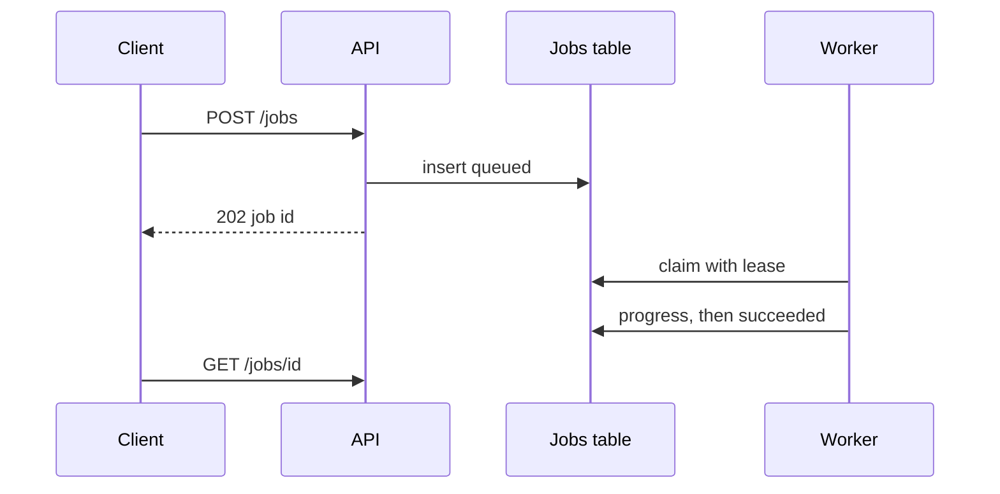

---
failureModes:
- Doing the slow work inside the HTTP request and timing out at the gateway while the work
  continues.
- A worker crash that loses the job because you acked on receipt.
- No idempotency, so a retry charges or emails twice.
- A status endpoint that 404s for a job the client just submitted, because the write was only
  in memory.
sayThis:
- I return 202 and a job id. The client polls the job or subscribes to its events. A worker
  with a lease does the slow part.
- If the worker dies, the lease expires and another worker can take the job. The steps are
  idempotent.
- I bound retries and park poison jobs for a human, instead of spinning forever.
gaps:
- 'The public pattern article is paywalled. Free Kafka and queue mentions do not assemble
  the user-facing contract: 202, a status resource, a lease, and a dead-letter path.'
- Progress reporting (percent, stage) is a product requirement in uploads and grading and
  is easy to forget once the queue is drawn.
- This page separates 'a task queue' from 'a workflow engine.' Multi-step sagas have their
  own page. Here the job is one unit of work that happens to be slow.
references:
- title: Hello Interview, public long-running task outline (article may be paywalled)
  url: https://www.hellointerview.com/learn/system-design/patterns/long-running-tasks
- title: RFC 9110, 202 Accepted
  url: https://www.rfc-editor.org/rfc/rfc9110.html#name-202-accepted
quiz:
- kind: mc
  question: Why return 202 instead of holding the request?
  choices:
  - 202 is faster for the database.
  - Gateways and clients will time out a long request, and a retry looks like a second job.
    202 plus a job id gives them something to poll.
  - 202 disables retries.
  - The load balancer requires it.
  answer: 1
  explain: The HTTP request should be short. The work lives in a durable job the client can
    look up.
- kind: mc
  question: 'A lease on a job exists so that:'
  choices:
  - The job runs faster.
  - A crashed worker's job becomes available again after the lease expires, and two live workers
    do not both hold it.
  - You can avoid a database.
  - Retries are impossible.
  answer: 1
  explain: The lease is the failure detector. Heartbeats extend it for long jobs. The work
    itself must tolerate a double pickup.
- kind: short
  question: What do you store on the job row?
  reveal: Id, owner, status, input pointer, attempt count, lease_until, last error, and output
    pointer. Status moves from queued to running to succeeded or dead. The input blob is in
    object storage if it is large. The row is the source of truth for 'what happened to my
    upload.'
title: Long-running tasks
description: 'Accept the work, return immediately, and let a worker finish: leases, retries,
  and a status the user can poll.'
track: system-design
section: Patterns
order: 410
---

Some work is slower than an HTTP timeout: transcoding, a report, a grading pass, a mail merge. The request's only job is to record the work durably and hand back an id. Everything slow happens where a timeout cannot strand the user, and where a crash cannot lose the only copy of the intent.

## The contract

`POST /v1/jobs` validates, writes a row, enqueues a message or relies on workers polling the table, and returns **202** with `Location: /v1/jobs/{id}`. The client polls that resource or listens for events. The body shows status, stage, and, when you are done, a pointer to the result. Do not return 200 for work you have not finished. Do not return 500 for work you have successfully queued.

## The worker

A worker claims a job with a conditional update (`status = queued` and a lease). It heartbeats if the work is long. It writes progress on the row so the poll has something to say. On success it sets the output and status together. On a transient failure it increments an attempt counter and releases the lease, maybe with a delay. After N attempts it marks the job dead and stops. A human or a separate sweeper can requeue.

If the process is killed, the heartbeat stops, the lease expires, and another worker claims it. That second run must be safe. Store intermediate outputs under a key derived from the job id, not under a random temp path you will never find again.

## What the queue is

A jobs table with `SKIP LOCKED` is a fine queue up to a surprising scale and has the virtue that the status and the queue are the same row. SQS or a Redis stream is fine when you want to remove polling load from the database. Kafka is fine when the "job" is really "every event in this stream." Do not introduce a workflow engine for a single step. If the job grows branches, compensation, and human waits, move to the saga page.

