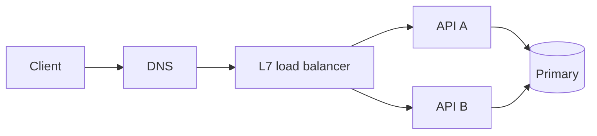

---
failureModes:
- Retrying a non-idempotent POST because the client saw a timeout, and creating a second charge.
- Opening a new TCP connection per request and spending the latency budget on handshakes.
- Assuming a load balancer will fairly spread long-lived gRPC streams. It balances connections,
  not in-flight RPCs, unless you configured it to.
- Setting no timeout, so one stuck dependency holds a thread until the process is exhausted.
sayThis:
- A cross-region round trip is tens of milliseconds before my code runs. I will not put three
  sequential cross-region calls on the user path.
- I retry only when the operation is idempotent or I send an idempotency key. Timeouts without
  that key are how you double-charge.
- 'HTTP/2 multiplexes many streams on one connection. The failure mode is stream exhaustion:
  the connection looks healthy and new RPCs queue anyway.'
gaps:
- Public networking primers cover layers, TCP, UDP, HTTP, gRPC, SSE, WebSockets, and load-balancer
  types. They are thin on connection pools and HTTP/2 stream limits, which is exactly how
  a 'healthy' gRPC tier falls over.
- 'They mention regional latency. They rarely make you compute a timeout budget: user budget
  minus the slowest dependency, with a deadline propagated, not a fresh 30-second timeout
  at every hop.'
- DNS, TLS session resumption, and health checks that kill in-flight streams are left as follow-ups.
  This page treats them as part of the basic story.
references:
- title: Hello Interview, public networking essentials
  url: https://www.hellointerview.com/learn/system-design/core-concepts/networking-essentials
- title: MDN, HTTP overview
  url: https://developer.mozilla.org/en-US/docs/Web/HTTP/Overview
- title: gRPC core concepts
  url: https://grpc.io/docs/what-is-grpc/core-concepts/
quiz:
- kind: mc
  question: A user is in Virginia and your database is in Oregon. What dominates a tiny query?
  choices:
  - The SQL parse time.
  - The round trip, often 60–80 ms, before the query runs.
  - TLS only on the first packet of the day.
  - JSON encoding of an empty body.
  answer: 1
  explain: Propagation and peering dominate small requests. This is why you colocate the read
    path with the user or cache at the edge.
- kind: mc
  question: Which retry is safe without extra machinery?
  choices:
  - POST /charges with a new random id on every attempt.
  - GET of a resource, or a POST that replays the same idempotency key.
  - Any request, if you wait long enough.
  - A DELETE that might have succeeded.
  answer: 1
  explain: Safe retries are ones whose second execution does not change the outcome. DELETE
    is often safe if it is idempotent, but a timeout after a successful delete still needs
    a defined response.
- kind: short
  question: What is a reasonable way to explain HTTP/2 stream exhaustion out loud?
  reveal: 'Many RPCs share one connection. Each RPC takes a stream. If the server caps concurrent
    streams, further calls queue on a connection the load balancer still considers up. Fix:
    more connections, a sane max-concurrent-streams, and deadlines so a slow RPC does not
    pin a stream.'
title: Networking basics
description: 'The network facts that change a design: latency, TCP versus UDP, HTTP, and what
  a load balancer can and cannot see.'
track: system-design
section: Core concepts
order: 30
---

You do not need to recertify in packet switching. You need the numbers and failure modes that change boxes on a whiteboard.

## Latency is mostly distance and queues

A packet inside one data center is well under a millisecond. Across the US it is on the order of 60–80 ms round trip, before your handler runs. A TLS handshake on a cold connection adds another round trip or two. None of that shows up in a microbenchmark on localhost.

So the design rule is boring: do not chain synchronous cross-region calls on a request a human is waiting for. Cache, replicate reads near the user, or accept the latency explicitly. Timeouts are part of the API. Every outbound call gets a deadline shorter than the caller's deadline, so a stuck dependency becomes an error instead of a pile of waiting threads.

## TCP, UDP, and what you actually choose

TCP gives you a byte stream, retransmission, and congestion control. UDP gives you datagrams. In interviews you almost always want TCP, then an application protocol on top. UDP shows up when you would rather drop than wait: voice, some multiplayer game state, QUIC (which rebuilds reliability on UDP). Saying "I'll use UDP for the API because it is faster" without a loss story is a yellow flag.

TCP's cost is the handshake and head-of-line blocking on a single stream. HTTP/2 and gRPC fix the "one request at a time" problem by multiplexing streams on one connection. The new failure mode is the cap on those streams. A connection can be open, pass health checks, and still refuse new RPCs. That looks like a latency climb with healthy averages. The fix is more connections per destination, an explicit concurrent-stream limit, and metrics on queue time, not just request time.

## Application protocols, only as far as the design needs

- **HTTP/1.1 and HTTP/2** are the default for public APIs. Status codes are part of the contract: 408/429/5xx may be retryable, 400-class errors are not.
- **gRPC** is a strong default between services you own: typed protobufs, deadlines, streaming. Do not expose it as the public API unless your clients are also yours.
- **SSE** is one-way server push over ordinary HTTP. It sits behind normal load balancers more happily than a custom socket.
- **WebSockets** are bidirectional. Use them when the client sends often (chat, cursors), and plan for sticky sessions or a pub/sub fan-out so any server can deliver.
- **WebRTC** is peer-to-peer media. Mention it for calls, then put signaling on your servers and media off them.

## Load balancers

Layer-4 balancers spray TCP connections. Layer-7 balancers understand HTTP and can route on path, header, or cookie. Both will send traffic to a target that just started failing unless health checks are honest and fast. Draining matters: a deploy that kills a process also kills the in-flight streams on it. For long polls and gRPC, "least connections" is a better policy than round-robin, and even that does not see queued streams inside one connection.

Health checks should hit a dependency that means the process can serve, not a handler that always returns 200. A check that passes while the database pool is exhausted will keep the box in rotation.

