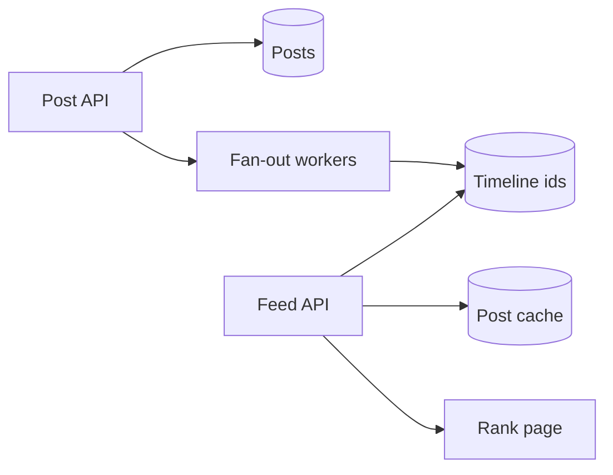

---
failureModes:
- On every refresh, joining every follow to every post and sorting the planet.
- Fan-out on write for a celebrity, so one post enqueues a hundred million writes.
- Ranking that only has recency, then being unable to say what a 'good' feed is.
- A cache of fully rendered per-user HTML that never hits because every page is unique and
  huge.
sayThis:
- Ordinary accounts fan out on write into a per-user timeline of post ids. Celebrities are
  merged at read time.
- The read is a page of ids from that timeline, then a multi-get of post objects from cache.
- Ranking can be 'time' for v1. If I rank by a model, I still generate candidates with the
  same fan-out and only rerank the page.
gaps:
- Public feed breakdowns cover push versus pull. They often stop before ranking features,
  ads as a merge, and the delete/edit path.
- The inbox of a user who follows 5,000 people, many of them large, needs a stated cap. 'Hybrid'
  without a cap is unfinished.
- This note separates candidate generation from ranking so you do not pretend the ranker reads
  the entire corpus.
references:
- title: Hello Interview, public news-feed breakdown
  url: https://www.hellointerview.com/learn/system-design/problem-breakdowns/fb-news-feed
- title: These notes, fan-out
  url: /helpmeprep/system-design/fan-out
quiz:
- kind: mc
  question: What do you store in the timeline cache?
  choices:
  - The full HTML of the home page.
  - Post ids (and maybe a score), not the post body.
  - Every follower's password.
  - A copy of the social graph.
  answer: 1
  explain: Bodies are fetched from a shared post cache so an edit or a delete is one invalidation,
    not a million.
- kind: mc
  question: 'A user with 40 million followers posts. You should:'
  choices:
  - Write 40 million timeline entries synchronously in the request.
  - Store the post once and merge it on read for their followers.
  - Refuse to render the post.
  - Email everyone.
  answer: 1
  explain: Write fan-out does not fit. Read-time merge of a small celebrity set does.
- kind: short
  question: Where does ranking run?
  reveal: After you have a few hundred candidate ids for this user, not over the global post
    table. Features can include recency, past engagement, and relationship. The request budget
    is tens of milliseconds, so the ranker is a cheap model or a formula, with heavier experiments
    offline.
title: News feed
description: Show each user a ranked page of posts from the people they follow, without scanning
  the world on every refresh.
track: system-design
section: Worked problems
order: 550
---

## What you are designing

A logged-in user opens the app and sees a page of posts from accounts they follow, newest or ranked, and can page down. Posting is much rarer than reading. Some accounts have millions of followers. Assume hundreds of millions of users and that the feed should render in a couple of hundred milliseconds.

## Requirements

- Publish a text post (media is a pointer, not the hard part).
- Follow and unfollow.
- Read a paged home feed.
- Delete a post and have it disappear on a short bound.

Ranking quality is a deep dive, not a reason to skip the candidate path. Availability beats a perfectly consistent feed: missing a post for a second is acceptable, showing a deleted post for an hour is not.

## Entities and API

`User`, `Follow(follower, followee)`, `Post`, `Timeline(user_id, post_id, score)`.

```text
POST /v1/posts          { text }
POST /v1/follows        { followee_id }
GET  /v1/feed?cursor=
```

Identity comes from the session. The feed is never cached as one anonymous object.

## High-level design



The post row is the source of truth. Workers append the post id to followers' timelines when the author is under the celebrity threshold. The read path loads a window of ids, hydrates posts from cache, drops ones the user should not see, and returns a cursor.

## Data model

```sql
CREATE TABLE posts (
  id           BIGSERIAL PRIMARY KEY,
  author_id    BIGINT NOT NULL,
  body         TEXT NOT NULL,
  created_at   TIMESTAMPTZ NOT NULL DEFAULT now(),
  deleted_at   TIMESTAMPTZ
);
CREATE INDEX posts_author_time ON posts (author_id, created_at DESC);
CREATE TABLE follows (
  follower_id BIGINT NOT NULL,
  followee_id BIGINT NOT NULL,
  PRIMARY KEY (follower_id, followee_id)
);
CREATE INDEX follows_followee ON follows (followee_id, follower_id);
```

The second follow index serves fan-out ("who follows this author?"). Timelines at scale live in Redis or a wide-column table keyed by user id, not as a SQL table you page with OFFSET.

## Deep dives

**Hybrid fan-out.** Under a threshold, push the id to each follower. Over it, record the author as a celebrity and, at read time, merge "recent ids from celebrities I follow" with the precomputed timeline. Cap how many celebrities you merge. See the fan-out page. Unfollow deletes future delivery; you can lazily skip old ids that are no longer followed.

**Hydration and deletes.** Cache `post_id -> post` with a TTL and delete the key when the author edits or deletes. The timeline can still contain the id; hydration sees a tombstone and skips it. That is cheaper than scrubbing every timeline.

**Ranking.** Candidate generation stays the fan-out. Take a few hundred ids, score them with features you can fetch quickly (age, author affinity stored on the follow edge, a precomputed quality score), sort, and return the page. Training the model is offline. Do not call a large language model on the feed request.

**Write amplification.** Fan-out reads followers in pages and writes timelines in batches, on a dedicated queue, with the celebrity path excluded. A backlog means feeds are late, so you alert on it and you shed by pausing fan-out for the largest remaining accounts first.

## Levels

- **Mid-level.** Post, follow, and a feed that is not a full scan. A cache of posts. Pagination by cursor.
- **Senior.** Push versus pull with a celebrity hybrid, delete invalidation, and a cursor that is stable.
- **Staff.** Ranking versus generation, hot-author isolation, multi-region timelines, and what you precompute so the request stays inside budget.
