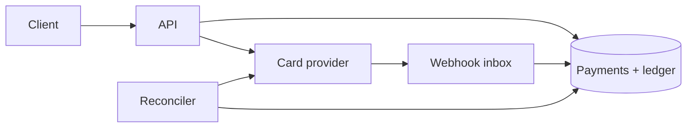

---
failureModes:
- A single balance column updated with last-write-wins.
- Calling the card network inside a database transaction that is holding row locks.
- A timeout treated as failure, so you charge again, or treated as success, so you ship without
  a capture.
- No ledger, so you cannot explain why a balance is what it is.
sayThis:
- I append ledger entries. The balance is a sum, or a cached sum I can rebuild. I do not update
  a balance in place as the only record.
- The charge uses an idempotency key I send to the provider and store myself. A timeout puts
  the payment in unknown, and I reconcile. I do not blindly retry with a new key.
- Authorization and capture can be separate. Fulfillment waits until the state I consider
  paid.
gaps:
- The public payment breakdown is paywalled. Free materials mention idempotency and stop before
  double-entry, unknown states, and webhooks that arrive twice.
- Refunds are a new ledger movement, not a delete. That is obvious to payments engineers and
  surprisingly easy to omit.
- 'This note is the one you can tie to high-volume order systems: retries only exist because
  the ledger makes them safe.'
references:
- title: Hello Interview, public payment outline (article may be paywalled)
  url: https://www.hellointerview.com/learn/system-design/problem-breakdowns/payment-system
- title: These notes, idempotency and retries
  url: /helpmeprep/system-design/idempotency
- title: Stripe, idempotent requests
  url: https://docs.stripe.com/api/idempotent_requests
quiz:
- kind: mc
  question: The provider times out. What state is the payment in?
  choices:
  - Definitely failed. Charge again with a new key.
  - Unknown. Look it up by the same idempotency key or reconcile before you charge again.
  - Definitely succeeded. Ship the goods.
  - Deleted.
  answer: 1
  explain: Timeout means you do not know. The key exists so the lookup and the retry are the
    same operation.
- kind: mc
  question: 'A balance should be:'
  choices:
  - A column you overwrite.
  - Derived from immutable ledger entries, with a snapshot for speed if you want one.
  - A Redis key only.
  - The HTTP status of the last request.
  answer: 1
  explain: The ledger is the history. A stored balance is a cache of that history and must
    be rebuildable.
- kind: short
  question: What is a double-entry movement?
  reveal: A charge credits a clearing account and debits the customer's receivable, or the
    equivalent in your chart of accounts, in one transaction. You do not insert a single 'plus
    10' row with no counterpart. Refunds are a reversing pair, not a destroyed row.
title: Payment system
description: Move money with a ledger, idempotent charges, and a clear story for the provider
  timing out.
track: system-design
section: Worked problems
order: 620
---

## What you are designing

Customers pay for something you sell. You record the intent, talk to a card or bank provider, and update an internal ledger. Assume you are not a bank with a banking license's full problem set, but you are responsible for not double-charging and for being able to explain a balance. Peak is bursty (a sale). The provider is slow and sometimes silent.

## Requirements

- Create a payment once, despite client retries.
- Know whether it is pending, authorized, captured, failed, or unknown.
- Refund a captured payment once.
- Produce a balance and a history that survive a bug in the cache.

Losing a request is acceptable. Losing track of a request is not.

## Entities and API

`Payment(id, idem_key, amount, state, provider_ref)`, `LedgerEntry(id, payment_id, account, amount, direction)`, `WebhookEvent`.

```text
POST /v1/payments          Idempotency-Key, { amount, currency, method }
POST /v1/payments/{id}/refund
GET  /v1/payments/{id}
POST /v1/provider/webhooks
```

Create requires `Idempotency-Key`. The same key and the same body replay the stored response, including a decline. The same key and a different body is 409, not a second charge. Refund uses its own key. Reusing the capture key would make a retry of the refund look like a replay of the capture. Webhooks are authenticated and deduped on the provider event id. A duplicate webhook returns 200 and does not append another ledger line. GET is safe to poll while the state is `unknown`.

## High-level design



Create inserts the payment in `pending` with the idempotency key, commits, then calls the provider with that key. You update state from the response. Webhooks are a second delivery of the same fact, deduped by provider event id. A reconciler lists provider payments that are newer than your last sync and repairs `unknown`.

## Data model

```sql
CREATE TABLE payments (
  id           BIGSERIAL PRIMARY KEY,
  owner_id     BIGINT NOT NULL,
  idem_key     TEXT NOT NULL,
  amount_cents BIGINT NOT NULL,
  currency     TEXT NOT NULL,
  state        TEXT NOT NULL,
  provider_ref TEXT,
  UNIQUE (owner_id, idem_key)
);
CREATE TABLE ledger_entries (
  id          BIGSERIAL PRIMARY KEY,
  payment_id  BIGINT NOT NULL,
  account     TEXT NOT NULL,
  amount_cents BIGINT NOT NULL,
  direction   TEXT NOT NULL, -- debit | credit
  UNIQUE (payment_id, account, direction)
);
```

Amounts are integers of minor units. Never floats. The unique keys make the retry and the webhook safe.

## Deep dives

**The unknown state.** On timeout, set `unknown` and call the provider's fetch-by-key before you try again. If they have it, adopt that result. If they do not, you may retry the same key. A new key is a second charge. Fulfillment (shipping, granting credits) subscribes to `captured`, not to "we sent the HTTP request."

**Ledger.** On capture, insert the balanced pair in the same transaction as the state change. A refund inserts the opposite pair and a refund payment row. A balance query sums entries or reads a snapshot that stores the last entry id it includes. If the snapshot disagrees with the sum, the sum wins and you alarm.

**Webhooks.** Verify the signature. Insert the event id. If the insert conflicts, ack and do nothing. Apply the state transition with a conditional (`WHERE state IN (...)`) so an old webhook cannot move a refunded payment back to captured.

**Internals you refuse.** Do not hold locks across the provider call. Do not let the client pick the amount from a hidden field you did not recompute. Do not log the full card number. PCI scope stays at the provider's hosted fields if you can; say that you tokenize.

## Levels

- **Mid-level.** Idempotency key, payment states, a provider call outside the DB transaction, integer money.
- **Senior.** Unknown and reconcile, ledger entries, webhook dedup, refunds as new movements.
- **Staff.** Fulfillment coupling, multi-currency rounding, dispute and chargeback as another state, and what you do when the provider is down (queue captures you already authorized, stop new checkouts).
