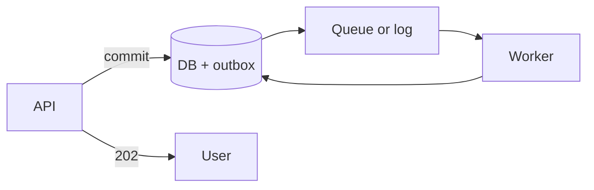

---
failureModes:
- Assuming a queue gives you exactly-once processing. It gives you a record you can retry.
  Your consumer makes the effect once.
- A consumer that acks before the side effect, so a crash drops the work.
- An unbounded queue that hides a downstream outage until the disk fills and the producer
  falls over.
- 'Using a log where you needed a work queue: a million consumers cannot ''pop'' the same
  Kafka partition.'
sayThis:
- The HTTP request writes the row and an outbox, returns 202, and a consumer does the slow
  part. The user is not waiting on a receipt email.
- Kafka is a log. I keep ordering inside a partition, and I key by the id that must stay ordered.
  A task queue is how I hand a job to exactly one worker.
- I will ack after the database commit. The worst case is a retry, and the consumer is idempotent.
gaps:
- The public technology map lists 'queue' and 'streams' as boxes and teaches Kafka in a deep
  dive. The conceptual split (work queue versus replayable log) is the part candidates muddle,
  and it is not a free concept page.
- Backpressure is rarely practiced. A queue without a limit is a slow leak. This page makes
  the limit part of the design.
- Ordering, delay, and dead-letter behavior get one sentence each in most primers. They are
  the follow-up questions.
references:
- title: Hello Interview, public Kafka deep dive
  url: https://www.hellointerview.com/learn/system-design/deep-dives/kafka
- title: Kafka documentation, introduction
  url: https://kafka.apache.org/documentation/#introduction
quiz:
- kind: mc
  question: You need each job handled by one worker, with retries and a delay. What fits?
  choices:
  - A Kafka topic with ten consumer groups all running the same logic.
  - A task queue (SQS, Redis streams consumed by one group, a jobs table with SKIP LOCKED).
  - A pub/sub fan-out to every server.
  - A CDN.
  answer: 1
  explain: A work queue delivers a job to one consumer. Kafka's unit of parallelism is the
    partition, and a second consumer group is a second copy of the whole stream, not a way
    to steal one message.
- kind: mc
  question: When should the consumer acknowledge?
  choices:
  - The moment it receives the message, to keep lag pretty.
  - After the side effect commits, so a crash retries.
  - Never. Acknowledgement is optional.
  - Before deserializing, in case the payload is poison.
  answer: 1
  explain: Ack after success. Poison messages need a retry limit and a dead-letter path or
    one bad payload blocks the partition.
- kind: short
  question: What is backpressure here?
  reveal: 'A signal that the consumer is behind: queue depth, consumer lag, or a full bounded
    buffer. The producer slows, sheds low-priority work, or returns 429. Without it the queue
    grows until it becomes the outage.'
title: Queues and streams
description: When to put a queue between two steps, how Kafka differs from a task queue, and
  the delivery guarantee you can honestly claim.
track: system-design
section: Core concepts
order: 130
---

A queue lets the producer finish without waiting for the slow step. That is the entire product reason. Everything else is about not losing, reordering, or infinitely buffering the work.

## Two different tools

A **work queue** (SQS, a Redis list, a Postgres table claimed with `FOR UPDATE SKIP LOCKED`) hands each job to one worker. If the worker dies, the job becomes visible again after a visibility timeout or a lease. You get competing consumers, delays, and a dead-letter queue.

A **log** (Kafka, Kinesis, Pulsar) appends records to a partition and keeps them. Consumers track an offset. Many consumer groups each see every record. Ordering holds inside a partition, so you key by the entity that must not be reordered (the account, the conversation). You can replay yesterday. You cannot easily say "give this one record to one of fifty workers" without extra machinery, because a partition has one active consumer inside a group.

Use the log when more than one system wants the same facts, or you want replay. Use the work queue when you want a job done once.

## Delivery, said honestly

**At-most-once:** ack first, then work. You can lose jobs. **At-least-once:** work, then ack. You can see a job twice. **Exactly-once** is a property of the outcome, not of the queue. You get it by making the consumer idempotent: a unique key, a transaction that writes the offset and the result together, or a dedup table. Say "at-least-once plus idempotent consumer." Do not say "Kafka is exactly-once" and stop.

## Operational basics

Bound the queue. Alert on age of the oldest message, not only on depth. A deep queue of fresh work is scale. A short queue of hour-old work is a stuck consumer.

Retries need a cap and a dead-letter destination. A poison message that always throws will stall a Kafka partition if you refuse to move past it. Move it aside and page a human.

Delay and priority are easy in a purpose-built queue and awkward in a plain log. If the product is "run this in an hour" or "premium customers first," say so when you pick the tool.

