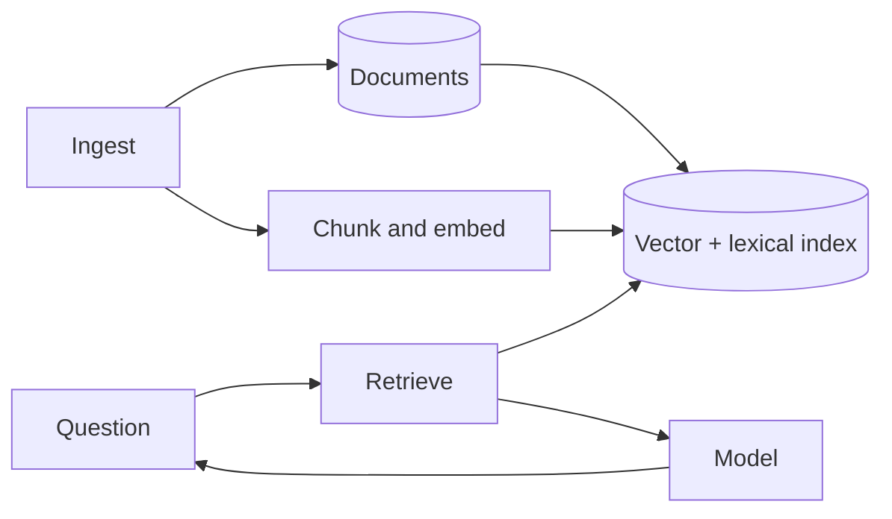

---
failureModes:
- A retrieval miss that the model fills in from its priors, presented as if it were cited.
- Chunking so large or so small that the right fact is never in the top K.
- An index that lags the source of truth, so the assistant quotes a policy you retracted.
- Putting the entire corpus in the prompt because the index was annoying.
sayThis:
- Ingest writes the source document, chunks it, embeds the chunks, and indexes them. The question
  path embeds the query, retrieves top K, and only then calls the model, with the chunks as
  cited context.
- If the top score is below a threshold, I refuse. A wrong answer is worse than no answer
  for this product.
- The index is derived. I can rebuild it. The document store is the source of truth, and deletes
  have to remove chunks.
gaps:
- RAG is not a free classic breakdown. Public ChatGPT-style chapters, when visible at all,
  blur 'the model knows it' and 'we retrieved it.' The refuse path, the citation check, and
  index freshness are the parts that make a RAG system production rather than a demo.
- Hybrid lexical plus vector retrieval is the usual fix for names and error codes, and it
  is easy to forget if you only draw a vector database.
- This note includes an evaluation set. A RAG system you cannot score will silently rot the
  first time you change a prompt.
references:
- title: These notes, vector databases
  url: /helpmeprep/system-design/vector-dbs
- title: pgvector
  url: https://github.com/pgvector/pgvector
quiz:
- kind: mc
  question: 'The model should be called:'
  choices:
  - Before retrieval, so it can guess which document to open.
  - After retrieval, with the retrieved chunks in the prompt and instructions to cite them
    or refuse.
  - Instead of retrieval, because scale is the model's job.
  - On every chunk in the corpus.
  answer: 1
  explain: Retrieval narrows the context. The model writes from that context. Calling it on
    the whole corpus does not fit.
- kind: mc
  question: A deleted policy still shows up in answers. What failed?
  choices:
  - TCP.
  - The derived index still contains chunks from a document the source marked deleted. Deletes
    must propagate, ideally via the outbox, and the cache must drop.
  - The CDN cached the user's password.
  - CAP requires it.
  answer: 1
  explain: The index is not the source of truth. Deletion is a pipeline, not only a row update.
- kind: short
  question: Why a confidence threshold?
  reveal: Similarity always returns neighbors, even when none of them answer the question.
    Below a threshold you respond that you do not know, or you ask a clarifying question.
    You pick the threshold on a labeled set of questions, not by vibes, and you recheck it
    when the embedder changes.
title: RAG system
description: 'Answer questions from a corpus you control: ingest, chunk, retrieve, generate,
  and refuse when the corpus does not support an answer.'
track: system-design
section: Worked problems
order: 660
---

## What you are designing

People ask questions against a corpus you own: internal docs, tickets, a knowledge base. The system retrieves relevant passages and a model writes an answer grounded in them. Assume the corpus is large enough that you cannot put it in the prompt, it changes daily, and a confident wrong answer is worse than a refusal. This is the shape of an internal assistant, not a pretraining run.

## Requirements

- Ingest a document, update it, and delete it, and have answers follow within a stated lag (minutes, not weeks).
- Answer with citations to passages, or refuse.
- Isolate tenants so one customer's documents are invisible to another.
- Measure answer quality on a fixed eval set.

Latency of a few seconds is acceptable for an assistant. Sub-100 ms is not the goal and should not drive you to skip retrieval.

## Entities and API

`Document`, `Chunk(doc_id, offset, text, embedding, model_version)`, `QueryLog`, `EvalItem`.

```text
POST /v1/documents
DELETE /v1/documents/{id}
POST /v1/answers          { question } -> { answer, citations[] } or a refusal
```

Document create returns 202 until chunks are embedded. The answer path must not retrieve a document that is still pending, or you will cite text you have not indexed. Delete removes the chunks and the vectors before it returns 204. A later answer that cites a document the user just deleted is a trust bug, not a stale cache you can shrug at. The answer call returns 200 with citations, or 200 with a refusal and an empty citation list. "I don't know" is not a 500. Log the question either way so the eval set can grow.

## High-level design



Ingest stores the original, splits it into chunks with overlap, embeds each chunk with a recorded model version, and upserts the index through an outbox so a crash can resume. The query embeds with the same model, runs a hybrid search constrained to the tenant, drops weak scores, and sends the remaining passages to the model with instructions to cite chunk ids. The response includes those ids. A second check can verify each cited span actually occurs in the chunk.

## Data model

```sql
CREATE TABLE chunks (
  id            BIGSERIAL PRIMARY KEY,
  tenant_id     BIGINT NOT NULL,
  document_id   BIGINT NOT NULL,
  ordinal       INT NOT NULL,
  text          TEXT NOT NULL,
  model_version TEXT NOT NULL
);
CREATE INDEX chunks_tenant_doc ON chunks (tenant_id, document_id);
```

The embedding lives in pgvector or a vector engine, keyed by chunk id. Tenant id is a filter on every search. The document table is the source of truth you re-chunk from.

## Deep dives

**Chunking.** Too big and the embedding averages unrelated paragraphs. Too small and you lose the condition of a rule ("unless the user is an admin"). Overlap by a sentence. Store offsets so the citation can highlight. This choice moves quality more than the brand of the vector database.

**Retrieval.** Hybrid: BM25 for exact tokens (error codes, names) and ANN for paraphrases, merged with reciprocal rank fusion, then a small rerank if you have the latency. Mandatory tenant filter. See the vector page for why a selective filter breaks post-filtering. Version the embedder and do not mix vectors.

**Refuse and evaluate.** Keep a labeled set: question, relevant chunk ids, and whether a refusal is the right answer. On every prompt or model change, run it. Track hit rate of the right chunk in the top K, and how often a cited span is not a substring of the chunk (a hallucination check you can do without a human). Threshold the retrieval score using that set.

**Freshness and abuse.** Deletes and permission changes must remove or hide chunks before the next query, or the lag must be stated. Documents are untrusted data: they can contain "ignore previous instructions." The system prompt and the chunk text stay in separate roles, and the model is not given tools that move money.

## Levels

- **Mid-level.** Ingest, chunk, embed, retrieve, generate, tenant filter, source of truth named.
- **Senior.** Hybrid search, refusal threshold, delete propagation, citation check, embedder versioning.
- **Staff.** Eval set and what you will not ship without it, cost per question, and how a bad document is quarantined without rebuilding the world.
