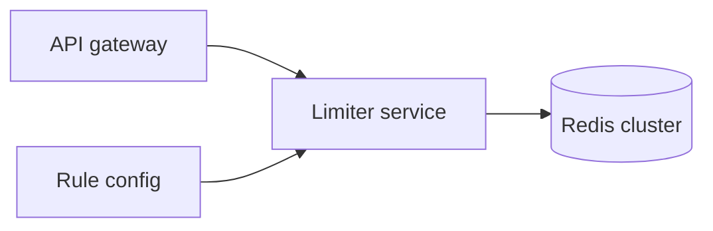

---
failureModes:
- A check and an increment that are not atomic, so two requests both observe one slot left.
- One Redis key for a huge tenant, so the limiter becomes the outage.
- Limiting per server and accidentally multiplying the budget by the fleet size.
- Failing open on a login route when the limiter store is down.
sayThis:
- Token bucket per key, stored in Redis, mutated in one script. The gateway asks on each request
  and returns 429 with Retry-After.
- I will shard a hot key's bucket only if I can tolerate a small overshoot, and I will not
  do that for authentication.
- If Redis is unreachable I fail closed for auth and fail open for a cached product read,
  and I say which one this limiter is.
gaps:
- Public rate-limiter breakdowns focus on the algorithm and Redis. Multi-dimensional limits
  (per user and per IP and a global budget) and cost-based limits for tokens are thinner.
- The failure mode of the limiter itself (store down, hot key, clock skew) is the senior deep
  dive and is easy to skip once the Lua script is mentioned.
- This note ties the answer to the concept page so you do not redesign sliding windows from
  scratch if the interviewer wants the distributed question.
references:
- title: Hello Interview, public rate-limiter breakdown
  url: https://www.hellointerview.com/learn/system-design/problem-breakdowns/distributed-rate-limiter
- title: These notes, rate limiting
  url: /helpmeprep/system-design/rate-limiting
quiz:
- kind: mc
  question: Why a Lua script or a single INCR, not GET then SET?
  choices:
  - Lua is faster at parsing JSON.
  - Two clients can both read 'under limit' and both write 'allowed.' The update has to be
    one atomic step.
  - Redis cannot GET.
  - It encrypts the key.
  answer: 1
  explain: The race is the bug. Atomicity is the fix.
- kind: mc
  question: 'A global API has 50 gateway machines with an in-memory counter of 100 per minute.
    A client can send:'
  choices:
  - 100 per minute.
  - About 5,000 per minute if they spread across machines.
  - 1 per minute.
  - Unlimited only during deploys.
  answer: 1
  explain: Local counters multiply. Shared state, or an accepted overshoot you quantify, is
    required.
- kind: short
  question: What do you return when the limit is exceeded?
  reveal: HTTP 429 and Retry-After set from the bucket's next refill. Log the key and the
    rule id. Do not return 500, and do not include a body that invites an immediate retry
    loop.
title: Rate limiter
description: A service other teams call to decide if this request is allowed, correctly, under
  race and failure.
track: system-design
section: Worked problems
order: 580
---

## What you are designing

Every request to an API should be allowed or rejected based on a rule: 100 requests per minute per token, 5 login attempts per minute per IP, a global budget for a scarce downstream. The limiter must be correct under concurrency and must not become slower than the API it protects. Assume tens or hundreds of thousands of checks per second and many millions of distinct keys.

## Requirements

- Decide allow or deny for a named key and a named rule, in about a millisecond.
- Rules can be per user, per IP, per API key, and global.
- A small burst is allowed; the sustained rate is not.
- Callers learn when to retry.

Correctness here means "not wildly over the budget," unless the rule is a security control, in which case overshoot should be near zero.

## Entities and API

`Rule(id, limit, window or refill rate, capacity)`, `Decision`.

```text
POST /v1/limits/check   { rule_id, key, cost? } -> { allowed, retry_after_ms }
```

`cost` defaults to 1. For an LLM proxy, cost is tokens.

## High-level design



The gateway authenticates first, then checks the limit, then forwards. Rules live in config and cache locally. Counters live in Redis so every gateway sees the same bucket. The concept page has the algorithms; use a token bucket unless they ask you to compare.

## Data model

Redis key `rule:{id}:bucket:{key}` holds tokens and a last-refill timestamp. The script:

1. Refill `min(capacity, tokens + elapsed * rate)`.
2. If tokens >= cost, subtract and allow.
3. Else deny and return how long until one token exists.

That is one round trip. The durable audit, if you need it, is a sample of denials in a log, not a row per check.

## Deep dives

**Hot keys.** A single global bucket is one Redis slot. Replica reads do not help because every check writes. Split into N buckets and allow if the sum of takes stays under N times the per-bucket rate, accepting that the split is approximate, or serialize the global budget through one key and admit that its QPS ceiling is the ceiling of the rule. For a per-user key the natural cardinality already spreads load.

**Failure.** If Redis times out, the limiter must choose. Security rules fail closed (deny, or a very small local allowance). Product reads can fail open for a short circuit-breaker window and page a human. Do not hide this behind "Redis is highly available."

**Multiple rules.** A request may consume a user budget and an IP budget. Check the stricter dimension first or check both in a pipeline, and only consume if all allow, so a deny on the second rule does not burn the first. Say that you refund or that you check without consuming and then commit, atomically per key as far as Redis lets you.

**Clocks.** Refill uses the Redis server time, not the client, so skewed gateways do not mint tokens.

## Levels

- **Mid-level.** A shared counter, atomic update, 429 with Retry-After, token bucket or sliding window with the boundary flaw named.
- **Senior.** Hot key, fail-open versus fail-closed, cost greater than one, several rules on one request.
- **Staff.** Accuracy versus the Redis budget, multi-region (a user hopping regions can double-spend a local bucket unless you accept that or pin a home region), and how other teams define rules without shipping your service.
