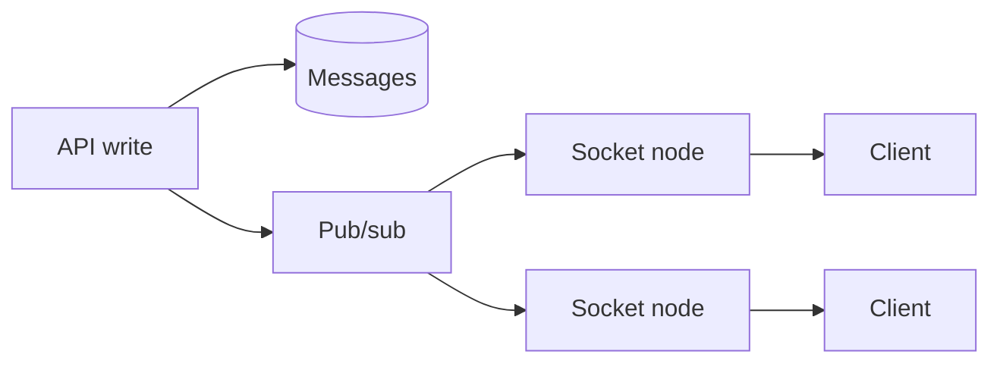

---
failureModes:
- A reconnect that replays the entire history, or one that misses the messages sent during
  the gap.
- Sticky sessions with no resume path, so a deploy drops every chat client.
- One process holding the socket and also owning the data, so you cannot scale either.
- Polling so aggressively that it costs more than a push channel would have.
sayThis:
- I will start with short polling if the update can wait a second. I will move to SSE if the
  server is the only one talking, and WebSockets if both sides talk often.
- The socket tier is dumb. It subscribes to a channel for this user. Any API server can publish
  to that channel.
- The client resumes from the last sequence number. The server replays the gap or tells the
  client to refetch.
gaps:
- The public pattern article is paywalled. The free networking page names SSE and WebSockets
  and does not design the subscription tier, the cursor, or presence.
- Polling is treated as the naive answer to abandon. For many products a one-second poll is
  the right v1, and saying so is a sign of judgment.
- Ordering across devices and the 'missed message while offline' path are the chat follow-ups
  this pattern has to include.
references:
- title: Hello Interview, public real-time pattern outline (article may be paywalled)
  url: https://www.hellointerview.com/learn/system-design/patterns/realtime-updates
- title: MDN, server-sent events
  url: https://developer.mozilla.org/en-US/docs/Web/API/Server-sent_events
quiz:
- kind: mc
  question: Which design lets any API server notify a user connected to a different socket
    server?
  choices:
  - In-memory maps only.
  - Socket servers subscribe to a shared pub/sub channel per user or conversation.
  - Sticky load balancing alone.
  - A database trigger that writes to the socket.
  answer: 1
  explain: The connection is local. The event bus is shared. Stickiness without a bus dies
    on deploy.
- kind: mc
  question: A client reconnects. What should it send?
  choices:
  - Nothing. The server remembers every TCP connection forever.
  - The last sequence or event id it applied, so the server can replay or refuse and force
    a refetch.
  - Its password.
  - A request to rebuild the world from offset zero every time.
  answer: 1
  explain: The cursor makes reconnects correct. Replaying from zero is how you duplicate messages
    in the UI.
- kind: short
  question: When is polling the right answer?
  reveal: When a second of staleness is fine, the client count is modest, and you want to
    ship today. Poll with a backoff, and use conditional requests so an unchanged resource
    is cheap. Switch to push when the poll QPS or the latency requirement stops fitting.
title: Real-time updates
description: 'How a client learns that something changed: polling, SSE, WebSockets, and the
  fan-out behind them.'
track: system-design
section: Patterns
order: 400
---

"Real-time" means the user sees a change without refreshing, within a bound you state (a second for chat, a few seconds for a dashboard). The transport is the easy part. The hard part is getting the event to the right connection and not losing the ones that happen during a reconnect.

## Choose a transport

**Polling.** The client asks on an interval. Simplest. Wasteful if almost nothing changes, and perfectly fine if you say "every two seconds is acceptable" and the numbers work. Conditional GETs and long polling (the server holds the request until there is news or a timeout) are the grown-up versions.

**SSE.** One HTTP response that stays open and carries events. Works with ordinary infrastructure. The client reconnects with `Last-Event-ID`. Use it when the server pushes and the client sends ordinary HTTP for its actions.

**WebSockets.** Both directions, one connection. Use it for chat, cursors, and games. You now operate a long-lived connection fleet: heartbeats so dead clients go away, a load balancer that does not idle-timeout the socket, and a plan for deploys.

## The fan-out

Do not store "which socket" inside the database row. The API writes the durable event (the message row), then publishes a thin notification (`conversation_id`, `sequence`) on Redis pub/sub, NATS, or a Kafka topic. Each socket server subscribes to the conversations its local clients care about and writes to those sockets. Any API instance can publish. Any socket instance can deliver.

Presence ("is this user online?") is a lease in Redis, refreshed by the heartbeat, not a boolean in Postgres you update on every packet.

## Correctness

Give events a per-conversation sequence. The client applies them in order and asks for the gap if it sees a skip. On reconnect it sends the last applied sequence. If the gap is still in the hot log, replay it. If not, the client refetches the resource. That is the whole reliability story, and it is the same story on mobile networks that drop constantly.

