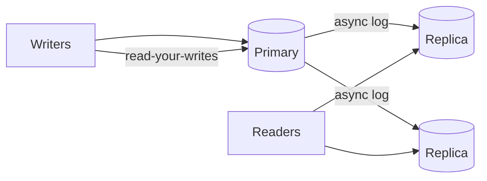

---
failureModes:
- Reading your own write from a lagging replica and showing the user a success that then disappears.
- Promoting a replica that was not fully caught up, and silently dropping the last seconds
  of commits.
- A replication topology with no monitoring on lag, so the failover is the way you discover
  it.
- Using replicas as backup. A bad UPDATE replicates too. Backups are a separate, restore-tested
  path.
sayThis:
- The primary takes writes. Replicas are asynchronous, so I will send a user back to the primary
  for a few seconds after they write, or read from the primary on that key.
- Failover is a new primary plus a way for clients to find it. I care about who is allowed
  to promote, and whether we wait for a quorum.
- Replicas scale reads. They do not scale writes. If the primary's write disk is full, another
  reader does not help.
gaps:
- The free public sidebar has no replication page. Replication is scattered across CAP, sharding,
  and technology reviews, so candidates say 'I'll add replicas' without a lag or failover
  sentence.
- Sync versus async is the whole product trade-off (lost writes versus slow writes) and deserves
  its own minute. Quorum replication (R + W > N) is usually left inside a Dynamo chapter.
- Backups versus replicas are constantly confused. This page separates them.
references:
- title: Hello Interview, public CAP theorem (consistency versus availability)
  url: https://www.hellointerview.com/learn/system-design/core-concepts/cap-theorem
- title: Postgres, high availability and replication
  url: https://www.postgresql.org/docs/current/high-availability.html
quiz:
- kind: mc
  question: Async replicas primarily buy you what?
  choices:
  - More write throughput on the primary.
  - Read scale and a failover candidate, at the cost of lag.
  - Strong linearizability for all readers.
  - A substitute for backups.
  answer: 1
  explain: The primary still serializes writes. Readers can go to replicas. They might be
    behind. A dropped replica is not a point-in-time backup.
- kind: mc
  question: A user posts and immediately refreshes, and the post is missing. What is the likely
    cause?
  choices:
  - The CDN ate the POST.
  - The read went to a replica that had not applied the commit.
  - B-trees cannot store text.
  - The load balancer cached a 404.
  answer: 1
  explain: Read-your-writes is broken by lag. Route that user to the primary briefly, or include
    the new row from the write response so the client does not need to reread.
- kind: short
  question: What does synchronous replication cost?
  reveal: The primary does not acknowledge until a replica has the commit. You lose less data
    on failover. You add replica latency to every write, and a dead replica can stall writes
    unless you have a quorum rule that allows a different replica to take its place.
title: Replication
description: 'Copies of data for failover and for read scale: sync versus async, lag, and
  what ''the primary died'' actually looks like.'
track: system-design
section: Core concepts
order: 100
---

Replication copies a log of changes from a primary to one or more standbys. You do it for two different reasons, and the configuration is not the same.

## Read scale

Send reads that tolerate staleness to replicas. Listing a restaurant's menu, a public profile, a search result: fine. Send the read that follows a user's own write to the primary, or pin that session to the primary for a second. Replica lag of hundreds of milliseconds is normal. Lag of minutes is an incident, and you only know if you graph it.

Replicas do not make writes faster. Every write still hits the primary's log.

## Failover

A replica can be promoted when the primary is dead. The dangerous moment is split brain: two nodes both accept writes. Fencing (the old primary cannot write once it is demoted; a token or a STONITH step) matters more than the election algorithm. Say who forms a quorum. A primary plus one replica cannot elect anyone if they cannot talk; you wanted three nodes, or an external witness.

Asynchronous replication means the acknowledged write might not be on any replica yet. A crash can lose those commits. Synchronous replication (or a quorum write) shrinks that window and adds latency. For money, lean synchronous or quorum. For a feed, asynchronous is usually the right call, and you say the loss window out loud.

## Quorum form

Dynamo-style systems skip a single primary. A write succeeds when W replicas accept it. A read succeeds when R respond. If R + W > N, a read sees the latest write in the absence of other failures. If not, you have a conflict-resolution story (last-writer-wins, vector clocks, or an application merge). Do not claim quorum and also claim you never resolve conflicts.

## What replication is not

It is not a backup. An operator's `DELETE` without a `WHERE` will be dutifully copied. Backups are snapshots plus a log you can restore to a timestamp, stored somewhere a bug cannot reach, and you have restored them once. Mention both if the data matters.

