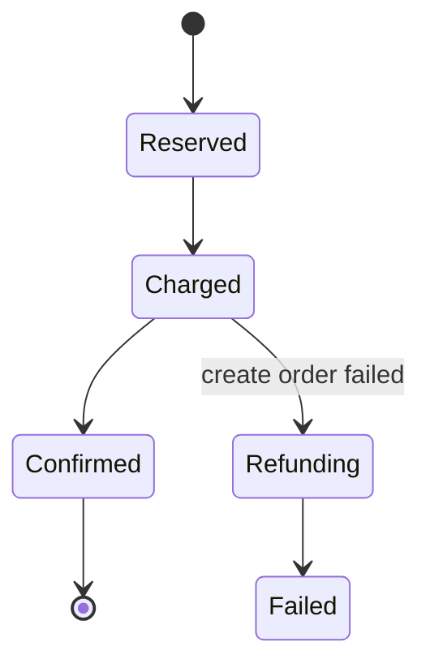

---
failureModes:
- A process that crashes after charging the card and before creating the order, with no record
  of either.
- A compensation that is not idempotent, so a retry refunds twice.
- A 'distributed transaction' via two-phase commit across services you do not operate, including
  a human and an LLM.
- No timeout on a step that waits for a person, so the workflow row lives in 'waiting' forever.
sayThis:
- Each step commits locally and records progress. If a later step fails, I run compensations
  for the steps that succeeded, in reverse. I do not hold locks across services.
- The workflow state lives in one table or one workflow engine. After a crash I resume from
  the last completed step.
- A compensation is a forward action, like a refund, not a time machine. I design it to be
  safe to run twice.
gaps:
- The public multi-step article is paywalled. Free delivery frameworks mention 'a queue' and
  stop. Orchestration versus choreography, and the compensation list, are the parts a payment
  or grading pipeline has to say out loud.
- Humans and models are steps with timeouts and a dead-letter path. Classic saga write-ups
  assume every step is a service that answers quickly.
- This page connects the saga to the outbox so 'record the decision' and 'emit the next command'
  cannot diverge.
references:
- title: Hello Interview, public multi-step outline (article may be paywalled)
  url: https://www.hellointerview.com/learn/system-design/patterns/multi-step-processes
- title: Hello Interview, public Temporal outline (article may be paywalled)
  url: https://www.hellointerview.com/learn/system-design/deep-dives/temporal
quiz:
- kind: mc
  question: Why not use two-phase commit across the payment provider and your database?
  choices:
  - 2PC is always faster.
  - You do not control the provider's prepare phase, and a coordinator failure leaves everyone
    stuck. A saga with compensation matches the APIs you actually have.
  - Payments are idempotent so order does not matter.
  - CAP forbids tables.
  answer: 1
  explain: Sagas accept a temporary inconsistent state and a compensating action. That is
    the tool you have. 2PC wants participants that can prepare and wait.
- kind: mc
  question: 'A compensation must be:'
  choices:
  - A DELETE that forgets the charge.
  - Idempotent and explicit, like 'refund payment p' recorded once.
  - Run only in memory.
  - Best-effort with no record.
  answer: 1
  explain: The process will retry the compensation after a crash. The second run must see
    'already refunded' and succeed.
- kind: short
  question: Orchestration versus choreography?
  reveal: 'Orchestration: one workflow owns the sequence and tells each service what to do
    next. Easier to read and to timeout. Choreography: each service emits events and others
    react. Looser coupling, harder to see the whole process and to know it is stuck. Prefer
    an orchestrator when the business process is the product (checkout, grading, onboarding).'
title: Multi-step processes
description: 'Sagas and workflows: how to finish a business process that spans several services
  without pretending you have a distributed transaction.'
track: system-design
section: Patterns
order: 460
---

A checkout charges a card, reserves stock, creates an order, and emails a receipt. Those steps do not share a transaction. A grading pipeline transcribes, scores, and asks a human. A crash in the middle is normal. A saga is the record of how far you got and what you will undo.

## The state

One row (or a workflow engine's history) holds the process id, the current step, and the ids of external effects you have already created (`payment_id`, `reservation_id`). Steps advance only by committing that row. You resume by reading it. If the state lives only in a process's memory, a deploy is data loss.

Write the transition and an outbox event in the same database transaction. A dispatcher delivers the command to the next worker. That way you never "charged the card" in memory and forgot to tell anyone.

## Forward and back

Each step is idempotent, keyed by the process id. Running "reserve stock" twice reserves once.

If step N fails for good, run compensations for N-1, N-2, … down to the start. A compensation is another step: refund this payment, release this reservation. It has its own idempotency key. Some steps cannot be compensated (an email already sent). Say so, and send a correction rather than pretending you rolled back.

Timeouts are steps. If a human does not answer in two days, the workflow takes the timeout branch. Without that branch the table fills with zombies.

## Orchestrator or events

An orchestrator (a service, or Temporal or a similar engine) makes the sequence readable and gives you timers, retries, and a UI for "what is stuck?" Choreography, where each service listens for events and emits more, fits when no team owns the whole process. It is harder to debug. For an interview, draw the orchestrator unless the company is clearly an event-driven platform. Name Temporal if you want a real engine; do not spend the interview re-deriving it.

Do not hold a database lock while you wait for a card network or a person. Record the intent, commit, and continue when the reply arrives.

