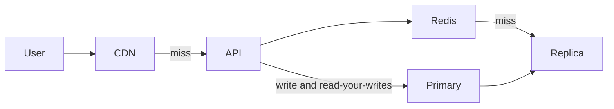

---
failureModes:
- Adding replicas and still sending every read to the primary out of habit.
- A cache with no TTL and no delete, serving last month's price.
- A CDN in front of a per-user response, with a cache key that ignores identity.
- Scatter-gather across shards with no deadline, so the slowest shard sets your p99.
sayThis:
- This is read-heavy. I will cache the hot set in Redis, put replicas behind the cache for
  misses, and keep the primary for writes and for read-your-writes.
- I cache the rendered public object, not the personalized page. The feed is assembled from
  cached posts plus the user's follow list.
- If a key is hot enough to melt one cache node, I replicate that key or I serve it from the
  edge.
gaps:
- The public pattern article is paywalled. Free caching and replication pages exist but do
  not give the order of operations, so candidates jump to sharding a read-heavy workload whose
  primary is bored.
- Request coalescing and stale-while-revalidate are the difference between a cache that survives
  expiry and one that causes the outage. They belong in this ladder.
- Indexing is a read-scaling technique and is omitted when the pattern is framed only as 'add
  Redis.' A missing index is not a capacity problem.
references:
- title: Hello Interview, public scaling-reads outline (article may be paywalled)
  url: https://www.hellointerview.com/learn/system-design/patterns/scaling-reads
- title: Hello Interview, public caching
  url: https://www.hellointerview.com/learn/system-design/core-concepts/caching
quiz:
- kind: mc
  question: 'The hot query is a sequential scan. The first fix is:'
  choices:
  - Shard the database.
  - Add the index the predicate needs, and confirm with a plan.
  - Put a CDN in front of Postgres.
  - Rewrite the service in a faster language.
  answer: 1
  explain: Sharding a sequential scan gives you several sequential scans. Fix the access path
    first.
- kind: mc
  question: 'Read replicas do not help when:'
  choices:
  - The product can tolerate a second of staleness and the primary CPU is spent on reads.
  - The primary is saturated by writes. Replicas do not take those writes.
  - You have a cache miss storm and the working set fits in Redis.
  - Both the cache and the replicas can serve the GET.
  answer: 1
  explain: 'Replicas scale reads. Write saturation needs a different move: fewer indexes,
    batching, or sharding writes.'
- kind: short
  question: Give the ladder in order.
  reveal: Index the query. Cache hot immutable or slowly changing reads. Add read replicas
    for the misses. Put a CDN in front of shared bytes. Shard only when a single primary cannot
    hold the working set or the write rate that comes along with the reads. At each step,
    say what staleness you just accepted.
title: Scaling reads
description: A ladder of techniques for a read-heavy system, in the order you should actually
  propose them.
track: system-design
section: Patterns
order: 430
---

Most product systems are read-heavy. The mistake is to shard immediately. Sharding is a write and data-size tool that makes reads more complicated. Climb this ladder and stop when the numbers work.

## 1. Make one read cheap

An index that matches the filter and the sort turns a scan into a handful of page fetches. A covering index avoids the table. This is not glamorous and it is often the whole interview. Check the plan before you draw a new datastore.

## 2. Cache the hot set

Cache-aside in Redis for objects many users read: a video's metadata, a short-link redirect, a public profile. TTL plus delete-on-write. Single-flight on miss so expiry is not a stampede. If the object is public and large, prefer the CDN and skip the application cache.

Do not cache per-user responses unless the hit rate is real. Cache the shared parts and assemble the page.

## 3. Replicas

Point cache misses at a replica. Keep the primary for writes and for the read that must see the write. Graph replica lag. A replica that is minutes behind is a second primary you have forgotten to feed.

## 4. Edge

Anything with a stable URL and the same bytes for everyone goes to the CDN. Version the URL so a publish is a new key, not a purge of every city. A public video segment and a versioned thumbnail belong here. A logged-in feed does not. If one object is hot enough to miss on every edge at once, put an origin shield in front of the app so those misses collapse. The CDN page is the list of responses that must stay uncached.

## 5. Only then, split

If the working set does not fit one machine, or a single key's reads melt one cache node, replicate that key or partition the dataset. Scatter-gather reads need a deadline and a policy for a shard that is down (fail the request, or return a partial result and say so).

At every step, state the staleness. "This cache can be 30 seconds old" is a design. "I added a cache" is a hope.

