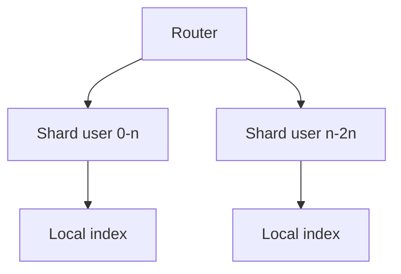

---
failureModes:
- 'A shard key that looks uniform and is not: one tenant, one celebrity, or one day of a time-partition
  that receives all current writes.'
- A cross-shard transaction you discover after you have promised a feature.
- Resharding by rewriting the world in one maintenance window.
- A secondary index that has to broadcast to every shard for a simple filter.
sayThis:
- Partitioning is the split. Sharding is when those partitions live on different machines.
  I need sharding when one machine cannot hold the writes or the working set, not because
  the slide deck says so.
- The shard key is the column every hot query already has. If I shard users by user_id, a
  query for 'all users in France' becomes a scatter-gather.
- I would range-partition the event log by time so I can drop old months, and hash-partition
  the user table so one week does not land on one disk.
gaps:
- Public sharding pages explain partition versus shard, key choice, hot spots, and cross-shard
  work. Online resharding and the cost of a global secondary index are easy to leave as a
  slogan.
- Time partitioning and hash sharding solve different problems and are often blended into
  'just shard it.' This page separates them.
- Geo-sharding (whose rows live on which continent) is a product decision about data residency
  and latency, not only a scale decision. Free write-ups treat geography as a latency footnote.
references:
- title: Hello Interview, public sharding
  url: https://www.hellointerview.com/learn/system-design/core-concepts/sharding
- title: Postgres, table partitioning
  url: https://www.postgresql.org/docs/current/ddl-partitioning.html
quiz:
- kind: mc
  question: You shard chats by conversation_id. Which query becomes expensive?
  choices:
  - Load one conversation's messages.
  - Show the inbox of all conversations for a user, if that list is not stored elsewhere.
  - Append a message to a known conversation.
  - Look up a message by its primary key, if the key contains the conversation id.
  answer: 1
  explain: The inbox spans conversations, so it spans shards. You keep a separate inbox row
    per user, or you accept a scatter.
- kind: mc
  question: All of today's orders hash to many shards, but one customer is 30% of traffic.
    What do you have?
  choices:
  - A perfect hash.
  - A hot shard key. Isolate that tenant or add a bucket suffix for them.
  - A reason to turn off indexes.
  - Replication lag.
  answer: 1
  explain: Hashing spreads keys, not popularity. A single heavy key still lands on one shard.
    Split that key or give the tenant a dedicated partition.
- kind: short
  question: What is the difference between a partition and a shard in one sentence?
  reveal: A partition is a logical slice of the data, often still on one machine (a monthly
    table). A shard is a partition placed on its own machine so CPU, disk, and connections
    scale out.
title: Sharding and partitioning
description: How to split data so one machine is not the ceiling, and the three ways that
  split punishes you later.
track: system-design
section: Core concepts
order: 90
---

One machine has a ceiling: disk, connections, write IOPS, and the time to rebuild a replica. Sharding raises the ceiling by putting different rows on different machines. It also makes some queries, transactions, and schema changes harder. Propose it when you can point at the ceiling, not as a default.

## Partition first

Partitioning splits a table inside one database. The common case is time: each month of events lives in its own partition, queries include the month, and dropping a year is a metadata operation. This does not add write throughput beyond one machine. It does make retention and backups sane. Say "partition" when you mean this, and "shard" when you mean separate servers.

## The key

The shard key is a column (or columns) present in the hot path. All rows with the same key live together.

- **Hash.** Spreads keys evenly. Range queries on the key become scatter-gather. Good for user ids.
- **Range.** Keeps ranges together, which is what you want for time series and for "scan this customer's timeline." The newest range is often the hot one.
- **Directory.** A lookup table maps key to shard. Flexible, and the directory is now a dependency.
- **Geo.** Pin a user's rows to a region for latency or residency. Cross-region features become explicit.

If you cannot name the key, you are not ready to shard.

## What gets worse

**Hot keys.** Even a good hash has celebrities. Measure, then isolate them: a bucket suffix (`artist_id#0` … `#15`) with a merge on read, or a dedicated shard.

**Cross-shard queries.** Fan out, merge, and put a deadline on it. If the product cannot work without a global sorted query, maintain a separate index or accept that this query is approximate.

**Cross-shard transactions.** Avoid them. Place rows that must commit together on the same shard (the tenant id, the conversation id). If you cannot, you have a saga.

**Resharding.** Doubling the cluster with consistent hashing moves about half the keys once, not all of them. Moving them is still an online job: copy, catch up a changelog, flip a directory, delete the old copy. "We will reshard over a weekend" is not a plan at this size.

**Secondary indexes.** A global index is itself a distributed system. A local index on each shard only answers queries that already know the shard. Pick one and say which queries it serves.

