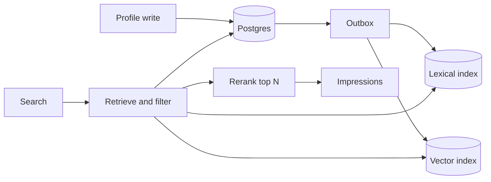

---
failureModes:
- A selective filter applied after vector search, so the right expert is never in the neighbor
  list.
- An index that lags the profile edit, so a banned expert still appears.
- A feedback loop that only shows the experts who were shown last week, so new experts never
  get a hire.
- An LLM reranker that obeys instructions hidden in a resume.
sayThis:
- I retrieve with filters plus BM25 plus a vector index, merge to a few hundred, then rerank.
  I do not ask a model to scan ten million profiles.
- Postgres is the source of truth. Search and vectors are derived, fed by an outbox, and rebuildable.
- I will log the features on the shown list so I can evaluate ranking against later hires,
  and I will explore new experts so the loop does not freeze.
gaps:
- Marketplace search is not a public classic problem (proximity and post search are the nearest
  free cousins). Filtered ANN, cold start, and hire-based evaluation are the actual product,
  and they are absent from a generic 'design search' answer.
- Prompt injection via resumes is a security bug in the ranker, not a curiosity. Classic search
  chapters do not mention it.
- 'This note matches the way you should talk about expert search: tables and indexes first,
  models second, and a metric that is a hire, not a click.'
references:
- title: These notes, indexing
  url: /helpmeprep/system-design/indexing
- title: These notes, vector databases
  url: /helpmeprep/system-design/vector-dbs
- title: These notes, Elasticsearch
  url: /helpmeprep/system-design/elasticsearch
quiz:
- kind: mc
  question: Where is the source of truth for an expert's skills?
  choices:
  - Only in the vector index.
  - In a relational table you can constrain and join. The vector index is a derived view.
  - In the prompt cache.
  - In the CDN.
  answer: 1
  explain: You will query 'skill = rust and level >= 4' transactionally. That is SQL. Embeddings
    help recall, they do not replace the predicate.
- kind: mc
  question: 'A very selective filter (one rare skill, one country) on a vector index often:'
  choices:
  - Improves recall automatically.
  - Returns too few hits if you search neighbors first and filter after, because the true
    matches were not geometric neighbors.
  - Disables BM25.
  - Shards itself.
  answer: 1
  explain: Say pre-filter versus post-filter. For rare structured constraints, filter first.
- kind: short
  question: How do you know the ranker got better?
  reveal: Offline, NDCG or recall against a set of roles that ended in a hire or a strong
    human yes. Online, a guarded experiment on interview rate or hire rate, not on click rate
    alone. Log the feature vector with the impression so you can rebuild the comparison.
title: Talent marketplace matching
description: Search and rank vetted experts against a role, from structured filters through
  retrieval to a rerank you can explain.
track: system-design
section: Worked problems
order: 680
---

## What you are designing

A company posts a role: skills, hours, rate, location constraints. You return a page of vetted experts who fit, best first, in under a second. Assume on the order of ten million profiles, edits every day, and that 'best' eventually means 'likely to be hired,' not 'text looks similar.' New experts have no hire history.

## Requirements

- Filter by hard constraints (skill, level, rate ceiling, work authorization).
- Rank the survivors.
- Reflect a profile edit or a ban within a short, stated lag.
- Explain a result well enough that a recruiter trusts it (matched skills, not a mystery score).

A missing great candidate is bad. Showing a banned expert, or the wrong person's private data, is worse.

## Entities and API

`Expert`, `Skill(expert_id, skill, level)`, `Role`, `Impression(role_id, expert_id, features, position)`, `Outcome(impression, hired)`.

```text
POST /v1/roles/{id}/search     { filters, cursor } -> ranked experts
PATCH /v1/experts/{id}         profile edits
```

Search is a POST because the filter body does not belong in a cacheable query string, and it is still safe to retry. The cursor is opaque and tied to one ranking snapshot. Offset pagination will show the same expert twice when someone edits a profile mid-scroll. A banned expert is absent even if the index still contains them, so the serve path checks the ban and does not wait for the next index build. Profile PATCH authorizes the caller against that expert id. Another person's id is 403.

## High-level design



Hard filters hit Postgres or the lexical index, not the vector index alone. You merge that set with a vector neighborhood and a BM25 hit list, dedupe, take a few hundred, and rerank with features you can name: skill overlap, rate fit, recent activity, past outcome rate with shrinkage toward the mean. The page returns experts plus the reasons.

## Data model

```sql
CREATE TABLE expert_skills (
  expert_id BIGINT NOT NULL,
  skill     TEXT NOT NULL,
  level     SMALLINT NOT NULL,
  PRIMARY KEY (expert_id, skill)
);
CREATE INDEX expert_skills_lookup ON expert_skills (skill, level DESC, expert_id);

SELECT e.id
FROM expert_skills s
JOIN experts e ON e.id = s.expert_id
WHERE s.skill = 'rust' AND s.level >= 4 AND e.status = 'active'
ORDER BY e.quality DESC
LIMIT 200;
```

That index is the answer to the structured part. Embeddings live beside it, versioned by model, not instead of it.

## Deep dives

**Filtered retrieval.** If the SQL predicate is already selective, do not ANN-search ten million vectors and then filter. Search inside the filtered set, or filter first and only embed-rank the survivors. If the filter is broad ("any backend engineer"), ANN plus BM25 is how you recall people whose resume wording does not match the query tokens.

**Freshness.** Profile writes and bans commit in Postgres with an outbox row. Consumers update both indexes. A ban is a tombstone checked again at serve time against Postgres or a cache, so a lagging index cannot show a banned person. Say the lag for ordinary edits.

**Cold start and loops.** New experts have no hires. Give them a prior, and reserve a slice of the page for exploration, or they will never collect the outcomes that would rank them. Log impressions and downstream hires. Without the log you cannot train or even argue that a change helped.

**Injection and privacy.** Resume text is data. A reranker prompt must not follow instructions inside it. Do not return emails or government ids in the search payload. Rate-limit and audit searches; the corpus is a target.

## Levels

- **Mid-level.** Tables for experts and skills, an index for the filter, a simple rank, a cursor.
- **Senior.** Derived indexes via outbox, hybrid retrieval, filtered-ANN choice, ban checked at serve time.
- **Staff.** Outcome evaluation, exploration versus exploitation, model-version cutover, and tenant isolation if each customer brings private talent pools.
