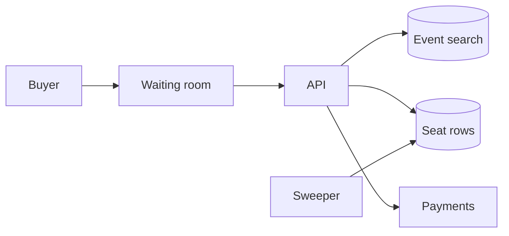

---
failureModes:
- Two buyers pass a 'seat is free' check and both pay.
- Holding a row lock while the card network is called.
- A waiting room that is only a frontend spinner, so the API still gets the full spike.
- A popular show's seats all hashing to one hot partition you did not isolate.
sayThis:
- A seat is sold by a conditional update from open to held. The loser gets a conflict, not
  a charge.
- I hold the seat for a few minutes, then charge. If payment fails or the hold expires, the
  seat returns to open. The hold is a lease, not a lock across the payment call.
- On sale, a waiting room admits users at the rate the hold path can take. I do not let a
  million clients hit the seat row.
gaps:
- Public ticket breakdowns cover conditional updates and a queue. They are thinner on fairness
  (bots, per-user caps), on the expired-hold sweeper, and on what you do with a captured charge
  if the seat assignment fails.
- Search for events is a different system from the seat map. Designs that put both in one
  'scalable database' miss the split.
- This note makes the payment step a saga with a compensation, not a single SQL transaction.
references:
- title: Hello Interview, public Ticketmaster breakdown
  url: https://www.hellointerview.com/learn/system-design/problem-breakdowns/ticketmaster
- title: These notes, contention
  url: /helpmeprep/system-design/contention
quiz:
- kind: mc
  question: 'The statement that sells a seat safely is:'
  choices:
  - SELECT status; if open, UPDATE to sold.
  - UPDATE seats SET status='held' WHERE id=:id AND status='open' and require one row updated.
  - A Redis lock with no lease around a later payment.
  - Last writer wins on a status column.
  answer: 1
  explain: The condition and the write are one statement. A separate read is a race.
- kind: mc
  question: Why a waiting room on a popular on-sale?
  choices:
  - It improves search relevance.
  - It turns an unbounded spike into an admission rate the hold path can commit.
  - It replaces the need for a unique seat id.
  - It makes payments idempotent.
  answer: 1
  explain: The database can do a finite number of conditional updates per second on that event.
    Admission protects that budget.
- kind: short
  question: What happens when a hold expires?
  reveal: A sweeper, or a conditional update at read time, sets status back to open only if
    status is still held and lease_until has passed. It must not release a seat that has moved
    to sold. If a charge succeeded and the seat release raced, the saga refunds.
title: Ticketmaster
description: Sell a finite set of seats without selling the same seat twice, including the
  spike when a show goes on sale.
track: system-design
section: Worked problems
order: 520
---

## What you are designing

People browse events and buy specific seats. A seat has one buyer. Popular shows go from idle to a huge spike in a second. Assume events are known ahead of time, a large show has tens of thousands of seats, and checkout may call a card network that takes hundreds of milliseconds.

## Requirements

- Search events by city, date, and artist.
- Show a seat map that is fresh enough that two people are not both sent to pay for a seat that is gone, within a second or two.
- Hold a seat, pay, and confirm, without double-selling.
- Release holds that are abandoned.

Double-selling is worse than telling someone the seat is gone. Fail closed.

## Entities and API

`Event`, `Seat(id, event_id, status, holder, lease_until)`, `Order`, `Payment`.

```text
GET  /v1/events?city&date
GET  /v1/events/{id}/seats
POST /v1/events/{id}/holds     { seat_ids }  -> hold or 409
POST /v1/orders/{id}/pay       Idempotency-Key
```

The seat map GET is allowed to be a second stale. The hold is the truth: 201 with a lease deadline, or 409 if any requested seat is not open. Do not hold a subset and return success unless the client asked for a partial. Pay uses an idempotency key and returns 200 only when the seat is sold and the charge is captured, or explicitly authorized if you capture later. A timeout on pay leaves the order `unknown`. The client retries the same key. It does not start a second hold.

## High-level design



Event search is a replica or a search index. It can be a few seconds stale. The seat map and the hold hit the primary for that event. Payment is an external call bracketed by the hold, not inside the database transaction.

## Data model

```sql
CREATE TABLE seats (
  id           BIGINT PRIMARY KEY,
  event_id     BIGINT NOT NULL,
  label        TEXT NOT NULL,
  status       TEXT NOT NULL, -- open | held | sold
  holder_id    BIGINT,
  lease_until  TIMESTAMPTZ,
  version      INT NOT NULL DEFAULT 0
);
CREATE INDEX seats_event_status ON seats (event_id, status);
```

```sql
UPDATE seats
SET status = 'held', holder_id = :user, lease_until = now() + interval '5 minutes', version = version + 1
WHERE id = :id AND event_id = :event AND status = 'open';
```

Hold a small set in one transaction so you do not leave the user with one of three seats. If any update matches zero rows, roll back and return 409.

## Deep dives

**The spike.** Put a waiting room in front of the on-sale: a queue token, admitted at a configured rate, with a per-user cap so a botnet cannot drain the room. The seat API rejects requests without a valid admit token. Isolate a famous event on its own partition if its write rate would disturb everyone else.

**Payment saga.** On successful hold, create an order in `pending` and call the processor with an idempotency key. On success, conditional-update seats from `held` by this holder to `sold`. On failure, set them back to `open` if you still hold them. If the process crashes after the charge and before `sold`, the saga resumes from the order row and either finishes the assignment or refunds. Do not hold a `FOR UPDATE` lock during the card call.

**Fairness and bots.** Captchas and identity checks belong at admission, not as a hope. Limits per payment instrument and per account are part of the design. Say that a perfect bot solution does not exist, and that the hard guarantee is still one seat, one buyer.

**Showing the map.** Serve seat status from a replica or a short-TTL cache for browsing. The hold path ignores that cache and uses the conditional update as the truth. The UI must tolerate "the map said open and the hold said no."

## Levels

- **Mid-level.** Conditional seat update, a hold, a payment call outside the transaction, a basic API.
- **Senior.** Waiting room, expiry sweeper, idempotent pay, and a clear fail-closed stance. Knows search is a separate path.
- **Staff.** Hot-event isolation, compensation when charge and seat assignment diverge, bot policy, and what you tell the user in each failure.
