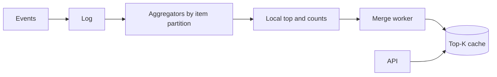

---
failureModes:
- Sorting the entire event history on every read.
- A single sorted set that becomes both a hot key and a memory problem.
- An approximate structure you cannot explain the error of.
- A tie you break randomly so the board flickers.
sayThis:
- If the candidate set is small, a Redis sorted set is the whole design. I shard when one
  set cannot hold the counts or the write rate.
- I keep exact counts in time buckets and merge the top of each bucket. I do not need the
  exact rank of the millionth item.
- Ties break on a stable key, item id, so the page does not shuffle.
gaps:
- Public top-K breakdowns cover heavy hitters and sharding a sorted set. They are lighter
  on the difference between 'top K this hour' (a window) and 'all-time leaderboard' (a set),
  which want different storage.
- Count-min sketch and lossy counting are named in passing in many guides. Saying the error
  bound, or refusing to, is the senior distinction.
- This note includes a rebuild path so a bad deploy of the aggregator does not permanently
  invent a winner.
references:
- title: Hello Interview, public top-K breakdown
  url: https://www.hellointerview.com/learn/system-design/problem-breakdowns/top-k
- title: These notes, Redis
  url: /helpmeprep/system-design/redis
quiz:
- kind: mc
  question: 'You need the top 10 songs this hour, with millions of plays. A practical design
    is:'
  choices:
  - Sort every play on the request.
  - Aggregate counts per song per minute, keep the heavy hitters, and merge.
  - One global lock around a std::vector.
  - A CDN of the audio files.
  answer: 1
  explain: The read needs 10 rows. The write path can discard songs that are obviously not
    in contention, as long as you know you might be wrong at the boundary.
- kind: mc
  question: 'Sharding a sorted set by song id hurts because:'
  choices:
  - Redis cannot store strings.
  - The top K is a global order. Each shard has a local top, and you must merge them.
  - Hashes cannot be keys.
  - It makes increments slower than a scan.
  answer: 1
  explain: You merge shard-local heaps. That works. Pretending each shard's ZRANGE is the
    global answer does not.
- kind: short
  question: When is a count-min sketch appropriate?
  reveal: When you can tolerate a bounded overestimate and the key space is huge. It will
    not undercount, so it can drop keys that are safely below the current Kth score, and it
    can be wrong near the boundary. For a contest people pay for, keep exact counts of the
    plausible winners instead.
title: Top-K and leaderboards
description: Keep a live 'top K items' when the full ranking does not fit on one machine and
  exactness is negotiable.
track: system-design
section: Worked problems
order: 610
---

## What you are designing

Events arrive (a view, a point, a vote) and a reader wants the K items with the highest score right now, or in a recent window. The item space can be large. Assume you need top 10 or top 100, updates can be very frequent, and being wrong about rank 10,000 does not matter. Being wrong about rank 1 might.

## Requirements

- Ingest increments for an item id.
- Read the current top K quickly.
- Support a time window if the product is "trending," not "all time."
- Break ties deterministically.

State whether approximate is allowed. For a game leaderboard of a million players who all look at their exact rank, say that is a different, harder product and keep exact scores.

## Entities and API

`Score(item_id, window, count)`, `Event(id, item_id, ts)`.

```text
POST /v1/events     { item_id, event_id }
GET  /v1/top?k=10&window=1h
```

`event_id` is the idempotency key. A retry of the same event must not increment the score twice, or a client timeout becomes a fake trend. `GET /top` is allowed to be a few seconds stale; say the bound before they ask. Each row is the item id, the score, and a stable tie-break (score, then item id) so two polls do not shuffle equals. Cap `k` (100 is plenty) and return 400 above it. Return 429 if a dashboard polls faster than the product needs. The read path never scans the raw event log.

## High-level design



Partition events by item id so increments for one item are ordered and not lost to a race. Each partition keeps counts and a small heap of its local top. A merger reads those heaps and publishes the global top K every second or so. The API reads the published board, not the raw log.

## Data model

For a modest all-time board, one Redis sorted set is enough: `ZINCRBY` and `ZREVRANGE 0 K`. That is the answer until the write rate or the cardinality melts one key.

For trending:

```sql
CREATE TABLE item_buckets (
  item_id BIGINT NOT NULL,
  bucket  TIMESTAMPTZ NOT NULL,
  cnt     BIGINT NOT NULL,
  PRIMARY KEY (item_id, bucket)
);
```

Sum the buckets in the window for items that might win. You do not sum the window for every item on the read. You keep a candidate set.

## Deep dives

**Finding candidates.** Exact counts for every item are fine if the distinct items in the window are manageable. If they are not, use a sketch or a lossy counter per partition to drop items far below the current Kth score, and keep exact counts for the survivors. Say the failure: an item that spikes late can be underestimated until the next refresh. Refresh often enough that this is acceptable, or keep exact counts when money or prizes depend on the order.

**Merge.** Each partition publishes `(item, count)` for its top few hundred. The merger sorts the union and truncates. Because an item lives on one partition, you do not double-count. The published result is a cache with a timestamp so the UI can show "as of 2 seconds ago."

**Exact rank for one user.** Top K does not give "you are rank 482,331" cheaply. That needs the full ordered set or a sampled estimate. Do not promise both unless you stored all scores (a sorted set per league, sharded by league id so each set stays small).

**Idempotency.** Event ids dedup so a retried play does not increment twice. Dedup state only needs to live for the retry window.

## Levels

- **Mid-level.** Sorted set or a count map plus a heap, a read API, a reason it does not scan the log.
- **Senior.** Partition and merge, windowed buckets, hot item, stable tie-break, replay-safe increments.
- **Staff.** Approximate versus exact, the error you will defend, rebuild from the log, and the product line between trending and a paid leaderboard.
