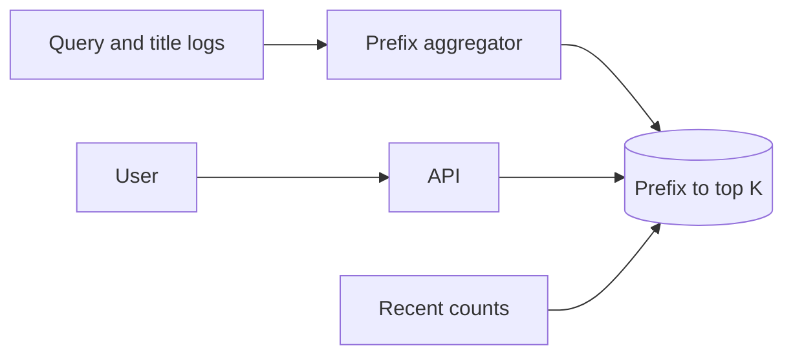

---
failureModes:
- Running a full-text 'contains' query on every keystroke against the primary database.
- A trie that only lives in one process, so a restart forgets the corpus and deploys disagree.
- Suggestions that ignore popularity and return a random dictionary order.
- No bound on prefix length or QPS, so a script walking the alphabet melts the index.
sayThis:
- I keep a prefix-to-top-K map for prefixes people actually type, built offline from query
  logs, and I serve it from memory.
- The keystroke path does not rank the whole corpus. It looks up a precomputed list and filters
  personalization after, if at all.
- Updates to the corpus lag by the rebuild interval. I will say how stale a new headline is
  allowed to be.
gaps:
- Typeahead is not a named public breakdown (search problems like post search exist, and some
  are paywalled). The specific constraints of a keystroke budget and a precomputed prefix
  map get mixed up with 'just use Elasticsearch.'
- Elasticsearch prefix queries work and are a fine v1. At keystroke QPS the cost and the tail
  matter, and a cache of top prefixes is the usual graduation.
- This note covers offensive or private suggestions as a filter on the list you store, not
  as a hope that ranking will be polite.
references:
- title: Hello Interview, public post-search breakdown
  url: https://www.hellointerview.com/learn/system-design/problem-breakdowns/fb-post-search
- title: These notes, Elasticsearch
  url: /helpmeprep/system-design/elasticsearch
quiz:
- kind: mc
  question: 'The request budget for a keystroke suggestion is closest to:'
  choices:
  - Several seconds, like a report.
  - Tens of milliseconds, ideally a memory lookup.
  - A minute, batched.
  - Whatever a full table scan takes.
  answer: 1
  explain: People type faster than a heavy query. Precompute.
- kind: mc
  question: Why not build the top-K inside the keystroke request?
  choices:
  - Ranking is illegal.
  - The corpus is large and the QPS is every character. You would repeat the same work for
    the same prefix millions of times.
  - Memory cannot store strings.
  - Prefixes are not ordered.
  answer: 1
  explain: The set of popular prefixes is smaller than the query stream. Compute it on a cadence
    and cache it.
- kind: short
  question: How do you handle a brand-new trending phrase?
  reveal: The offline map will miss it until the next rebuild. A small real-time side structure
    (counts of recent queries, promoted into the map every minute) covers trends. Say the
    lag. Do not block the keystroke on a log scan.
title: Typeahead
description: Suggest completions as someone types, from a prefix index that stays fast and
  does not require a search cluster on every keystroke.
track: system-design
section: Worked problems
order: 640
---

## What you are designing

As a user types in a search box, show a handful of completions after each character. Suggestions should feel instant and lean toward what people actually search, not toward an alphabetical dump. Assume a large catalog or query log, a keystroke rate far above the search-submit rate, and that being a minute behind a brand-new trend is acceptable if you say so.

## Requirements

- Return up to K suggestions for a prefix, in well under 100 ms.
- Rank by popularity (and optionally by this user's history, as a second step).
- Stop suggesting queries or titles you have banned.
- Survive a restart without an empty box.

Personalization is a deep dive. The core path is global popularity.

## Entities and API

`Suggestion(prefix, rank, text, score)`, `QueryLog`, `Ban`.

```text
GET /v1/suggest?q=hel&limit=8
```

This endpoint must be cacheable at the edge for logged-out, global suggestions. Include the prefix in the cache key and nothing private.

## High-level design



A batch job (hourly, or every few minutes for head prefixes) reads successful queries, counts them, and for each prefix of each popular query keeps the top K phrases. The serving tier loads that map into memory, sharded by prefix. The request is a hash lookup plus a filter. A full search index is how you generate the map, not how you serve the keystroke, once volume is real.

## Data model

The serving structure is not a SQL table you scan. It is:

```text
prefix -> [(phrase, score), ...]   # already sorted, length K
```

Stored as an immutable snapshot in object storage and loaded into a process or into Redis hashes. A version number lets you roll back a bad build. Banned phrases are removed at build time and also checked at serve time so a ban does not wait for a rebuild.

## Deep dives

**What you materialize.** You cannot store every prefix of every rare query. Materialize prefixes that appeared often enough, and cap prefix length (the first 10–15 characters). Below the threshold, fall back to a slower index or return nothing. Say that rare prefixes are allowed to be empty.

**Tries versus maps.** A trie of the corpus is the textbook picture and works in memory for a modest dictionary. For web-scale query logs the precomputed top-K map is smaller and matches the product (you only ever show K). Mention the trie, then serve the map.

**Trends and updates.** Stream the last few minutes of submitted queries into a counter, take phrases that cross a threshold, and merge them in front of the snapshot for their prefixes. This is a tiny top-K problem. The snapshot remains the base so a counter bug does not wipe suggestions.

**Personalization.** If you add it, do it after the global list: boost phrases this user has searched, from a small per-user cache. Do not build a per-user prefix map. That explodes memory and defeats the CDN.

## Levels

- **Mid-level.** A prefix lookup, a precomputed or indexed top K, a latency budget, a ban list.
- **Senior.** Snapshot and rollback, what you refuse to materialize, a trend side channel, caching at the edge.
- **Staff.** Cost per keystroke, multi-language analysis, abuse (someone polling the suggest API as a dictionary attack), and how suggestion quality is evaluated offline.
