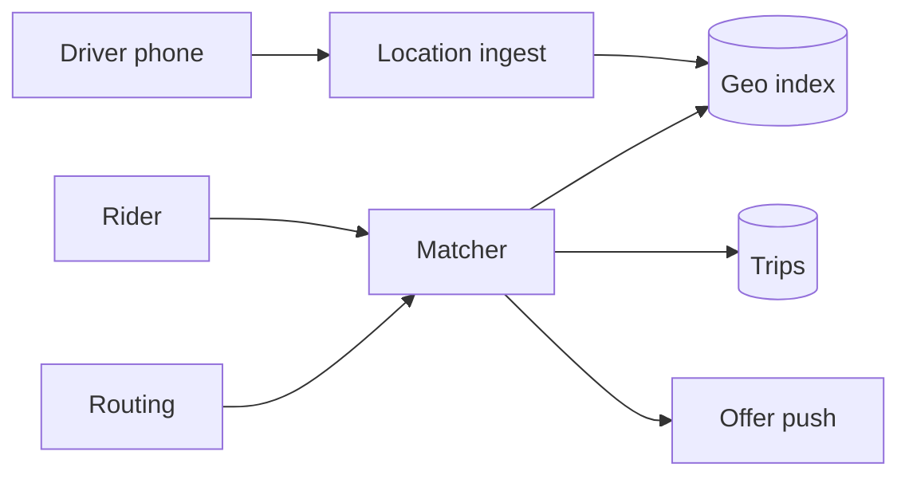

---
failureModes:
- Matching on a full scan of every driver in the country.
- Offering the same driver to ten riders and hoping the app sorts it out.
- Using Euclidean distance as the ETA you show the rider.
- A location write path that inserts a durable row on every GPS ping.
sayThis:
- Latest driver location lives in a geo index in memory. I query the cell and its neighbors,
  then rank a small set by ETA.
- An offer is a conditional claim on the driver with a short lease. If they decline or time
  out, I offer the next candidate.
- The trip, once accepted, is a durable row. The pings that got us there are not.
gaps:
- Public Uber breakdowns cover geo index and matching. They underplay driver decline and the
  lease, surge as a separate control loop, and the write rate of location updates.
- Dispatch fairness (not always picking the same driver) is a product requirement that pure
  nearest-neighbor ignores.
- This note splits 'find candidates' from 'claim one driver' so you do not hold a lock during
  ETA computation.
references:
- title: Hello Interview, public Uber breakdown
  url: https://www.hellointerview.com/learn/system-design/problem-breakdowns/uber
- title: These notes, geo search
  url: /helpmeprep/system-design/geo-search
quiz:
- kind: mc
  question: Location updates should land where?
  choices:
  - A Postgres row per ping, indexed by lat and long.
  - An in-memory geo index of the latest point, with durable storage only for the trip itself.
  - Only on the rider's phone.
  - In the CDN.
  answer: 1
  explain: Pings are a hot latest-value workload. The trip record is the durable fact.
- kind: mc
  question: 'Two riders match the same nearest driver. You prevent a double assignment by:'
  choices:
  - Showing both the driver and letting them race in the car.
  - 'A conditional claim: update driver set status=offered where id=:id and status=free.'
  - Sorting harder.
  - A daily batch.
  answer: 1
  explain: The geo query is a candidate generator. The claim is the source of truth.
- kind: short
  question: Distance versus ETA?
  reveal: The geo index ranks by straight-line or cell distance cheaply. A routing service
    scores ETA for the top handful, with a few-second cache. You do not compute a road route
    for every driver in view.
title: Uber and ride matching
description: Match a rider to a nearby driver, keep locations fresh, and survive the moment
  everyone leaves a concert.
track: system-design
section: Worked problems
order: 530
---

## What you are designing

A rider requests a trip. You find a driver who is online, nearby, and not already committed, offer them the trip, and record it if they accept. Locations update every few seconds. A stadium letting out is a localized spike. Assume a large city has tens of thousands of online drivers.

## Requirements

- Rider requests a pickup and sees a driver within a few seconds if one is available.
- Drivers stream location while online.
- A driver is offered at most one trip at a time.
- Both sides see trip state (accepted, arriving, started, finished) and can cancel under rules you state.

Matching latency matters. Historical pings do not need to be queryable for the match.

## Entities and API

`Driver(id, status, cell, lat, lng, updated_at)`, `Rider`, `Trip(id, rider, driver, state)`, `Offer(trip, driver, lease_until)`.

```text
POST /v1/trips                 { pickup, dropoff } -> trip or searching
POST /v1/drivers/location      { lat, lng }
POST /v1/offers/{id}/accept
POST /v1/offers/{id}/decline
```

## High-level design



Location ingest writes Redis (hash + GEO set) and nothing else on the hot path. The matcher reads candidates, asks routing for ETA on the top K, and claims a driver in Postgres or with a conditional Redis/DB update. The offer goes out through the real-time path. Accept flips the trip to assigned.

## Data model

```sql
CREATE TABLE trips (
  id          BIGSERIAL PRIMARY KEY,
  rider_id    BIGINT NOT NULL,
  driver_id   BIGINT,
  state       TEXT NOT NULL, -- searching | offered | assigned | started | done | canceled
  pickup_lat  DOUBLE PRECISION NOT NULL,
  pickup_lng  DOUBLE PRECISION NOT NULL,
  offered_to  BIGINT,
  offer_until TIMESTAMPTZ
);
CREATE INDEX trips_driver_active ON trips (driver_id) WHERE state IN ('offered','assigned','started');
```

The partial index is what you use to answer "is this driver busy?" if the Redis status is lost. Redis is the live index. Postgres is the trip ledger.

## Deep dives

**Candidate search.** Geohash or Redis GEO on the driver's latest point. Query the cell and neighbors, filter `status=free`, take a few dozen. Expand the radius if the set is empty, up to a cap, then tell the rider no one is close. See the geo page for boundary cells.

**The claim.** Sort candidates by ETA, then try:

```sql
UPDATE trips SET state='offered', offered_to=:driver, offer_until=now()+interval '15 seconds'
WHERE id=:trip AND state='searching';
```

And a driver-side condition so a driver with an active trip is not selected. If the driver declines or the lease expires, a worker tries the next candidate. The offer push uses the real-time pattern with a cursor so a flaky phone can still accept.

**Spike and fairness.** A concert is one hot cell. Cache the candidate id list briefly and isolate matching workers for that cell so one neighborhood cannot fill the global queue. Rotate which free driver you try first among similar ETAs so the nearest driver is not always the one who works.

**Money and state.** Fare estimation can be approximate. The fare charge is a saga after the trip completes, idempotent on trip id. Do not block matching on the payment discussion.

## Levels

- **Mid-level.** Geo index, a durable trip, an offer that a second rider cannot also take.
- **Senior.** Lease and decline loop, ETA versus distance, location ingest split from durable state, hot-cell behavior.
- **Staff.** Fairness, surge as a supply signal (even if you do not fully design pricing), multi-modal fallbacks, and what you degrade if routing is down (fall back to straight-line and say so).
