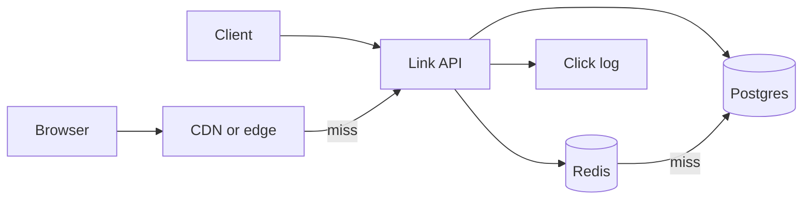

---
failureModes:
- Two creates hashing to the same code with no unique constraint, so one long URL silently
  replaces another.
- A redirect path that always hits the primary database, so a viral link melts it.
- Caching a 404 for a code that is created a moment later, or caching forever so a disabled
  link still redirects.
- Guessable sequential codes that let someone walk every link ever created.
sayThis:
- Creates are rare compared with redirects. I will generate an id, store the mapping in Postgres,
  and serve redirects from a cache and the CDN.
- I want a unique index on the code. If I use a hash I must handle collisions. A counter plus
  base62 cannot collide, and I can obfuscate it if I do not want people enumerating.
- Disabling a link deletes the cache key. Until then, redirects are allowed to be cached.
gaps:
- Public breakdowns cover uniqueness, cache, and a level rubric. They are lighter on abuse
  (spam links, malware hops), on custom aliases, and on the read-your-writes moment right
  after create.
- Analytics ('how many clicks') is waved in as a counter. At real volume it is a write-scaling
  problem and should be a log, not an update of the mapping row.
- This note separates the id scheme's product consequences (enumerable versus opaque) from
  its technical ones (collision versus coordination).
references:
- title: Hello Interview, public Bitly breakdown
  url: https://www.hellointerview.com/learn/system-design/problem-breakdowns/bitly
- title: These notes, caching
  url: /helpmeprep/system-design/caching
quiz:
- kind: mc
  question: Redirect QPS is 50× create QPS. Where do you spend the design?
  choices:
  - On sharding the create path first.
  - On making the redirect a cache hit, with the database as the miss path.
  - On a graph database of links.
  - On synchronous click analytics in the redirect.
  answer: 1
  explain: The read path is the scale problem. Creates are a modest write with a uniqueness
    constraint.
- kind: mc
  question: 'A hash of the long URL as the code will:'
  choices:
  - Never collide.
  - Collide, and also force the same code for the same URL, which you may or may not want.
  - Require a distributed lock per redirect.
  - Make caching impossible.
  answer: 1
  explain: Say whether identical long URLs should share a code. If they should not, the hash
    input needs a salt and you still handle collisions.
- kind: short
  question: How do you count clicks without slowing the redirect?
  reveal: The redirect returns as soon as the cache hits. Emit a click event asynchronously
    (a log or a buffered counter). Aggregate later. Do not update the mapping row on the request
    path.
title: URL shortener
description: Create a short link and redirect fast. The interesting parts are id generation,
  cache, and abuse, not the CRUD.
track: system-design
section: Worked problems
order: 500
---

## What you are designing

A service where a client submits a long URL and receives a short code, and anyone hitting that code is redirected to the long URL. Assume a few thousand creates per second at the peak you care about, and tens of times that in redirects. Links live for years. Custom aliases are optional. Analytics can lag.

## Requirements

- Create a short link, optionally with a custom alias and an expiry.
- Redirect with a low latency budget, on the order of tens of milliseconds at the edge.
- Disable a link and have redirects stop within a short bound (a minute, not a week).
- Do not require an account for the basic flow. If you add accounts, they are for managing links, not for the redirect.

Availability of redirects matters more than linearizability. A brand-new link must work for its creator immediately.

## Entities and API

`Link(code, long_url, owner_id, created_at, expires_at, disabled)` and, if you count, a separate click stream.

```text
POST /v1/links   { url, alias? }  -> 201 { code, short_url }
GET  /v1/links/{code}             -> 302 Location, or 404
DELETE /v1/links/{code}           -> 204
```

The redirect is the hot path and should stay cacheable. Do not put the creator's identity on it.

## High-level design



Create writes Postgres with a unique `code`, then fills the cache. Redirect reads the cache, then the database, and returns 301 or 302. 301 is aggressively cached by clients; use 302 if you need to retire links and still see clicks. Say which.

## Data model

```sql
CREATE TABLE links (
  code        TEXT PRIMARY KEY,
  long_url    TEXT NOT NULL,
  owner_id    BIGINT,
  expires_at  TIMESTAMPTZ,
  disabled    BOOLEAN NOT NULL DEFAULT false,
  created_at  TIMESTAMPTZ NOT NULL DEFAULT now()
);
```

The primary key is the only index the redirect needs.

## Deep dives

**Generating the code.** A database sequence (or a range of ids handed to each app server) converted to base62 is collision-free and short. It is also guessable. If that matters, random 64-bit values encoded in base62, inserted with a unique constraint and a retry on conflict, are enough at this QPS. A cryptographic hash of the URL collides and couples one URL to one code. Pick based on the product, and say the collision behavior.

**Speed.** At redirect time you have one key lookup. Redis holds the hot codes. A CDN can cache the 302 for codes that are not personalized, with a short TTL so disable works. The creator's first click should read through to the primary or trust the write response, so replica lag does not 404 a link they just made.

**Abuse and edits.** Allow a denylist and a disable flag. Delete the cache key on disable. Do not update the long URL in place if the short code has been shared; that is a phishing vector. Expire abandoned rows. Click analytics go to a log and a batch counter, not to an update of `links`.

## Levels

- **Mid-level.** Clear API, a unique code, a database, and a cache in front of redirects. Mentions collision or sequence.
- **Senior.** States read/write ratio, 302 versus 301, cache invalidation on disable, and async analytics. Discusses guessability.
- **Staff.** Abuse, multi-region redirects, how the id generator behaves when a region is partitioned, and what you refuse to build (synchronous global click counts).
