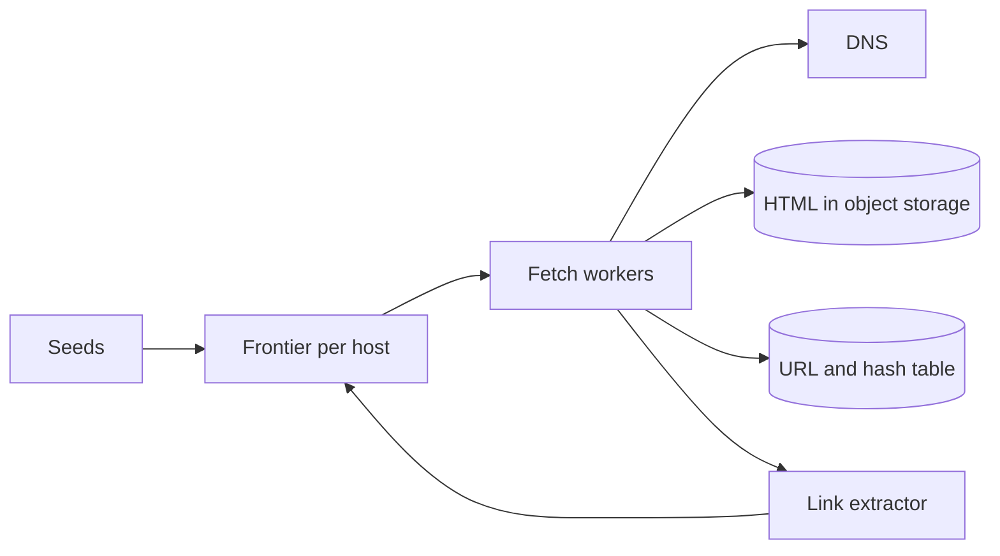

---
failureModes:
- A URL queue that lets one domain occupy every worker.
- Fetching the same URL forever because the visited set is in one process.
- No robots.txt and no per-host delay, so you are a denial-of-service tool.
- Storing raw HTML in the database row instead of object storage.
sayThis:
- I separate the frontier (URLs to fetch) from the content store. Workers pull with a per-host
  budget so one site cannot take the fleet.
- Dedup is the canonical URL plus a content hash. I skip bytes I have already stored.
- 'Politeness is a product requirement: robots.txt, a crawl delay, and a max concurrency per
  registrable domain.'
gaps:
- Public crawler breakdowns cover the frontier and dedup. Politeness budgets, canonicalization,
  and the trap of infinite URL spaces (calendars) are easier to rush.
- Recrawl policy (news daily, a personal site monthly, adaptive to change rate) is the real
  scheduler and is often 'a queue.'
- This note keeps HTML in object storage and only the facts you query in a table or an index.
references:
- title: Hello Interview, public web crawler breakdown
  url: https://www.hellointerview.com/learn/system-design/problem-breakdowns/web-crawler
- title: These notes, deduplication
  url: /helpmeprep/system-design/dedup
quiz:
- kind: mc
  question: Why a per-host queue or budget?
  choices:
  - DNS requires it.
  - Without it, the frontier's hottest domain fills every worker and you hammer that site
    while ignoring the rest of the web.
  - It replaces dedup.
  - HTTP/2 forbids cross-host connections.
  answer: 1
  explain: 'Fairness and politeness are the same mechanism: cap concurrency and rate per host.'
- kind: mc
  question: 'The visited set should be:'
  choices:
  - A hash set in the crawler process.
  - A durable store keyed by canonical URL, so a restart and a second worker agree.
  - A CDN.
  - The browser history of the user who asked for the crawl.
  answer: 1
  explain: Crawls are long and distributed. The dedup set is data, not a variable.
- kind: short
  question: What do you do with a URL that changes only by a session id?
  reveal: 'Canonicalize before dedup: drop known tracking parameters, sort the query, follow
    redirects to a final URL, and cap path patterns that explode (a calendar). Otherwise the
    frontier is infinite and the content is duplicate.'
title: Web crawler
description: Fetch a polite, deduplicated slice of the web, on a schedule, without melting
  a single host.
track: system-design
section: Worked problems
order: 590
---

## What you are designing

Start from a set of seed URLs. Fetch pages, store them, extract links, and fetch those too, continuously. You must be polite to hosts, skip duplicates, and still make progress across the web rather than getting stuck on one domain. Assume billions of URLs over time and a fetch budget you choose (say tens of thousands of fetches a second across the fleet).

## Requirements

- Crawl seeds and discovered links.
- Do not fetch the same content repeatedly in a short window.
- Respect robots.txt and a per-host rate.
- Store the page so a search index can be built later (building the whole search engine is a follow-up).

Freshness is tunable. A news site is recrawled sooner than a static PDF.

## Entities and API

This is mostly a pipeline, not a public CRUD API. Internally: `FrontierEntry(url, host, next_fetch_at, priority)`, `Page(canonical_url, content_hash, fetched_at, object_key)`, `RobotRule`.

There is no public write API for the pages you fetch. An operator API is enough to discuss:

```text
POST /v1/seeds
POST /v1/hosts/{host}/pause
GET  /v1/pages?url=
```

Pause must reach workers within a bound you state (a few seconds). Otherwise "stop" is a suggestion and a polite crawler becomes a denial of service. `GET /pages` returns metadata and a pointer to the stored body, not the body inline. Seeds are idempotent on the canonical URL.

## High-level design



Workers pull the next URL whose host is under budget. They fetch with a timeout, store bytes, hash them, extract links, canonicalize, and enqueue links you have not seen. A separate job refreshes robots.txt.

## Data model

```sql
CREATE TABLE pages (
  canonical_url TEXT PRIMARY KEY,
  content_hash  TEXT NOT NULL,
  fetched_at     TIMESTAMPTZ NOT NULL,
  object_key     TEXT NOT NULL,
  http_status    INT NOT NULL
);
CREATE TABLE frontier (
  url            TEXT PRIMARY KEY,
  host           TEXT NOT NULL,
  next_fetch_at  TIMESTAMPTZ NOT NULL,
  priority       INT NOT NULL
);
CREATE INDEX frontier_ready ON frontier (host, next_fetch_at);
```

At real size the frontier is a set of per-host queues in a log or Redis, and the visited set is a large key-value store. The SQL is the logical model. Say when you would leave it.

## Deep dives

**Politeness.** Group by registrable domain. Allow a small concurrency (one or two) and a delay taken from robots.txt or a default. If a host starts returning 429 or timing out, back off that host only. This is a rate limiter whose key is the host. One global queue sorted only by priority will starve the politeness rule the first time a large site dominates.

**Dedup and canonicalization.** Normalize scheme, host case, default ports, and tracking parameters. Follow redirects and store the final URL. Dedup exact URLs in the visited set. Dedup bytes by hash so two URLs with the same body do not produce two index documents. See the dedup page for near-duplicates; exact hash is the v1.

**Traps and priority.** Cap URL length, skip non-http schemes, detect repeating path patterns, and cap pages per host per day so a calendar cannot eat the budget. Priority comes from the page that linked here (a seed outranks a footer) and from change rate: if the hash keeps changing, recrawl sooner; if it does not, back off.

**Rendering.** Some pages are empty without JavaScript. A headless render farm is expensive. Say you render a sample or only hosts that need it, and you still store the URL as seen.

## Levels

- **Mid-level.** Frontier, workers, durable visited set, object storage for HTML, a timeout.
- **Senior.** Per-host politeness, canonicalization, recrawl backoff, separation of content and metadata.
- **Staff.** Budget across tenants if this is a hosted crawler, hostile pages (huge bodies, zip bombs), and how the index consumes your output without a second copy of the web in a database.
