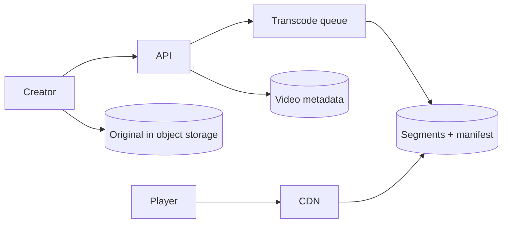

---
failureModes:
- Streaming the original 4K file from the origin to every viewer.
- Transcoding inside the upload request.
- A view counter updated synchronously on every play start, on one row.
- No resumable upload, so a flaky connection restarts a two-hour file.
sayThis:
- Upload is multipart to object storage. A job transcodes to adaptive segments and writes
  a manifest. Playback is the CDN.
- The watch page metadata is a normal cached read. The bytes never touch the application tier.
- View counts are a sampled or streamed aggregate. I will not increment a row on every start.
gaps:
- Public YouTube breakdowns cover transcoding and CDN. They are thinner on the manifest, resumable
  upload completion, and recommendation as a separate offline system.
- Rights and takedown (a video must become unplayable globally) fight long CDN TTLs. Versioned
  segment URLs plus a short-TTL manifest is the lever, and it is often skipped.
- This note keeps recommendations out of the playback path so a ranking outage does not stop
  video.
references:
- title: Hello Interview, public YouTube breakdown
  url: https://www.hellointerview.com/learn/system-design/problem-breakdowns/youtube
- title: These notes, large blob uploads
  url: /helpmeprep/system-design/large-blobs
quiz:
- kind: mc
  question: What does the player fetch from the CDN?
  choices:
  - The original upload, always.
  - A manifest and short segments at a bitrate the client can sustain.
  - A Postgres bytea stream.
  - The recommendation model.
  answer: 1
  explain: Adaptive bitrate means many renditions of small segments. The manifest points at
    them.
- kind: mc
  question: 'A takedown must stop playback quickly. You should:'
  choices:
  - Rely on a one-year cache of the media playlist.
  - Keep the manifest TTL short or purge it, so clients stop learning segment URLs. Immutable
    segments can stay cached and unused.
  - Delete every edge disk by hand.
  - Wait for expiry of the original upload only.
  answer: 1
  explain: The manifest is the control point. Segments are content-addressed and harmless
    if no manifest names them.
- kind: short
  question: Where do recommendations run?
  reveal: 'Offline or nearline: a pipeline writes ''top N video ids per user'' or a candidate
    set. The watch request reads that precomputed list and hydrates metadata. It does not
    train or scan the catalog.'
title: YouTube
description: Upload a video, transcode it into streamable segments, and play it near the viewer
  without pushing bytes through your API.
track: system-design
section: Worked problems
order: 570
---

## What you are designing

A creator uploads a video. Viewers around the world press play and get a smooth stream. They can browse a home page. Assume videos are large, watches vastly outnumber uploads, and a popular video is many millions of viewers. Comments and a full social graph are out of scope unless you have time; say so.

## Requirements

- Resumable upload and a processing state the creator can see.
- Playback that adapts to bandwidth and starts within a couple of seconds.
- A video page with title, owner, and a view count that is approximately right.
- Ability to make a video private or remove it.

Playing the video is the availability-critical path. A slightly stale view count is fine.

## Entities and API

`Video(id, owner, state, manifest_url)`, `Rendition`, `ViewCounter` as an aggregate, not a row you lock.

```text
POST /v1/videos                      -> id + multipart upload
POST /v1/videos/{id}/complete
GET  /v1/videos/{id}                 -> metadata + manifest URL if ready
```

The player then talks to the CDN, not to you, for segments.

## High-level design



Complete enqueues a job (see long-running tasks). Workers produce several bitrates of HLS or DASH, write segments as immutable objects, and publish a manifest. The video row flips to `ready` with the manifest URL. Metadata reads are cached. Bytes are not.

## Data model

```sql
CREATE TABLE videos (
  id           BIGSERIAL PRIMARY KEY,
  owner_id     BIGINT NOT NULL,
  title        TEXT NOT NULL,
  state        TEXT NOT NULL, -- uploading | processing | ready | removed
  manifest_key TEXT,
  created_at   TIMESTAMPTZ NOT NULL DEFAULT now()
);
```

View facts are events (`video_id`, `ts`) sampled or aggregated in a stream job to a compact counter store. The page reads the counter through a cache.

## Deep dives

**Playback.** The manifest lists segments of a few seconds at each bitrate. The client picks a bitrate, fetches segments from the nearest CDN edge, and switches down if downloads stall. Range requests are the fallback if you did not segment; segmentation is the cleaner answer. An origin shield protects storage when a new video expires on every edge at once.

**Processing cost.** Transcoding is CPU-heavy and parallel by chunk, then stitched. It does not belong on the web tier. Show the creator progress from the job row. A failure leaves the video in `processing` with an error, not a half-published manifest.

**Takedown and privacy.** Manifest URLs are unguessable and short-lived or short-cached. Setting state to `removed` stops the API from handing out the manifest and purges the manifest cache. Segments can be immutable and cached long; without the manifest they are not useful. Signed URLs if the video is private, checked before the CDN will serve.

**Popularity.** The home page reads precomputed recommendation ids. A trending counter is a stream window, not a scan. The deep dive if they push is hot-video CDN hit rate, not a cleverer database.

## Levels

- **Mid-level.** Direct-to-storage upload, async transcode, CDN playback, metadata in a database.
- **Senior.** Adaptive segments and manifest, resumable parts, view counts off the play path, takedown via the manifest.
- **Staff.** Cost of renditions, origin shield, regional caches, and a recommendation path that can fail independently of playback.
